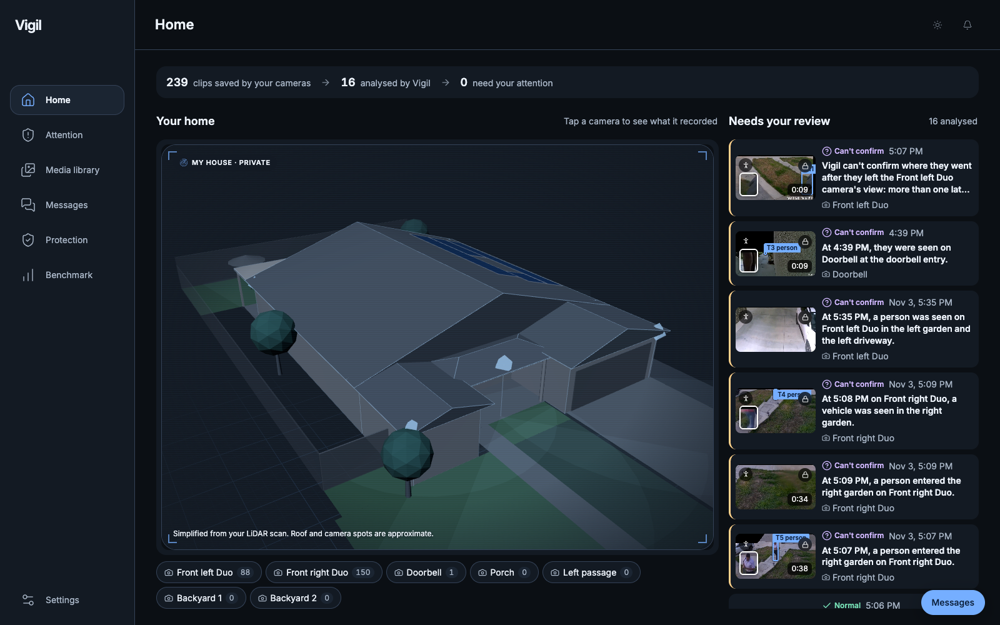
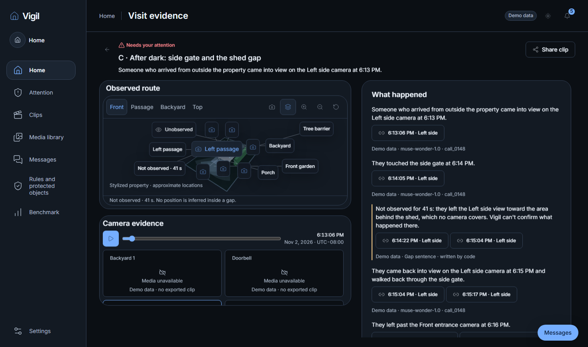
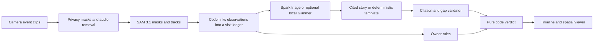

<div align="center">

# Vigil

### One cited story per visit. A spatial view of what happened at home.

Motion alerts tell you something moved. **Vigil connects the evidence across cameras, shows the gaps, and applies your rules to decide what needs attention.**

Built for the **Meta Global AI Developer Hackathon 2026**.

[Quickstart](#run-the-offline-showcase) · [Architecture](#how-it-works) · [Evaluation](EVAL.md) · [Readiness](docs/readiness.md) · [Documentation](docs/README.md)

</div>



*Owner-reviewed capture of the local Home dashboard at `http://127.0.0.1:8000/#/home`, November 4, 2026. It shows masked camera previews and the simplified house model. Approved for this private repository; the hosted sandbox below uses synthetic data.*

## From motion alerts to a visit story

A person arrives, crosses the yard, disappears behind a shed and reaches a gate. Separate camera alerts leave you piecing the visit together. Vigil assembles those observations into a timeline, places them in a 3D view, and links each story sentence to its evidence.

- **See the visit in context.** Review camera observations, a shared playback clock, protected objects and estimated paths through the property.
- **Protect by pointing.** Select an object in a reviewed camera frame; SAM 3.1 proposes its mask. A 3D footprint requires measured camera placement.
- **Write rules in plain language.** Type a rule or use the separate voice-rule flow, review the draft, then confirm it. Rules execute deterministically.
- **Keep blind spots visible.** Unobserved intervals stay explicit gaps. Vigil never invents a path or action inside one.
- **Ask your home.** Follow cited answers back to the recorded events. The real-only home mode answers from analysed captures.
- **Follow up on a visit.** Validated watch proposals can create a bounded follow-up watch, with an owner-visible undo action.

Roles come from spatial origin and explicit owner context. An unknown role fails closed; faces and profile names never decide who is household or whether a rule fires.

<details>
<summary>See the visit evidence view</summary>



*Current visit evidence view, captured November 4, 2026: synthetic observations, cited sentences and an explicitly marked blind gap.*

</details>

## How it works



**Models perceive and describe. Code decides.** Only a deterministic rule can produce `needs_attention`. Muse Wonder receives the event ledger as JSON, never pixels. Its sentences must pass citation, gap and role checks; invalid output falls back to a code-written template. Gap sentences are always written by code.

| Model | Responsibility |
| --- | --- |
| **SAM 3.1** | Object masks, tracking, Tap-to-Protect and watch observations |
| **Muse Spark 1.3** | Allowlisted appearance notes, rule drafts and triage |
| **Muse Wonder 1.0** | Cited stories and bounded watch proposals |
| **Muse Voice Transcribe 1.0** | Transcription for the separate voice-rule flow |
| **Muse Glimmer 30B** | Optional local triage; hardware acceptance remains open |

Every Meta API call goes through `MetaClient`: cache first, budget check before sending, and a durable call ledger. The Benchmark page distinguishes recorded model usage from measured evaluation results.

## Run the offline showcase

Requires **Python 3.12**, **uv**, **Node.js** (CI uses 24.15.0), **ffmpeg/ffprobe** and **ExifTool**. No cameras, model weights or API key are needed for this path.

```bash
git clone --filter=blob:none https://github.com/gabrielromerod/meta-global-ai-developer-hackathon-2026.git
cd meta-global-ai-developer-hackathon-2026
uv sync --locked
npm --prefix web-next ci
npm --prefix web-next run build

# Dedicated local state, synthetic bundle and cache-only model access.
export VIGIL_MODE=sandbox
export MODEL_API_KEY=invalid
export VIGIL_META_CACHE_ONLY=true
export VIGIL_META_BASE_URL=http://127.0.0.1:9/v1
export VIGIL_REAL_ONLY=0
export VIGIL_FACE_TEMPLATES=0
export VIGIL_DATA_DIR=data/showcase
export VIGIL_DB_PATH=data/showcase/vigil.db
export VIGIL_LEDGER_PATH=data/showcase/ledger.db
export VIGIL_CACHE_DIR=data/showcase/cache
export VIGIL_BUNDLE_DIR=demo/synthetic
uv run vigil serve --host 127.0.0.1 --port 8000
```

Open **[localhost:8000](http://127.0.0.1:8000/)**. Explore Home and Attention, open a visit and its citations, then try Messages and Rules. Cached results and unavailable media are labelled. The sandbox makes no live model calls and incurs no inference spend.

Windows CMD: use `set NAME=value` for the environment assignments. See the [setup runbook](docs/runbooks/seven-camera-setup.md) for Windows and camera preparation, and the [demo walkthrough](docs/demo-happy-path.md) for the judge sequence.

### Docker alternative

```bash
docker build -t vigil-sandbox .
docker run --rm -p 127.0.0.1:8000:8000 \
  -e MODEL_API_KEY=invalid \
  -e VIGIL_META_BASE_URL=http://127.0.0.1:9/v1 \
  vigil-sandbox
```

The image defaults to sandbox mode and cache-only model access. Real-camera setup and live inference are separate, owner-approved workflows.

## Privacy and trust boundaries

- **The hosted sandbox uses synthetic data.** The README Home image is a separate owner-approved local dashboard capture with masked previews. Raw footage, private scan files, camera credentials, local databases and `.env` stay out of Git. The public sandbox house view uses generic geometry.
- **Mask before inference.** The cloud path sends reviewed, privacy-masked, audio-free inputs to Meta. Raw home footage stays local; streets, neighbours and identifying details must be excluded before processing or export.
- **Decisions do not use identity.** Rules, roles, event ledgers and stories never use face templates or profile names. Optional local recurring-visitor profiles are isolated from reasoning and disabled by default. Clothing-based groups are labelled as uncertain matches. See the [profile design and limits](docs/spec/changes/2026-11-04-face-templates.md).
- **Camera audio is excluded.** Voice rules use a separate flow. Only fixtures on the explicit audio allowlist may be versioned.
- **Exports are gated.** Privacy, metadata, secret and screenshot-provenance checks run before release. Two curated QA screenshots are retained; temporary captures and logs stay local.

## Evidence and current limits

Vigil is a hackathon prototype. Offline tests exercise the pipeline, API and interface with deterministic fixtures. Owner-approved real-clip runs are recorded in [readiness](docs/readiness.md); they do **not** establish real-home accuracy or production readiness.

| Area | Status |
| --- | --- |
| Rules, verdicts, citations, privacy boundaries and API | Covered by offline regression suites |
| React interface | Component tests, production build and browser acceptance suite |
| Real-camera cloud processing | Initial owner-approved runs; broader acceptance remains open |
| 3D calibration and real visit replay | Measured placement and field acceptance still required |
| Local SAM/Glimmer inference | Optional; hardware acceptance incomplete |
| Accuracy, latency, alert reduction and unit economics | Targets and assumptions in [EVAL.md](EVAL.md); no production benchmark claimed |

The [requirement matrix](docs/requirements/functional.md) distinguishes offline verification from real-data acceptance. [HACKATHON.md](HACKATHON.md) records build provenance, models and submission items still requiring owner confirmation.

## Development and verification

```bash
uv run ruff check .
uv run ruff format --check .
uv run pytest
npm --prefix web-next test
npm --prefix web-next run build
make scan
uv run python scripts/scan_ui_evidence.py

# Optional browser suite; uses an offline test backend.
uv run playwright install chromium
uv run pytest -m e2e tests/e2e -q
```

Default Python tests exclude live, GPU, E2E and hardware cases. Never run paid inference or change spend controls as part of verification. Windows users can run `pwsh scripts/tasks.ps1 scan` in place of `make scan`.

| Path | Contents |
| --- | --- |
| `vigil/` | Python pipeline, model client, spatial logic, rules, validator, storage and FastAPI |
| `web-next/` | React and TypeScript app, shared playback and 3D viewer |
| `config/` | Cameras, privacy masks, rules and allowlists |
| `demo/` | Synthetic bundle and voice-fixture documentation |
| `tests/` | Offline unit, integration and marked browser suites |
| `qa/final/` | Two curated screenshots and their provenance |
| `docs/`, `eval/` | Specification, architecture, runbooks, requirements and evaluation records |

Start with [CLAUDE.md](CLAUDE.md) for repository rules and the [specification](docs/spec/vigil-spec.md) for contracts. The current package license is **Proprietary (hackathon submission)**; public source visibility does not grant an open-source license.
