# Architecture diagrams

Every Mermaid diagram in the specification, extracted verbatim into its own `.mmd` file and embedded below with an explanation and the files it maps to. Source sections: [spec 5](../spec/vigil-spec.md#5-technical-architecture) (5.1 to 5.13) and [spec 10](../spec/vigil-spec.md#10-compute-plan-rtx-3090-first-dgx-spark-only-if-a-gate-fails). There are **14 diagrams**.

Vigil is a fixed pipeline: Meta models perceive and write; Vigil's code links, checks and decides.

## Validation

Each `.mmd` file was compiled with Mermaid CLI 11.17.1 on 2026-11-02, rendering to a temporary directory outside the repo:

```sh
npx -y @mermaid-js/mermaid-cli@11 -i docs/architecture/<name>.mmd -o docs/architecture/rendered/<name>.svg
```

`docs/architecture/rendered/` is gitignored; render locally when you need the SVGs. Keep the `.mmd` files and the blocks below identical; if a diagram changes, change the spec first.

| # | File | Spec section | Compiles |
| --- | --- | --- | --- |
| 1 | [5.1-c4-context.mmd](5.1-c4-context.mmd) | [5.1](../spec/vigil-spec.md#51-c4-level-1-system-context) | Pass |
| 2 | [5.2-c4-containers.mmd](5.2-c4-containers.mmd) | [5.2](../spec/vigil-spec.md#52-c4-level-2-containers) | Pass |
| 3 | [5.3-c4-components.mmd](5.3-c4-components.mmd) | [5.3](../spec/vigil-spec.md#53-c4-level-3-components-of-the-vigil-package) | Pass |
| 4 | [5.4-seq-process-window.mmd](5.4-seq-process-window.mmd) | [5.4](../spec/vigil-spec.md#54-sequence-processing-one-window) | Pass |
| 5 | [5.5-seq-story-validation-verdict.mmd](5.5-seq-story-validation-verdict.mmd) | [5.5](../spec/vigil-spec.md#55-sequence-story-validation-and-verdict) | Pass |
| 6 | [5.6-seq-tap-to-protect-voice-rule.mmd](5.6-seq-tap-to-protect-voice-rule.mmd) | [5.6](../spec/vigil-spec.md#56-sequence-tap-to-protect-and-voice-rule) | Pass |
| 7 | [5.7-seq-closed-loop.mmd](5.7-seq-closed-loop.mmd) | [5.7](../spec/vigil-spec.md#57-sequence-the-closed-loop-wonder-steers-sam-31) | Pass |
| 8 | [5.8-data-flow-privacy-boundary.mmd](5.8-data-flow-privacy-boundary.mmd) | [5.8](../spec/vigil-spec.md#58-data-flow-and-ai-inference-pipeline-with-the-privacy-boundary) | Pass |
| 9 | [5.9-state-visit-lifecycle.mmd](5.9-state-visit-lifecycle.mmd) | [5.9](../spec/vigil-spec.md#59-state-machine-visit-lifecycle) | Pass |
| 10 | [5.10-state-rules-watches.mmd](5.10-state-rules-watches.mmd) | [5.10](../spec/vigil-spec.md#510-state-machines-rules-and-watches) | Pass |
| 11 | [5.11-deployment.mmd](5.11-deployment.mmd) | [5.11](../spec/vigil-spec.md#511-deployment) | Pass |
| 12 | [5.12-spatial-build-calibration.mmd](5.12-spatial-build-calibration.mmd) | [5.12](../spec/vigil-spec.md#512-spatial-build-and-calibration-pipeline) | Pass |
| 13 | [5.13-seq-live-home-mode.mmd](5.13-seq-live-home-mode.mmd) | [5.13](../spec/vigil-spec.md#513-sequence-live-near-real-time-mode-at-home) | Pass |
| 14 | [10-compute-plan.mmd](10-compute-plan.mmd) | [10](../spec/vigil-spec.md#10-compute-plan-rtx-3090-first-dgx-spark-only-if-a-gate-fails) | Pass |

## 5.1 C4 level 1: system context

Source: [5.1-c4-context.mmd](5.1-c4-context.mmd) · [spec section](../spec/vigil-spec.md#51-c4-level-1-system-context)

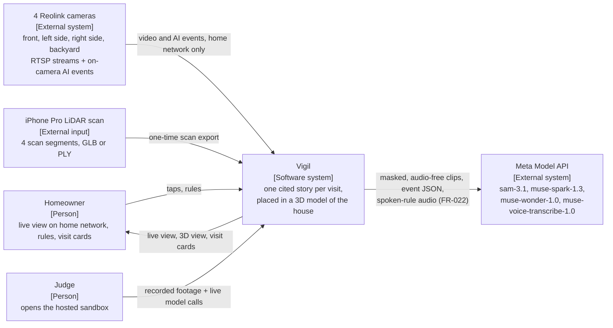

Vigil as one software system between its people (homeowner, judge) and its external systems (4 Reolink cameras, a one-time iPhone LiDAR scan, the Meta Model API). The key boundary: raw video stays at home, and only masked, audio-free clips, event JSON and spoken-rule audio (FR-022, transcribed and never stored) reach Meta.

**Maps to:** `vigil/` as a whole; `config/cameras.yaml`; `vigil/meta/client.py` (the only path to Meta)

## 5.2 C4 level 2: containers

Source: [5.2-c4-containers.mmd](5.2-c4-containers.mmd) · [spec section](../spec/vigil-spec.md#52-c4-level-2-containers)

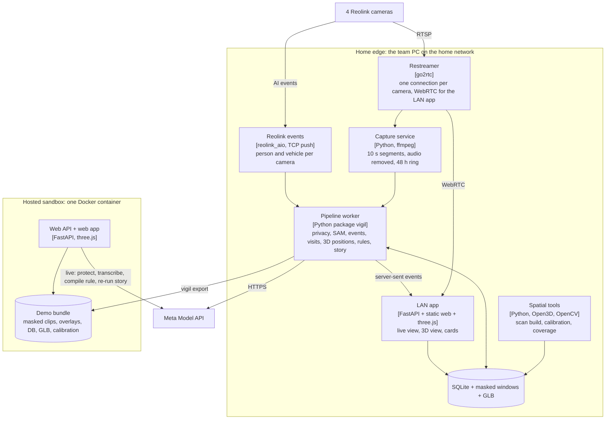

Two deployments of the same `vigil` package. The home edge PC runs the restreamer, capture, Reolink events, the pipeline worker, the spatial tools and the LAN app over SQLite plus masked windows and the GLB. The hosted sandbox is one Docker container serving an exported demo bundle; it makes only 4 kinds of live call (protect, transcribe voice, compile rule, re-run story) and never connects to the house.

**Maps to:** `infra/go2rtc.yaml`, `vigil/reolink/capture.py`, `vigil/reolink/ai_events.py`, `vigil/spatial/`, `vigil/api/`, `vigil/store/`, `vigil/store/export.py`, `Dockerfile`

## 5.3 C4 level 3: components of the vigil package

Source: [5.3-c4-components.mmd](5.3-c4-components.mmd) · [spec section](../spec/vigil-spec.md#53-c4-level-3-components-of-the-vigil-package)

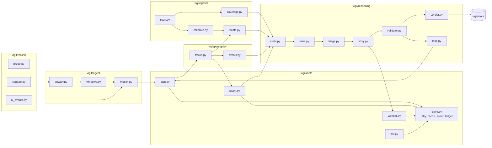

One box per file. Data flows from Reolink capture through ingest (privacy, windows, motion), to SAM 3.1 tracks and events, through spatial positions, into reasoning (visits, rules, triage, story, validator, verdict) and the store. Every model call goes through `meta/client.py`, which owns retries, caching and the spend ledger; `loop.py` feeds validated watch proposals back to SAM.

**Maps to:** `vigil/reolink/*`, `vigil/ingest/*`, `vigil/meta/*`, `vigil/perception/*`, `vigil/spatial/*`, `vigil/reasoning/*`, `vigil/store/*`

## 5.4 Sequence: processing one window

Source: [5.4-seq-process-window.mmd](5.4-seq-process-window.mmd) · [spec section](../spec/vigil-spec.md#54-sequence-processing-one-window)

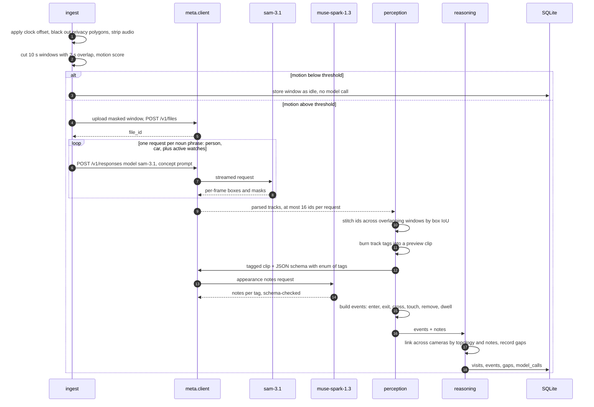

The motion gate decides whether any model is called. An active window is uploaded once (`POST /v1/files`) and SAM 3.1 gets one request per noun phrase (`person`, `car`, plus active watches) on the same `file_id`. Tracks are stitched across overlapping windows, tags are burned into a preview clip for Spark's appearance notes, events are built, and visits are linked by topology and notes with gaps recorded.

**Maps to:** `vigil/ingest/sync.py`, `privacy.py`, `windows.py`, `motion.py`; `vigil/meta/client.py`, `sam.py`, `spark.py`; `vigil/perception/tracks.py`, `overlays.py`, `events.py`; `vigil/reasoning/visits.py`, `topology.py`; `vigil/store/db.py`

## 5.5 Sequence: story, validation and verdict

Source: [5.5-seq-story-validation-verdict.mmd](5.5-seq-story-validation-verdict.mmd) · [spec section](../spec/vigil-spec.md#55-sequence-story-validation-and-verdict)

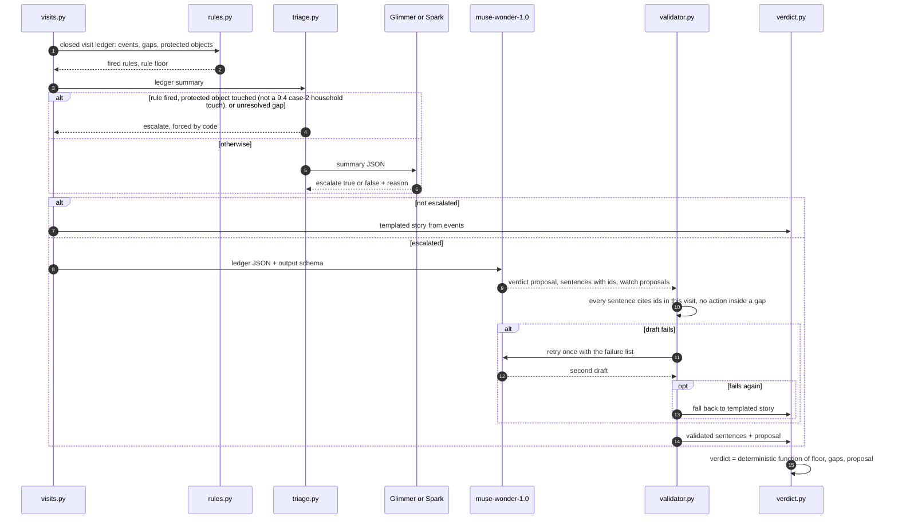

Wonder writes; code checks and decides. Rules set the floor; triage is forced by code for a fired rule, a touched protected object or an unresolved gap, otherwise Glimmer or Spark decides. Escalated visits go to Wonder with the ledger JSON; the validator retries once with the failure list, then falls back to the template. The verdict is a deterministic function of floor, gaps and proposal. Gap sentences never come from the model.

**Maps to:** `vigil/reasoning/rules.py`, `triage.py`, `story.py`, `templates.py`, `validator.py`, `verdict.py`; `vigil/meta/wonder.py`, `glimmer.py`, `spark.py`

## 5.6 Sequence: tap-to-protect and voice rule

Source: [5.6-seq-tap-to-protect-voice-rule.mmd](5.6-seq-tap-to-protect-voice-rule.mmd) · [spec section](../spec/vigil-spec.md#56-sequence-tap-to-protect-and-voice-rule)

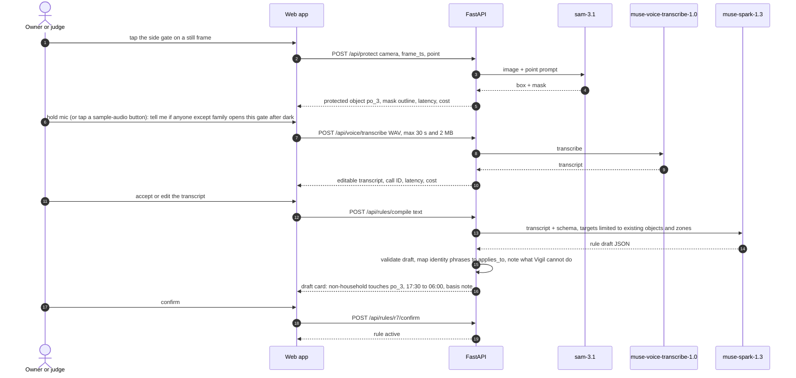

A tap on a still becomes a SAM 3.1 point prompt; the mask is stored as a protected object and returned with latency and cost. A spoken rule (or one of the 3 sample-audio fixture buttons) is transcribed first and returned as an editable transcript (FR-022, P0; typed rules skip this step). The accepted text is then compiled by Spark against the catalogue of existing objects and zones, identity phrases are mapped to `applies_to`, and the draft card shows the scope (here non-household, 17:30 to 06:00), the basis note and what Vigil cannot do. The rule is activated on confirm.

**Maps to:** `vigil/api/routes.py` (`POST /api/protect`, `POST /api/voice/transcribe`, `GET /api/voice/fixtures`, `POST /api/rules/compile`, `POST /api/rules/{id}/confirm`), `vigil/meta/sam.py`, `asr.py`, `spark.py`, `vigil/reasoning/rules.py`, `web/app.js`

## 5.7 Sequence: the closed loop (Wonder steers SAM 3.1)

Source: [5.7-seq-closed-loop.mmd](5.7-seq-closed-loop.mmd) · [spec section](../spec/vigil-spec.md#57-sequence-the-closed-loop-wonder-steers-sam-31)

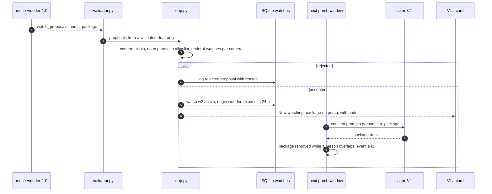

Watch proposals come only from a validated draft. `loop.py` checks the camera exists, the noun phrase is on the allowlist and the camera has fewer than 4 watches; rejected proposals are logged, accepted ones become a 24 h watch with an undo notice, and the next windows on that camera add the phrase to SAM's prompts, which is how scenario B later yields a `removed` event.

**Maps to:** `vigil/reasoning/loop.py`, `vigil/reasoning/validator.py`, `config/allowlist.json`, `vigil/meta/sam.py`, `vigil/perception/events.py`, `web/cards.js`

## 5.8 Data flow and AI inference pipeline, with the privacy boundary

Source: [5.8-data-flow-privacy-boundary.mmd](5.8-data-flow-privacy-boundary.mmd) · [spec section](../spec/vigil-spec.md#58-data-flow-and-ai-inference-pipeline-with-the-privacy-boundary)

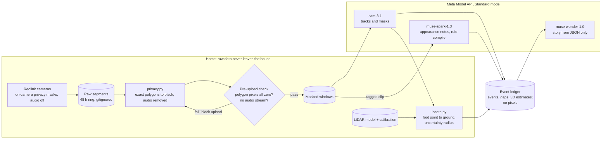

The privacy boundary drawn as data flow. Raw segments live only in the gitignored 48 h ring at home; `privacy.py` blacks out polygons and strips audio, and a pre-upload check blocks any window with a non-zero polygon pixel or an audio stream. Only masked windows reach SAM and Spark; Wonder sees only the event ledger (events, gaps, 3D estimates), never pixels, which is also what makes its claims checkable.

**Maps to:** `vigil/ingest/privacy.py`, `scripts/privacy_scan.py`, `vigil/reolink/capture.py`, `vigil/spatial/locate.py`, `vigil/meta/sam.py`, `spark.py`, `wonder.py`, `vigil/store/schema.sql`

## 5.9 State machine: visit lifecycle

Source: [5.9-state-visit-lifecycle.mmd](5.9-state-visit-lifecycle.mmd) · [spec section](../spec/vigil-spec.md#59-state-machine-visit-lifecycle)

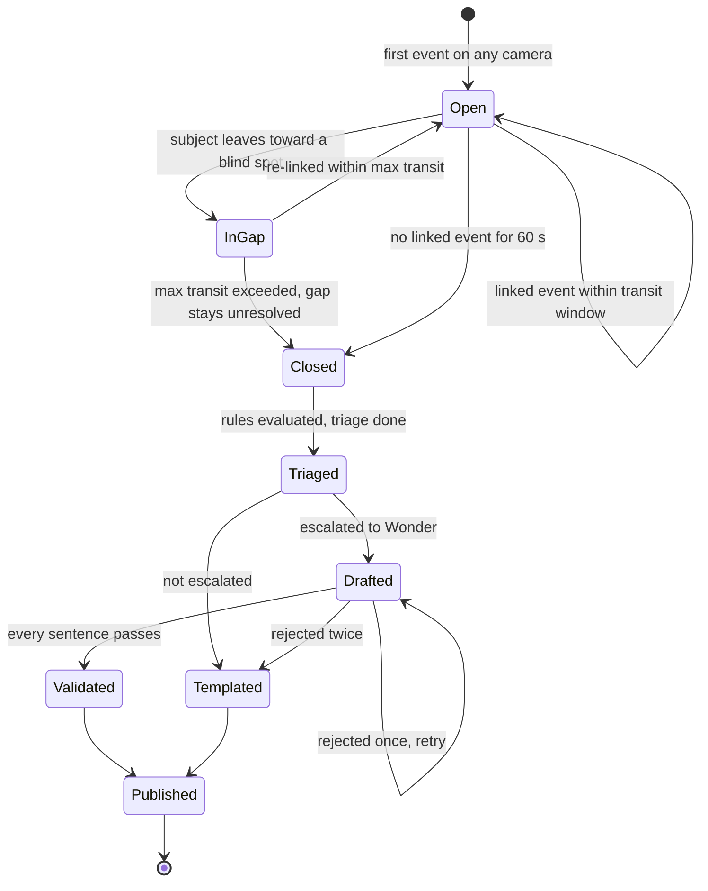

A visit opens on its first event, stays open while linked events arrive within the transit window, and enters InGap when the subject leaves toward a blind spot; it re-links within the maximum transit time or closes with the gap unresolved. After 60 s with no linked event it closes, is triaged, then either templated or drafted by Wonder (one retry, then template) before it is published.

**Maps to:** `vigil/reasoning/visits.py`, `topology.py`, `triage.py`, `story.py`, `validator.py`; `visits.state` in `vigil/store/schema.sql`

## 5.10 State machines: rules and watches

Source: [5.10-state-rules-watches.mmd](5.10-state-rules-watches.mmd) · [spec section](../spec/vigil-spec.md#510-state-machines-rules-and-watches)

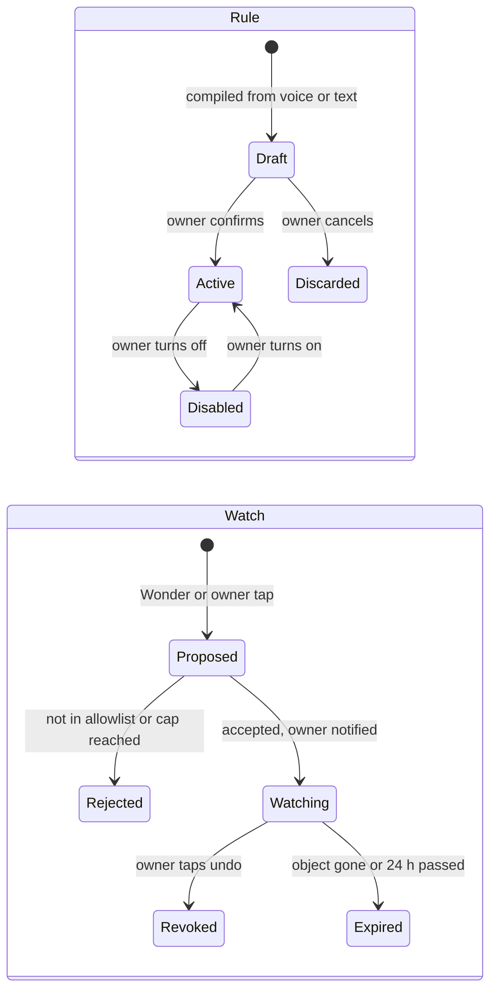

Rules go Draft to Active only on owner confirmation, and can be disabled and re-enabled. Watches are Proposed by Wonder or an owner tap, Rejected if off the allowlist or over the cap, otherwise Watching with an owner notice, and end as Revoked (undo) or Expired (object gone or 24 h).

**Maps to:** `vigil/reasoning/rules.py`, `vigil/reasoning/loop.py`; `rules.state` and `watches.status` in `vigil/store/schema.sql`

## 5.11 Deployment

Source: [5.11-deployment.mmd](5.11-deployment.mmd) · [spec section](../spec/vigil-spec.md#511-deployment)

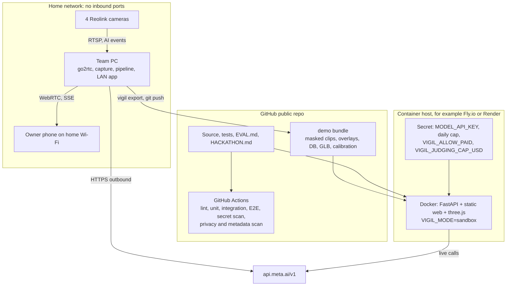

Where everything runs. The home network has no inbound ports: cameras feed the team PC, which serves the owner's phone over WebRTC and SSE and calls Meta outbound only. The public GitHub repo holds source, tests, EVAL.md, HACKATHON.md and the demo bundle, and CI runs lint, tests, E2E and the secret, privacy and metadata scans. A container host runs the sandbox image with `VIGIL_MODE=sandbox`, the API key as a secret, the daily cap, and the judging settings `VIGIL_ALLOW_PAID` and `VIGIL_JUDGING_CAP_USD`.

**Maps to:** `.github/workflows/ci.yml`, `Dockerfile`, `vigil/settings.py`, `vigil/api/app.py`, `vigil/store/export.py`, `demo/`

## 5.12 Spatial build and calibration pipeline

Source: [5.12-spatial-build-calibration.mmd](5.12-spatial-build-calibration.mmd) · [spec section](../spec/vigil-spec.md#512-spatial-build-and-calibration-pipeline)

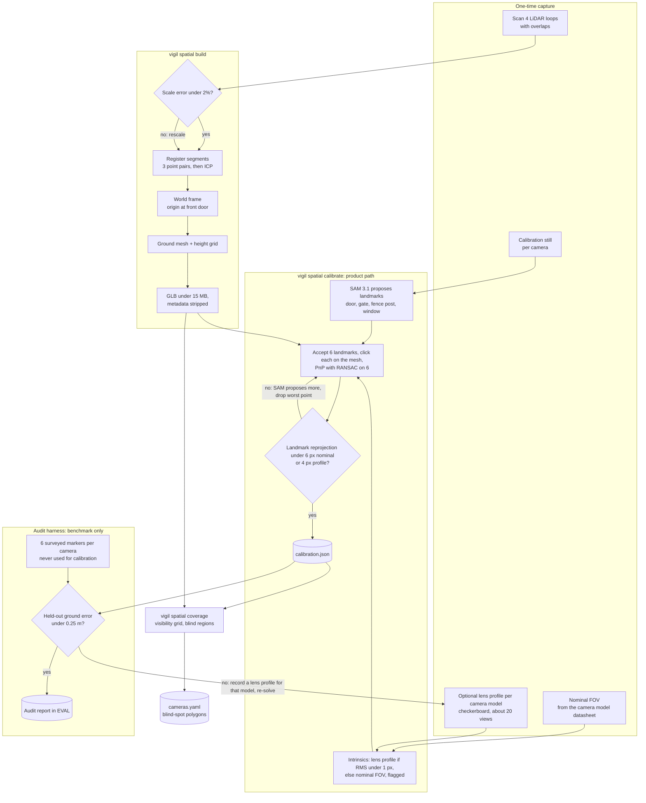

One-time capture (4 LiDAR loops, a still per camera, the camera model's nominal FOV, and an optional checkerboard lens profile per camera model) feeds `vigil spatial build` (scale check, registration, world frame, ground mesh, GLB under 15 MB with metadata stripped), then the product path of `vigil spatial calibrate`: intrinsics from the lens profile if its RMS is under 1 px, else nominal FOV (flagged); SAM 3.1 proposes landmarks, the installer accepts 6 and clicks each on the mesh, and PnP with RANSAC runs on the 6 with a landmark reprojection gate. The audit harness (benchmark only) compares the result against 6 surveyed markers per camera that are never used for calibration; a miss leads to a lens profile for that model and a re-solve. `vigil spatial coverage` then writes blind-spot polygons back to `cameras.yaml`. Every gate has a measured acceptance value and a fallback.

**Maps to:** `vigil/spatial/scan.py`, `calibrate.py`, `coverage.py`, `web/calibrate/`, `config/calibration.json`, `config/cameras.yaml`; runbooks [lidar-scan](../runbooks/lidar-scan.md) and [calibration](../runbooks/calibration.md)

## 5.13 Sequence: live near-real-time mode at home

Source: [5.13-seq-live-home-mode.mmd](5.13-seq-live-home-mode.mmd) · [spec section](../spec/vigil-spec.md#513-sequence-live-near-real-time-mode-at-home)

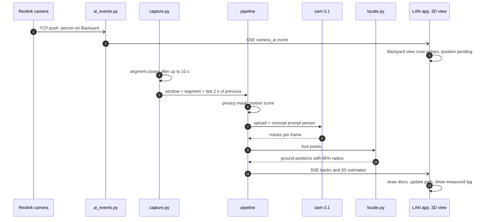

Why the live mode is near-real-time, not real-time. The Reolink TCP-push event reaches the 3D view first (the cone pulses, position pending). When the 10 s segment closes, the window (segment plus the last 2 s of the previous one) is masked, gated and sent to SAM 3.1; foot points become ground positions with a 95% radius, and the discs, path and measured lag are pushed over SSE.

**Maps to:** `vigil/reolink/ai_events.py`, `capture.py`, `vigil/api/live.py`, `vigil/meta/sam.py` (or `sam_local.py`), `vigil/spatial/locate.py`, `web/twin/`; runbook [reolink](../runbooks/reolink.md)

## 10 Compute plan: RTX 3090 first, DGX Spark only if a gate fails

Source: [10-compute-plan.mmd](10-compute-plan.mmd) · [spec section](../spec/vigil-spec.md#10-compute-plan-rtx-3090-first-dgx-spark-only-if-a-gate-fails)

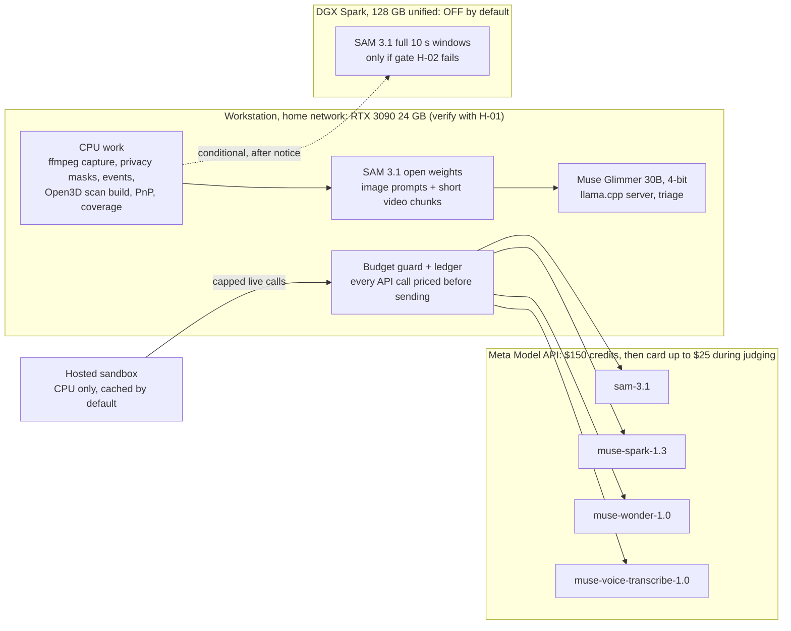

Where each workload runs. CPU work, local SAM 3.1 open weights and Muse Glimmer 30B 4-bit run on the RTX 3090 workstation (only after H-01 verifies it; SAM and Glimmer are never co-resident). The DGX Spark is off by default and only runs full 10 s SAM windows if gate H-02 fails (phase D-1). Every paid API call passes the budget guard first, including the hosted sandbox's capped live calls: the $150 credits first, then at most $25 on the card during judging.

**Maps to:** `vigil/meta/sam_local.py`, `glimmer.py`, `budget.py`, `client.py`, `vigil/settings.py` (`VIGIL_SAM_BACKEND`, `VIGIL_TRIAGE_BACKEND`), `scripts/gpu_probe.py`; runbooks [gpu-h01-h04](../runbooks/gpu-h01-h04.md) and [dgx-spark-d1](../runbooks/dgx-spark-d1.md)
