# Vigil — Engineering Specification and Build Plan

Nov 2, 2026 · @Lord Solutions

> **Revised Nov 2, 2026 (afternoon):** six business, product and schedule corrections applied, then corrected after adversarial review (economics, consistency, role logic) — see [`changes/2026-11-02-business-corrections.md`](changes/2026-11-02-business-corrections.md). Live requirement status lives in [`docs/requirements/`](../requirements/functional.md), not in the Status columns below.

## 0. Baseline and scoring logic

This plan defines 44 functional requirements (FR-001 to FR-044), 34 of them P0 for the MVP. Every one can be built, tested and demoed by **Wed Nov 4, 2:00 PM PT**, and each traces to a module, a test and a piece of demo evidence. The section 0 audit was run on Nov 2: the repository was empty, so there is no prior work to disclose (`docs/audit/2026-11-02-repo-audit.md`).

**Scope change (Nov 2, revised).** Core additions:

- The 4 home Reolink cameras become the testing environment (section 6).
- A phone LiDAR scan becomes a 3D model of the house (section 7).
- Each camera is placed in that model by **SAM 3.1-assisted landmark alignment**: nominal lens FOV plus 6 fixed landmarks such as door frames, gate posts and shed corners. Checkerboards and surveyed tape markers are kept only as the benchmark's ground-truth audit harness (section 7, EVAL).
- A 3D viewer becomes the main view, replacing the 2D yard map.
- **Spatial origin roles (no identification).** A person who walks out of the house's own doors and is followed without an unresolved break is treated as `household_insider`. A person who arrives from the perimeter, on a camera or zone inside an owner-set guest or delivery window's scope, while the window is active, is `expected_visitor`. A person entering from the street, the driveway entry or the side alley is `external_visitor`. Rules can then say "anyone except household", and Rules and roles never use a face, voice or body template (FR-008, FR-010, FR-012, FR-021, FR-029, FR-044).
- **Voice rules are back in the MVP (FR-022, P0).** "Tap and speak" completes a **5-model Meta AI loop**:

  | Model | Role | File |
  | --- | --- | --- |
  | SAM 3.1 | perceives: masks, tracks and landmark proposals | `meta/sam.py` |
  | Muse Glimmer 30B on the local 3090 | triages routine visits at $0 API cost | `meta/glimmer.py` |
  | Muse Spark 1.3 | describes appearance and compiles rules | `meta/spark.py` |
  | Muse Wonder 1.0 | writes the cited story and steers SAM through watch proposals | `meta/wonder.py` |
  | Muse Voice Transcribe 1.0 | turns spoken rules into text | `meta/asr.py` |

  Glimmer's part depends on gate H-03 and runs only on the home edge and in the benchmark; the hosted sandbox's live triage uses Spark, and Glimmer appears there as recorded trace badges. If H-03 fails, triage falls back to Spark and the loop is 4 models (SAM 3.1, Spark, Wonder, Voice Transcribe), with SAM 3.1 on open weights locally only if H-02 passes. The README must say which configuration was used.

Wi-Fi sensing was evaluated and stays out of the submission (section 8). The spatial work keeps its hard cut-off: if landmark PnP has not passed by **Tue 10:00 AM PT**, switch to the measured site-plan fallback (section 7) and keep going.

### What exists versus what is planned

| Item | Status | Source |
| --- | --- | --- |
| Product definition, cut list, 3 demo scenarios, verdict model | Decided | [Final proposal](https://claude.ai/artifact/1CQ5fcYtqS9vZbLZaY27wg) |
| Code in the Vigil repository | **Audited Nov 2: empty repository, no prior work**; bootstrap and offline core built Nov 2 | `docs/audit/2026-11-02-repo-audit.md`, `docs/readiness.md` |
| Footage of the 12 scenarios | Unknown | Audit below |
| Meta API facts used in this plan | Verified on Nov 2 against Meta's docs | Section 5 notes |
| Everything in sections 1 to 13 | Planned unless the audit marks it Done | This doc |

### 20-minute repo audit (run first, then update the Status column in section 1)

Run in CMD at the repo root:

```bat
git log --since="2026-10-26" --pretty=format:"%h %ad %an %s" --date=iso > audit_commits.txt
git log --until="2026-10-26" --oneline > audit_before_event.txt
dir /s /b *.py *.js *.html *.sql *.yaml > audit_files.txt
```

1. Open `audit_before_event.txt`. Any code committed before Oct 26 must be listed as prior work in HACKATHON.md, or kept out of the demo.
2. For each FR in section 1, find the file listed in section 9. If it runs and its test passes, mark it **Done**; if only partly built, **In progress**.
3. Where the existing code differs from section 9, keep the existing names and update this doc, rather than renaming working code.

### Scoring logic behind every choice
| Criterion (weight) | What earns the score | Where this plan delivers it |
| --- | --- | --- |
| Impact (30%) | A real, relatable problem; a usable product; theme fit | Alert fatigue solved without identifying anyone: the same walk across the yard reads as household (quiet) or external visitor (alert) from spatial origin alone (FR-008, FR-012). Measured alert reduction (FR-024). A homeowner setup in minutes with SAM-assisted alignment (UC-10). Unit economics that support a consumer subscription, with the arithmetic shown (11.9) |
| Use of Meta AI tooling (25%) | Beyond basic integration; unexpected capabilities | Five models in distinct roles in one closed loop (above): Spark citing SAM's own track tags; Wonder steering SAM (FR-020); SAM proposing calibration landmarks; voice rules (FR-022); local Glimmer triage |
| Technical depth (20%) | Sound engineering, refinement, craft | Code-owned verdicts and roles, a validator that also checks role claims, topology linking, gaps as data, fail-closed role propagation, a ground-truth audit harness, a pre-registered benchmark, 5 blocking CI suites |
| Demo (25%) | Works, impressive, holds up live, good video | Hosted sandbox **with live calls kept on through judging** under a $25 hard cap (11.8); cached fallback with a notice; voice with 1-click audio fixtures; telemetry panel |

**A 10/10 cannot be promised.** The plan instead removes every known reason to lose points, and makes each claim checkable by a judge in one click.

## 1. Functional requirements

The MVP is the 34 P0 requirements (FR-001 to FR-044); P1 adds the closed loop, the baseline, Expected Guest / Delivery Windows and the live Reolink mode, which together lift the tooling, depth and demo scores; P2 is built only if G3 (Tue 6 PM PT) passes early. Each requirement is done only when its acceptance test passes in CI.

**Priority key.** P0: required for a working demo. P1: required for a top score. P2: optional.

| ID | Pri | Requirement and expected behavior | Depends on | Acceptance criteria | Status |
| --- | --- | --- | --- | --- | --- |
| FR-001 | P0 | **Camera config.** `cameras.yaml` defines cameras, zones and lines (polygons), blind spots, and topology edges with min and max transit seconds | none | Loader rejects unknown camera or zone references with a named error; `test_config.py` passes | Not verified |
| FR-002 | P0 | **Clock alignment.** Each camera gets a time offset measured from one sync event (a hand clap with a phone flash) filmed by all cameras at session start | FR-001 | The sync event's aligned times agree within 0.2 s across cameras on every session | Not verified |
| FR-003 | P0 | **Privacy at source.** Fixed polygons are blacked out and audio removed before anything is stored for upload | FR-001 | Every pixel inside a polygon is 0 in every output frame; ffprobe finds no audio stream; upload is refused otherwise | Not verified |
| FR-004 | P0 | **Windowing.** Clips are cut into 10 s windows with 2 s overlap, re-encoded to H.264 MP4, 10 fps, at most 1280 px wide, faststart | FR-002, FR-003 | Window edges match the plan to one frame; SAM 3.1 accepts every window (no 400) | Not verified |
| FR-005 | P0 | **Motion gate.** Frame differencing outside masked areas; windows below a per-camera threshold make no model calls | FR-004 | On the 12 labelled scenarios, no labelled event falls in a skipped window | Not verified |
| FR-006 | P0 | **SAM 3.1 tracking.** Upload each active window once, then one request per noun phrase (`person`, `car`, plus active watches) with confidence; parse with `meta-sam-parser`; cache by request hash | FR-005 | Recorded responses parse into tracks; zero matches give an empty result, not an error; a 400 is surfaced with its body | Not verified |
| FR-007 | P0 | **Track stitching.** IDs are joined across overlapping windows by box overlap (IoU) on shared frames | FR-006 | A person crossing 3 windows on one camera is 1 track in the fixture | Not verified |
| FR-008 | P0 | **Event builder with origin tagging.** Emits `enter`, `exit`, `cross`, `touch` (person mask overlaps a protected object), `removed` (watched object disappears while a person overlaps it) and `dwell`. When more than one person mask overlaps a protected or watched object, one `touch` (or `removed`) event is emitted per overlapping track, each carrying its own subject's `actor_role`; rules are evaluated per event. Each event has an ID, camera, times, track, clip range and the `actor_role` of its subject (filled in after visit assembly, FR-044). Each track also gets an `origin_zone`: the zone, by `kind` (`egress`, `perimeter`, `interior_yard`), that contains the track's foot point in the majority of its first 10 frames (1 s); no zone or a tie gives `null`. The origin is `null` unless that camera observed without interruption for the 2 s before the track's first frame: no outage, no skipped or unprocessed window, and not the first frame of a window whose predecessor was skipped. An `egress` origin is also `null` when any person track on that camera that did not itself originate in that egress zone was last seen overlapping the egress polygon, dilated by 50%, within the preceding 10 min | FR-007, FR-019 | Synthetic-track unit tests pass for every event type. A track born inside `front_door_egress` gets that origin; a track born mid-yard gets `null`; a track re-born in `front_door_egress` 5 s after a courier's track ended there gets `null`; a track whose first frame follows a skipped window gets `null`. Two overlapping tracks on `po_side_gate` give two touch events. Each demo scenario yields its labelled events and origins | Not verified |
| FR-009 | P0 | **Appearance notes.** Muse Spark reads a clip with SAM's track tags drawn on it and returns JSON whose tag field is an enum of those tags. Fields: class, upper and lower clothing colour, carried items, vehicle colour and body. No face, age, gender or ethnicity fields exist | FR-007 | 100% of responses pass schema validation; an unknown tag is rejected | Not verified |
| FR-010 | P0 | **Visit assembly.** Tracks are linked across cameras only when the gap fits a topology edge and the notes agree; two or more candidates means no link. *(Unchanged, plus:)* the visit records one **subject chain** per linked set of tracks, which carries the role (FR-044). When a link on a non-blind edge is ambiguous only because 2 or more candidates entered the edge together, every candidate holds the same role, and the same number of tracks emerge, each emerging chain takes that role with basis `group:<role>` while the tracks stay unlinked. This never applies across a blind-spot edge | FR-008, FR-009 | Link precision at least 90% on the labelled set | Not verified |
| FR-011 | P0 | **Gaps.** Every interval with a visit's subject out of view is stored with type (`blind_spot`, `ambiguous_link`), times and cameras | FR-010 | Scenario C records the shed gap at 41 s, within 1 s of the label | Not verified |
| FR-012 | P0 | **Rules engine.** Rule JSON with target, trigger, time window (crossing midnight), severity and **`applies_to`** (`anyone` \| `external_visitor_only` \| `non_household`). A rule fires only when the event's `actor_role` is in the set its `applies_to` covers (table in 9.4). Two default rules: watched package removed (`non_household`), and a non-household person in the backyard 23:00 to 05:00 (`non_household`) | FR-008, FR-044 | Truth-table tests pass, including windows across midnight and every `applies_to` × `actor_role` pair. `unknown` is always treated as non-household | Not verified |
| FR-013 | P1 | **Triage.** Code forces escalation when a rule fired, a protected object was touched (except a 9.4 case-2 touch by a `household_insider`), or a gap is unresolved; otherwise Spark decides. Visits not escalated get a story built from a template | FR-012 | Forced cases always escalate; the escalation rate is reported in EVAL | Not verified |
| FR-014 | P0 | **Story.** Muse Wonder receives the visit ledger as JSON (no pixels) and returns sentences citing event IDs, a verdict proposal and watch proposals. Gap sentences are written by code, not by the model | FR-011, FR-013 | Schema-valid output on all 12 scenarios | Not verified |
| FR-015 | P0 | **Citation validator.** Each sentence cites at least one event in this visit; clock times in the text match a cited event within 60 s; camera names match cited events. Failure triggers one retry with the reasons, then the template | FR-014 | Planted bad sentences are all caught; zero uncited sentences ship | Not verified |
| FR-016 | P0 | **Verdict.** A pure function: rules set the floor; only a rule can produce Needs your attention, and a protected-object touch with no rule gives Noteworthy; an unresolved gap with no rule fired gives Can't confirm; Wonder may raise Normal to Noteworthy, never lower | FR-012, FR-015 | Truth-table test covers every combination | Not verified |
| FR-017 | P0 | **Visit cards.** List and detail views: verdict as icon plus word, story with citation chips, gap bars, event timeline, path in the 3D view (FR-040), a source badge per sentence | FR-016 | E2E test opens each demo card and finds every element | Not verified |
| FR-018 | P0 | **Synced player.** 3 to 4 videos play in step; a canvas draws SAM boxes and outlines from overlay JSON; a citation click seeks all players and highlights the right camera | FR-017 | After a seek, players differ by under 0.2 s (Playwright reads `currentTime`) | Not verified |
| FR-019 | P0 | **Tap-to-protect.** A click on a still frame sends a SAM 3.1 point prompt; the mask is stored as a protected object and drawn on the feed | FR-006 | Live call returns a mask; cached mode returns stored masks for preset points | Not verified |
| FR-020 | P1 | **Closed loop.** Wonder's watch proposals pass an allowlist and a cap of 4 per camera, expire after 24 h, show the owner a notice with undo, and add the prompt to that camera's next windows | FR-014, FR-006 | In scenario B the package watch activates and later windows track the package | Not verified |
| FR-021 | P0 | **Typed rules.** Spark compiles text into rule JSON whose targets are limited to existing objects and zones. Identity phrases map to roles, never to people: "anyone except family", "except us" and "not the household" → `non_household`; "strangers only" and "not guests or deliveries" → `external_visitor_only`; a named person ("except Sam") → `non_household` plus the notice "Rules can't recognise individuals. It treats someone as household only if they came out of the house's own doors or checked in on the app, so Sam is exempt only in those cases." The draft card states the basis: *"Vigil treats someone as household only when it saw them come out of the house's own doors, or when a household member checked in on the app just before coming into view. Household members arriving from the street without checking in, and anyone Vigil loses track of, count as non-household and can trigger this rule. Vigil places people by where they came from; rules and roles never use a face, voice or body template."* The owner confirms | FR-012, FR-019, FR-044 | At least 9 of 10 reference phrasings compile to the expected JSON, including 3 role phrasings. An unresolvable target asks a question. No compiled rule ever names a person | Not verified |
| FR-022 | **P0** | **Voice rules ("tap and speak").** The browser records up to 30 s, downsamples to 16 kHz mono and encodes 16-bit PCM WAV in the client (30 s ≈ 0.96 MB; WAV input ⚠️ to be confirmed in T-03; the sandbox image has no ffmpeg). Muse Voice Transcribe 1.0 (batch endpoint, ⚠️ confirmed in T-03) returns text the owner can edit before compiling (FR-021). For judges without a microphone, **3 pre-recorded audio fixture buttons** each send a short consented WAV (`demo/voice/`, NFR-002), and each has a cached transcript for the offline fallback | FR-021 | 5 of 5 spoken reference phrasings compile correctly live. All 3 fixture buttons work live and in cached mode, and with `MODEL_API_KEY=invalid`. A 30 s recording is under 2 MB | Not verified |
| FR-023 | P0 | **Call ledger and telemetry.** Every model call logs model, purpose, latency, billed units, cost, cached or live, and success; each card has a "How this was decided" trace | FR-006 | 100% of calls appear; the panel total matches the ledger | Not verified |
| FR-024 | P0 | **Evaluation harness.** Labels are written before running; `vigil eval` computes the EVAL metrics and writes `eval/results.json` and the table in EVAL.md | FR-016 | Re-running from cache gives identical results | Not verified |
| FR-025 | P1 | **Naive baseline.** One Spark call per motion window asking whether anything is wrong; alerts and unsupported claims are counted for the 3 demo scenarios | FR-005 | Side-by-side table committed | Not verified |
| FR-026 | P0 | **Sandbox modes and guards.** Cached by default; live buttons; daily spend cap; per-IP rate limit; any live failure falls back to cached with a visible notice | FR-023 | With an invalid API key, every cached E2E flow still passes | Not verified |
| FR-027 | P0 | **Export and scenario switcher.** `vigil export` writes a demo bundle (masked clips, overlays, DB); the sandbox switches between scenarios A, A′, B, B′ and C | FR-017 | A clean clone plus `make demo` serves all 5 | Not verified |
| FR-028 | P1 | **Glimmer triage.** Muse Glimmer 30B (4-bit, llama.cpp) on the local RTX 3090 handles triage, with automatic Spark fallback (section 10) | FR-013 | Agrees with Spark on at least 10 of 12 scenarios; latency logged | Not verified |
| FR-029 | **P1** | **Expected Guest / Delivery Window and owner check-in** (was "owner label"). The owner sets a time window before it starts (start and end, optional cameras or zones, optional label such as "plumber" or "deliveries"). Subjects whose first track starts in a `perimeter` zone in the window's scope while it is active are `expected_visitor` (FR-044 step 3). Windows are capped at 12 h, show on the cards, and can be cancelled. The post-hoc "This was expected" button stays as feedback only and never changes a verdict retroactively. Also: an "I'm outside" check-in (LAN app, `POST /api/checkin`), single-use and never retroactive, which binds at most one subject chain in the 120 s after the tap (FR-044 step 2); an unused check-in expires after 30 min | FR-044 | A subject arriving inside an active window is `expected_visitor`, and one arriving from a perimeter zone 1 s after it ends, or on a camera outside its scope, is `external_visitor`; one with a `null` origin is `unknown`. Windows persist and expire. A check-in binds at most one chain | Not verified |

### Added for the real-world environment (Nov 2)

FR-022 (voice rules) is P0 again (Nov 2 correction): "tap and speak" completes the 5-model loop. Typed rules (FR-021) remain the fallback.

| ID | Pri | Requirement and expected behavior | Depends on | Acceptance criteria | Status |
| --- | --- | --- | --- | --- | --- |
| FR-030 | P0 | **Reolink connection and probe.** `cameras.yaml` lists the 4 cameras (host or NVR channel, stream paths); credentials come from `.env`. `vigil reolink probe` reports model, firmware, RTSP or FLV reachability and AI-event support | FR-001 | Probe passes for all 4 cameras; credentials never appear in logs | Not verified |
| FR-031 | P0 | **Continuous capture.** A restreamer holds one connection per camera; ffmpeg writes 10 s segments by stream copy, audio removed; raw segments kept 48 h; windows built with 2 s overlap | FR-030, FR-004 | 2 h run with no segment gap over 1 s; reconnects within 30 s after a cable is pulled | Not verified |
| FR-032 | P1 | **Reolink AI events.** Person and vehicle events via reolink\_aio TCP push are stored as `camera_ai` events and pushed to the UI | FR-030 | At least 9 of 10 staged walk-ins produce an event; latency measured | Not verified |
| FR-033 | P1 | **Near-real-time loop.** Windows overlapping a Reolink event or motion are processed automatically, in order, once each | FR-031, FR-006 | Median and 90th-percentile lag reported; no window processed twice | Not verified |
| FR-034 | P1 | **LAN live view.** WebRTC video from the restreamer, plus server-sent updates to cards and the 3D view; bound to the home network only | FR-033, FR-040 | Works on a phone on home Wi-Fi; unreachable from a phone on cellular | Not verified |
| FR-035 | P0 | **3D model build.** `vigil spatial build`: scale check, segment registration, world frame, ground mesh and height grid, compressed GLB, metadata stripped | none | Scale error under 2%; GLB under 15 MB loads in the viewer; no GPS metadata | Not verified |
| FR-036 | P0 | **Intrinsics.** The primary path is **nominal lens FOV** from the camera model's datasheet: focal length from the horizontal FOV at the processed resolution, principal point at the centre, no distortion. It is flagged `fov_nominal`. Optional lab refinement: one checkerboard session (about 20 views) **per camera model**, stored as a lens profile and reused for identical units; RMS under 1.0 px | FR-030 | Every camera has intrinsics: nominal, flagged, or a model lens profile with RMS under 1.0 px. The source is shown in the calibration report | Not verified |
| FR-037 | P0 | **Extrinsics from landmarks.** In the calibration tool, SAM 3.1 proposes fixed-landmark masks on each camera still (concept prompts `door`, `gate`, `fence post`, `window`, plus the corners of masks). The installer accepts 6 landmark points per camera and clicks the same points on the mesh (one click each). PnP with RANSAC runs on the 6, saved to `calibration.json`. Accuracy is **not** asserted from the 6 points; it is measured by the audit harness (NFR-024 to NFR-026) | FR-035, FR-036, FR-019 | Mean reprojection on the 6 landmarks under 6 px at 1280 px (nominal FOV) or under 4 px (lens profile). The audit-harness held-out ground error is reported per camera, target under 0.25 m | Not verified |
| FR-038 | P0 | **Coverage and blind regions.** A 0.25 m ground grid with per-camera visibility (image bounds, privacy polygons, mesh line of sight); blind regions written to `cameras.yaml` and used by FR-010 and FR-011 | FR-037 | The region behind the shed is found; a walk test along its edge agrees | Not verified |
| FR-039 | P0 | **3D position estimates.** Foot point ray-cast to the ground with a 95% radius; height-prior fallback flagged low confidence; two-camera fusion with an inconsistency flag; no positions inside gaps | FR-037, FR-007 | Pre-registered accuracy target met or reported as missed; at least 90% of test points inside their stated radius | Not verified |
| FR-040 | P0 | **3D viewer.** three.js view with mesh, coverage, blind regions, camera cones, discs, paths and gaps, encoded as in section 7; shared timeline with video and cards; click-through to evidence | FR-035, FR-039, FR-017 | E2E: scenario C shows the dotted 41 s gap, discs with radius and the cone pulse; at least 30 fps on a mid-range phone | Not verified |
| FR-041 | P2 | **Wi-Fi motion annotation** (after the hackathon): ESPectre over MQTT, annotation only, never a verdict on its own | FR-011 | As in section 8 | Not verified |

### Added for compute and budget (Nov 2)

| ID | Pri | Requirement and expected behavior | Depends on | Acceptance criteria | Status |
| --- | --- | --- | --- | --- | --- |
| FR-042 | P1 | **Local inference backends.** `VIGIL_SAM_BACKEND=local\|api\|remote` and `VIGIL_TRIAGE_BACKEND=glimmer\|spark` switch implementations behind one interface. Local SAM 3.1 runs in chunks on the RTX 3090; Glimmer runs through a llama.cpp server. The ledger records backend and GPU seconds | FR-006, FR-013 | H-02 to H-04 pass, or the API fallback is used and documented; parity IoU reported | Not verified |
| FR-043 | P0 | **Budget guard.** Prices every call before sending. Enforces the credit cap ($140, `credit`-tagged spend only), feature and daily caps, plus the **judging cap** (`VIGIL_JUDGING_CAP_USD=25`, $5 per day) on spend after the credit window ends. Warns at 50, 75 and 90%. Gives pre-flight estimates for batch commands. After the credit window, paid calls are allowed only while `VIGIL_ALLOW_PAID=1`, before `VIGIL_JUDGING_END` (Nov 10, 23:59 PT), and the judging cap has room. The ledger tags each call `credit` or `paid` (9.3) | FR-023 | Unit tests: refusal at each cap; refusal at the judging cap; window-end switch with and without `VIGIL_ALLOW_PAID`; refusal after `VIGIL_JUDGING_END`; estimate within 10% of the Billing page after T-03 | Not verified |
| FR-044 | **P0** | **Spatial origin roles (new; no identification).** `visits.py` assigns each subject chain an `actor_role` from evidence only, in this order: (1) its first track's `origin_zone` is an `egress` zone of the house → `household_insider`, basis `egress:<zone>`; (2) an **explicit check-in** binds it: a household member tapped "I'm outside" in the LAN app (passive Wi-Fi presence never counts). A check-in is single-use and never retroactive. When the 120 s interval after the tap closes, it binds the one subject chain whose first track started in that interval with `origin_zone` `null`, `interior_yard` or `perimeter` (never `egress`), but only if exactly one such chain started and no subject other than `household_insider` was in view on any camera at that chain's first frame; otherwise it binds nothing. A bound chain is `household_insider` with basis `checkin:<id>`. An unused check-in expires after 30 min; (3) its first track's `origin_zone` is a `perimeter` zone on a camera (or zone) in the scope of an Expected Window (FR-029) that is active at that track's first frame → `expected_visitor`, basis `window:<id>`. A window with no listed cameras or zones covers every perimeter zone. A `null` origin never becomes `expected_visitor`; (4) its origin is a `perimeter` zone → `external_visitor`, basis `perimeter:<zone>`; (5) otherwise → `unknown`, basis `ambiguous_link:<track_id>` when its first track followed an ambiguous link, else `origin_null:<track_id>` (origin `null` or an `interior_yard` zone); the same-role group rule in FR-010 (basis `group:<role>`) is the only exception. Roles carry across a link only when the link is unambiguous. Across a blind-spot gap, `external_visitor` carries on any unambiguous re-link (it can only make rules fire). `household_insider` and `expected_visitor` carry only when both tracks' appearance notes agree on at least one attribute that is not `unknown` (upper colour, lower colour or a carried item). A re-link on transit time alone, as at night under IR, makes the chain `unknown` with basis `gap_unresolved:<gap_id>`. Every role has a stored `role_basis` shown in the trace. If FR-029 is not built, step (3) never matches and FR-044 still passes A face-profile match (change 2026-11-04) never sets, changes or overrides `actor_role`; a named profile is never household by that name. | FR-008, FR-010 (FR-029 and the check-in only supply inputs; without them, rules (2) and (3) never apply) | Truth table over origin × check-in × window × link outcome. Scenario A subject = `household_insider` (basis `egress:front_door_egress`); scenario C subject = `external_visitor` (basis `perimeter:side_alley`). An ambiguous re-link gives `unknown`. A household subject enters `shed_back`; a never-seen person with `unknown` colours emerges inside 5–180 s → `unknown`. Two household members leave the front door together and two tracks emerge on `side_left` → both `household_insider` (basis `group:household_insider`). Two chains starting in one check-in's 120 s interval → neither is bound. No face, voice, body or name field exists in any person-related schema (NFR-003). EVAL reports assigned vs labelled role per subject, day and night separately, including the share of household subjects not assigned `household_insider` (role miss rate) and the alerts it caused | Not verified |

## 2. Non-functional requirements

Every target below is checked by a script or test, and the result is published even when it is missed. Latency targets marked ⚠️ are first estimates: Meta does not publish response times, so record the first measured values in EVAL.md before the benchmark run and keep the targets fixed after that.

| ID | Area | Requirement | Target | Validation method |
| --- | --- | --- | --- | --- |
| NFR-001 | Privacy | No unmasked pixel inside a privacy polygon in any uploaded or committed frame | 0 pixels | `scripts/privacy_scan.py` checks every frame of every file in `demo/` and every file before upload; CI fails on any non-zero pixel |
| NFR-002 | Privacy | No camera audio leaves the house or enters the repo. Voice-rule speech (FR-022) is sent only to Muse Voice Transcribe and is never written to disk or the response cache (only the transcript is cached, keyed by the audio hash). The only audio files in the repo are the 3 consented voice-rule fixtures under `demo/voice/`, listed by SHA-256 in `config/audio_fixtures.json` | 0 camera audio streams in any video; 0 audio files outside the fixture list | ffprobe check in the same scan; a repository-wide check (`git ls-files`) fails on any .wav, .mp3, .m4a, .ogg or .webm file not on the fixture list |
| NFR-003 | Privacy, fairness | The appearance, track, subject, event and position schemas have no face, age, gender, skin, ethnicity, height, gait, body-measurement, voice-feature or name fields, and the UI never shows such words outside the opt-in Faces card. Rules, roles and stories never use a face, voice or body template. Opt-in face templates (change 2026-11-04) live only in `data/faces.db`, separate from these schemas, are computed on the home box, are never sent to a model API, and are enrolled only from people inside the property | 0 such fields; 0 such words in the 12 stories | Schema unit test checks every field of those schemas against an allowlist; word-list scan over generated stories |
| NFR-004 | Privacy | All Meta calls use Standard mode (content not used for training); no `-contributor` model ID appears | 0 contributor calls | Ledger query plus a code grep in CI |
| NFR-005 | Performance | Cached sandbox: first visit card visible after page load | p95 under 2.5 s on a 50 Mbps connection | Playwright timing over 20 loads |
| NFR-006 | Inference latency | Live tap-to-protect: click to mask drawn | ⚠️ p50 under 5 s | `model_calls.latency_ms` over 20 calls |
| NFR-007 | Inference latency | Live story re-run with cached perception: triage + Wonder + validation | ⚠️ p50 under 30 s | Ledger timing over 10 runs |
| NFR-008 | Inference latency | Offline processing: from end of visit to published card | Report median per scenario | `vigil eval` timing columns |
| NFR-009 | Reliability | The sandbox works with the Meta API unreachable | 100% of cached E2E flows pass | E2E run with `MODEL_API_KEY=invalid` |
| NFR-010 | Reliability | Live failures degrade, never blank: 2 retries with backoff on 429 and 5xx, then cached result plus notice | 0 blank or broken screens | Fault-injection integration test with respx (429, 500, timeout, malformed JSON) |
| NFR-011 | Reliability | Determinism: re-running on cached model responses gives identical visits | Byte-identical `visits.json` | CI step runs the pipeline twice and diffs |
| NFR-012 | Cost | Full benchmark (12 scenarios) within the API credit | Under $25 with local SAM; under $40 including the baseline if API SAM is needed (H-02 fails) | Ledger sum, published in EVAL.md |
| NFR-013 | Cost | Sandbox spend is capped per day | $10 per day from credits before the window ends; after it, $5 per day and $25 in total (NFR-037). At a cap, live requests return the cached result with "Live budget for today used; recorded result shown" | Unit test on both caps; manual check on the deployed site |
| NFR-014 | Security | API key is server-side only; no secret is ever committed | 0 findings | gitleaks in CI; test asserts the key never appears in any served file |
| NFR-015 | Security | Live endpoints are rate-limited and inputs bounded | 10 live requests per minute per IP; audio up to 30 s and 2 MB; JSON up to 64 KB | Integration tests for 429 and 413 responses |
| NFR-016 | Security | Model output cannot trigger actions beyond the allowlist | 0 non-allowlisted watches created | Injection test: Wonder fixture proposes an off-list prompt; it is rejected and logged |
| NFR-017 | Usability | On a 390 px wide phone the verdict and first story sentence show without scrolling; verdicts use icon plus word, never colour alone | Pass on 3 demo cards | Playwright mobile viewport screenshot test |
| NFR-018 | Usability | Any story sentence leads to its evidence clip in 1 click | 100% of sentences | E2E clicks every citation chip in the 3 demo cards |
| NFR-019 | Resources | The pipeline also runs CPU-only (API backends) when no GPU is available | Peak memory under 2 GB on the CPU path; the GPU path is measured in section 10 | `/usr/bin/time -v` on the full benchmark |
| NFR-020 | Scalability (estimate only) | Cost and work per camera-day projected from measured numbers, labelled as an estimate | Published with method | Script multiplies measured per-window cost by measured active-window rate |
| NFR-021 | Reproducibility | A clean clone serves the cached sandbox | Under 10 min from clone to running | Timed run on a fresh machine or Codespace |
| NFR-022 | Provenance | Every displayed model output shows model ID and call ID | 100% of sentences and masks | E2E checks badge presence |
| NFR-023 | Accuracy | Pre-registered EVAL targets: alert reduction at least 80%; correct verdict at least 10 of 12; link precision at least 90%; 0 claims inside gaps; 0 uncited sentences shipped | As stated | `vigil eval` on labels committed before the run |

### Added for the real-world environment (Nov 2)

| ID | Area | Requirement | Target | Validation method |
| --- | --- | --- | --- | --- |
| NFR-024 | Spatial accuracy | Calibration quality, measured by the **ground-truth audit harness** (surveyed markers never used for calibration) | Landmark reprojection under 6 px (nominal FOV) or 4 px (lens profile) at 1280 px; held-out ground error under 0.25 m; lens-profile RMS under 1.0 px where a profile exists | Calibration report from `vigil spatial calibrate` plus the audit-harness report, both committed |
| NFR-025 | Spatial accuracy | 3D position error for people | ⚠️ Median under 0.5 m within 10 m of the camera; 90th percentile reported | A person stands on 6 surveyed markers per camera, not used in calibration |
| NFR-026 | Spatial honesty | Stated uncertainty is truthful | At least 90% of test points fall inside their stated 95% radius | Same marker test |
| NFR-027 | Inference latency | Reolink AI event to cone pulse in the UI | ⚠️ p50 under 3 s | 10 staged walk-ins timed against a clap on video |
| NFR-028 | Inference latency | Live lag: start of movement to SAM track and 3D disc on screen | ⚠️ p50 under 45 s; p90 reported | Ledger and SSE timestamps over 20 walk-ins |
| NFR-029 | Reliability | Continuous capture from 4 cameras | 2 h with no segment gap over 1 s; reconnect within 30 s | Capture log and ffprobe timestamps; cable-pull test |
| NFR-030 | Performance | 3D viewer | GLB under 15 MB; loads in under 5 s at 50 Mbps; 60 fps on a laptop, at least 30 fps on a mid-range phone | Playwright timing plus a manual phone check |
| NFR-031 | Security | Home network exposure | 0 camera or edge ports reachable from the internet; credentials never in logs or repo | Port check from a phone on cellular; gitleaks; log grep test |
| NFR-032 | Privacy | Location leakage | 0 GPS or device metadata in committed scans and images; no house number or street-facing frames | exiftool scan in CI plus manual review of every demo frame set |
| NFR-033 | Resources | Edge machine load while capturing 4 cameras | Stream copy only for segments; re-encode only triggered windows; average CPU reported | Resource log over the 2 h capture test |

### Added for compute and budget (Nov 2)

| ID | Area | Requirement | Target | Validation method |
| --- | --- | --- | --- | --- |
| NFR-034 | Hardware | No GPU is used before a runtime probe confirms it | Probe report exists for every GPU used | `eval/hardware/*.json` committed (H-01) |
| NFR-035 | Consistency | Local and hosted SAM 3.1 agree | ⚠️ Mean mask IoU at least 0.8 on 20 windows | H-04 |
| NFR-036 | Cost | Credit-funded Meta API spend (ledger tag `credit`) | Under $140 in `credit`-tagged calls; no single feature over its budget in section 11.4. Post-window `paid` spend is governed by NFR-037 (≤ $25) and does not count toward the $140 | Ledger (by `funding` tag) plus Billing page, reconciled daily |
| NFR-037 | Cost | No charges after the credit window except the approved judging allowance | 0 paid calls after the window unless `VIGIL_ALLOW_PAID=1`; with it, all post-window spend (from `VIGIL_CREDIT_WINDOW_END` to `VIGIL_JUDGING_END` = Nov 10 23:59 PT) is ≤ $25 in total and ≤ $5 per PT calendar day. The total binds first: 6 days × $5 = $30 > $25, so if every day is used fully, Nov 10 serves cached results. No paid call after `VIGIL_JUDGING_END` | Unit tests on the window-end switch, the judging cap and the end date; ledger check daily Nov 5–10 |

**On scalability.** The demo does not prove multi-home scale and should not claim it. NFR-020 gives an honest projection; windows are independent, so processing parallelises by camera, which is the only scaling statement the README should make.

## 3. Use cases and user flows

Four journeys carry Vigil's value and the demo: **J1** protect and set a rule, then catch the night visit with an honest gap; **J2** a delivery that makes Vigil start watching the package on its own; **J3** a judge checking any claim in one click; **J4** at home, a person walking into the backyard shows up in the 3D model as a camera event at once, then as a tracked position. The use cases below are the steps those journeys are made of.

### Actors

| Actor | Goal | Touches |
| --- | --- | --- |
| Owner | Fewer, better alerts; protect what matters | Visit cards, tap-to-protect, rules |
| Installer (the team, at setup) | Cameras, privacy polygons, topology, clock offsets | `cameras.yaml`, `vigil ingest` |
| Judge | Check that it works and that claims hold | Hosted sandbox |
| Visitor or household member | None; they are recorded subjects | Appears only in masked, consented footage |
| Meta Model API | Perception and language | Called by Vigil only |

### UC-01 Set up a home (installer)

- **Trigger:** first run. **Preconditions:** cameras recording; consent from everyone filmed.
- **Main flow:** draw privacy polygons and zones on one still per camera; enter topology edges with transit times; film the sync clap; run `vigil calibrate` to store offsets.
- **Alternatives:** SAM 3.1 proposes a polygon from one still (concept prompt such as `street`) and the installer edits it.
- **Errors:** an edge names an unknown camera → loader error with the line; sync event not found on a camera → that camera is excluded until fixed.
- **Outcome:** valid config; FR-001 to FR-003 pass.

### UC-02 Protect an object (owner)

- **Trigger:** owner taps an object on a camera still. **Preconditions:** UC-01 done.
- **Main flow:** point prompt to SAM 3.1 → mask drawn → owner names it ("side gate") → protected object saved.
- **Alternatives:** the mask is wrong → tap again with a second point or a negative point; or drag a box.
- **Errors:** zero matches → "Nothing found there, try tapping the centre of the object"; API down → preset objects in cached mode, with a notice.
- **Outcome:** object `po_N` active on that camera.

### UC-03 Create a rule (owner)
- **Trigger:** owner taps the mic and speaks, taps one of the 3 sample-audio buttons, or types a rule. **Preconditions:** the target object or zone exists.
- **Main flow:**
  1. (Voice) the browser records up to 30 s and encodes 16 kHz mono WAV; Muse Voice Transcribe returns a transcript, which stays editable.
  2. Muse Spark compiles rule JSON, with targets limited to existing objects and zones and identity phrases mapped to roles.
  3. A draft card states the rule in plain words, including whom it applies to.
  4. The owner confirms and the rule becomes active.
- **Role phrasing:** "Tell me if anyone except family opens this gate after dark" compiles to `applies_to: "non_household"`. The draft card says: *"Applies to everyone except household members. Vigil treats someone as household only when it saw them come out of the house's own doors, or when a household member checked in on the app just before coming into view. Household members arriving from the street without checking in, and anyone Vigil loses track of, count as non-household and can trigger this rule. Vigil places people by where they came from; rules and roles never use a face, voice or body template."*
- **Alternatives:** a named person ("except Sam") compiles to `non_household` with the notice "Rules can't recognise individuals". "Strangers only, not deliveries" compiles to `external_visitor_only`.
- **Errors:**
  - Target not found → "Which object do you mean?" with the list.
  - No microphone or permission denied → the sample-audio buttons and typing.
  - Transcription fails → the editable empty transcript plus typing.
  - Compile fails twice → the owner fills the form fields directly, including an `applies_to` selector.
- **Outcome:** active rule `rN`, visible in the rules list with its `applies_to` badge.

### UC-04 A routine visit (system)

- **Trigger:** motion on one or more cameras. **Preconditions:** rules and topology loaded.
- **Main flow:** windows → SAM tracks → events → notes → visit → no rule fired, no gap → triage says routine → templated story → verdict Normal.
- **Outcome:** a grey card, no alert. This is the scenario that proves alert reduction.

### UC-05 An expected visitor and the closed loop (system)

- **Trigger:** a courier enters the porch camera and leaves a package.
- **Main flow:** visit assembled → triage escalates (new object) → Wonder story, verdict proposal Noteworthy, watch proposal `package` on porch → validator passes → loop accepts → owner sees "Now watching: package on porch".
- **Alternatives:** the proposal is off the allowlist → logged as rejected, no watch.
- **Outcome:** one Noteworthy card; later windows track the package (feeds UC-08).

### UC-06 Rule broken with a blind spot (system)

- **Trigger:** after dark (rule r7: 17:30 to 06:00) a person who entered from the side alley (`external_visitor`) touches the protected side gate, goes behind the shed, reappears.
- **Main flow:** `touch` event on `po_side_gate` → rule r7 fires (floor: Needs your attention) → subject leaves the side-yard view on the blind-spot edge → gap g4 opens → re-linked 41 s later → Wonder writes observed sentences; code inserts the gap sentence → validator passes → verdict Needs your attention.
- **Errors:** Wonder writes "he checked the shed door" citing nothing → rejected, retried, or templated.
- **Outcome:** one red card with a labelled 41 s gap: "Vigil can't confirm what happened".

### UC-07 Review evidence (owner or judge)

- **Trigger:** opens a card.
- **Main flow:** clicks a citation → all players seek to the event, the right camera is highlighted, the SAM outline is drawn → opens "How this was decided" → sees rules fired, model calls, validator results.
- **Outcome:** every claim checked in 1 click (NFR-018).

### UC-08 Package taken (system)

- **Trigger:** a person overlaps the watched package and the package track ends.
- **Main flow:** `removed` event → default rule "watched package removed" fires → Needs your attention card.
- **Alternatives:** the person arrived from a perimeter zone in the scope of an active Expected Window (FR-029) and the rule is `external_visitor_only` → no alert, a Noteworthy card (9.4 case 3); the trace shows `role_basis: window:<id>`.

### UC-09 Judge explores the sandbox

- **Trigger:** judge opens the URL. **Preconditions:** bundle deployed.
- **Main flow:** see the evening summary → open the red card → check citations → tap-to-protect live → speak a rule, tap a sample-audio button, or type it → re-run a story live → open the benchmark tab.
- **Errors:** spend cap reached or API failing → the request shows "Live call failed; recorded result from \<date> shown" or "Live budget for today used; recorded result shown" and still works in cached mode.

### UC-10 Place the cameras in the 3D model (installer or homeowner)

There are two flows: the product flow every home uses, and the audit protocol only the benchmark uses.

**A. Commercial onboarding: "SAM 3.1-assisted spatial alignment" (target under 5 minutes per camera; ⚠️ a target, timed in the benchmark, not yet measured)**
- **Trigger:** first run, or a camera has moved. **Preconditions:** phone with LiDAR; camera model known.
- **Main flow:**
  1. Walk a short LiDAR loop around each side of the house (about 2 minutes per side) → `vigil spatial build`.
  2. Intrinsics come from the camera model's nominal FOV, or its lens profile if one exists.
  3. On each camera still, SAM 3.1 proposes fixed landmarks (doors, gate posts, shed corners, window corners). The homeowner accepts 6 and taps the same 6 on the 3D model.
  4. PnP places the camera → `vigil spatial coverage` → blind regions are written to the config.
- **Alternatives:** too few landmarks visible → add a temporary landmark (any box or chair, scanned once). Registration fails → align each segment to a tape-measured site plan. Scan unusable → site-plan model.
- **Errors:** landmark reprojection over threshold → SAM proposes more landmarks and the worst point is dropped. A landmark is hidden → pick another.
- **Outcome:** `calibration.json` and the GLB pass their tests (FR-035 to FR-038).

**B. Scientific verification protocol (benchmark only, never required of a homeowner)**
- 6 surveyed ground markers per camera (24 in total), tape-measured to the world frame and **never used for calibration**. They provide the held-out ground error (NFR-024) and the marker walk for position accuracy and r95 truthfulness (NFR-025, NFR-026).
- 2 tape-measured distances check the scan scale (under 2%).
- An optional checkerboard session per camera *model* builds a lens profile.
- This is the evidence behind any "±0.4 m" claim. The demo only shows radii that this harness has measured.

### UC-11 Live monitoring at home (owner)

- **Trigger:** someone walks into the backyard. **Preconditions:** capture running; LAN app open on a phone on home Wi-Fi.
- **Main flow:** Reolink event → the backyard cone pulses within seconds, "position pending" → the segment closes and is processed → outlines on the live video and a disc in the 3D view, with the measured lag shown → the visit closes → card and verdict.
- **Alternatives:** no Reolink event but motion → the same flow without the pulse; the camera's event fires but SAM finds no person → logged as a mismatch for EVAL, with no card.
- **Errors:** a camera drops → the cone turns grey with "Camera offline", and the time is stored as an outage gap; Meta API slow → the pulse still works and the lag grows on screen; owner off the home network → nothing is reachable, by design.
- **Outcome:** the owner sees presence at once and the full, cited picture shortly after.

### Global error scenarios

| Error | Where | Handling | Test |
| --- | --- | --- | --- |
| SAM returns zero matches | FR-006 | Empty track list; window marked processed | `test_sam_parse_empty` |
| More than 16 objects in a window | FR-006 | Split the window in half and re-run, as Guestlist does | `test_sam_window_split` |
| SAM 400 (aspect ratio, prompt) | FR-006, FR-019 | Do not retry; log the body; show a message | `test_sam_400` |
| 429 or 5xx | all calls | 2 retries with backoff and jitter, then fallback | `test_client_retry` |
| Wonder output not valid JSON or schema | FR-014 | Counts as a validator failure: retry once, then template | `test_wonder_malformed` |
| Camera clocks drift | FR-002 | Re-sync per recording session; reject sessions over 0.5 s residual | `test_sync_residual` |
| Spend cap reached | FR-026, FR-043 | Live request served from cache with the notice | `test_spend_cap` |

## 4. Demo happy path

A judge can verify Vigil's claims in about 4 minutes: the sandbox opens on one recorded evening and walks from the summary to the evidence. Then 3 live actions prove the models really run. The 3-minute video follows the same path (script in the [final proposal](https://claude.ai/artifact/1CQ5fcYtqS9vZbLZaY27wg), section 8) and is recorded from the deployed sandbox, so the video and the product match.

### The recorded evening

One evening on the 4 home Reolink cameras (front entrance, left side, right side, backyard), recorded through Vigil's capture service and placed in the LiDAR model of the house. It contains scenarios A, A′, B, B′ and C:

| Scenario | What happens | Expected verdict | Expected evidence |
| --- | --- | --- | --- |
| A Routine (daylight, T-07a; variant A′ at night, T-07b) | A household member walks **out of the front door** (`front_door_egress`), gets in the car and drives off. Variant A′ (night block, inside r7's 17:30–06:00 window, before C): a household member walks out of the front door again and straight to the side gate (front → side_left link within 2–20 s), touches it and goes back inside; no alert fires because r7 applies to non-household | Normal, no alert | Role `household_insider` (basis `egress:front_door_egress`); templated story; escalated: no; A′: inside r7's window, r7 not fired because of `applies_to` (the trace shows the exclusion) |
| B Delivery (daylight, T-07a) | A courier arrives from the street (`driveway_entry`) and leaves a box on the porch. Variant B′: inside an owner-set delivery window | Noteworthy (B′: Normal or Noteworthy, depending on the loop) | Role `external_visitor` (B′: `expected_visitor`); Wonder story; watch "package on porch" activated by the loop |
| C After dark (night, T-07b, about 18:00 PT) | A person enters from the **side alley** (`side_alley`), touches the protected side gate, goes behind the shed, reappears 41 s later and leaves | Needs your attention | Role `external_visitor` (basis `perimeter:side_alley`); rule r7 "Side gate after dark" (17:30–06:00, `non_household`) fired; gap g4 of 41 s; the role carried across the gap because the re-link was unambiguous; validator log |

**Contrast that carries the Impact claim.** Scenarios A′ and C show the same touch of the same gate, after dark and inside r7's window, with opposite outcomes, decided only by where each person came from. The card's trace shows the `role_basis` for each.

**Timestamps are never altered.** Scenario C is filmed at about 18:00 PT because of the night block (section 9.7), so r7's window is 17:30–06:00. The card shows the real recorded time. (The earlier "22:14" label is retired.)

People filmed are consenting adults from the team; vehicles appear with plates covered by paper signs reading "VIGIL-01"; privacy polygons cover the street and neighbouring houses.

### Judge sequence

| Step | Judge does | System responds | AI processing | Visible proof |
| --- | --- | --- | --- | --- |
| 1 (0:00) | Opens the URL | 3D model of the house with 4 camera cones and coverage; evening summary "N motion triggers → V visits → 1 alert", with N and V measured | None (cached) | Real home cameras; coverage and blind regions from measured geometry; Cached badge |
| 2 (0:20) | Opens the red card C | The 3D view moves to the side yard: solid path, discs with uncertainty rings, dotted "Not observed · 41 s" behind the shed; story with citation chips | Cached Wonder story, validator result | Gap drawn as a gap, never a guessed path; gap sentence written by code |
| 3 (0:50) | Clicks a citation chip | Video players seek; side camera highlighted with the SAM outline; the matching disc lights up, labelled "Estimated ±\<r95> m from Side camera" (r95 from the audit-harness-calibrated locate()) | Overlays from cached SAM 3.1; positions from `locate.py` | Seen versus estimated shown side by side; model and call IDs |
| 4 (1:15) | Opens "How this was decided" | Trace: rule r7 fired, triage forced, Wonder draft, validator results, verdict inputs, plus the calibration figures of the cameras involved | Ledger read | Code decides; any rejected sentence is visible |
| 5 (1:45) | Taps the recycling bin on a still, clicks Run live | Mask on the still, and its footprint projected onto the ground in 3D, with latency and cost | Live SAM 3.1 point prompt | Live badge, measured ms, $ cost |
| 6 (2:15) | Holds the mic and says *"Tell me if anyone except family touches the bin after 9 PM"*. Or taps one of the **3 sample-audio buttons**, or types it | Editable transcript → draft rule card: target the bin, trigger touch, 21:00–06:00, **applies to: non-household**, with the plain-words basis note → confirm → active rule | Live Muse Voice Transcribe 1.0 (WAV) → live Muse Spark 1.3 compile | Transcript and rule JSON side by side; model and call IDs; latency and cost; the "rules and roles never use a face, voice or body template" note. Offline: cached transcript and compile, labelled "recorded result" |
| 7 (2:45) | On card C clicks Re-run story live | New wording, same verdict, citations still valid | Live triage + Wonder + validator on cached perception | Cached and live side by side; validator result |
| 8 (3:15) | Opens the Benchmark tab | EVAL table, calibration and 3D-accuracy results, Reolink-versus-SAM agreement, naive baseline, cost per scenario | None | Pre-registration commit date and link |

The live home mode (UC-11) cannot be offered to judges without exposing the house, so it appears only in the video, with the measured lag on screen.

### Fallbacks

| Failure | Fallback the judge sees |
| --- | --- |
| Meta API down, slow (over 20 s) or 429 | "Live call failed; recorded result from \<date> shown" with the cached output; telemetry shows the error |
| Spend cap reached (daily or judging) | "Live budget for today used; recorded result shown", with the cached output; buttons stay active |
| No microphone, or transcription fails | 3 sample-audio buttons with cached transcripts; the editable transcript; typing |
| Mask wrong on a live tap | "Try another point" plus 3 preset points that are known to work |
| Wonder re-run fails validation twice | Card shows the templated story and the validator log, which is itself proof of the design |
| 3D view too slow or WebGL unavailable | Top-down 2D map drawn from the same data (camera cones, discs, gaps) |
| Video fails to load on a slow connection | Still frames with overlays, and a lower-bitrate 480p version |
| Host down during judging | README links a 90-second screen recording of the same sequence plus local `make demo` instructions |

### Evidence per criterion

| Criterion | Evidence in the demo | Where |
| --- | --- | --- |
| Impact | Real home cameras; summary counts; one alert instead of many; a Normal card that stays quiet; the house in 3D, readable at a glance | Steps 1, 2 |
| Use of Meta AI tooling | SAM outlines turned into 3D positions; live mask projected into 3D; Spark referring to SAM's tags; Wonder story; Wonder adding a SAM watch | Steps 3, 5, 6; card B |
| Technical depth | Calibration with held-out error, uncertainty radii shown to be truthful, gaps from measured coverage, validator log, benchmark with baseline | Steps 2, 4, 7, 8 |
| Demo | Works with no setup, live calls with telemetry, graceful fallbacks, live home mode in the video | Whole sequence and video |

## 5. Technical architecture

Vigil is a fixed pipeline: Meta models perceive and write, Vigil's code links, checks and decides. Every diagram below maps to files in section 9 and was checked to compile with Mermaid CLI.

### 5.1 C4 level 1: system context

Raw video stays at home; only masked, audio-free clips, event JSON and spoken-rule audio (FR-022, transcribed and never stored) reach Meta.

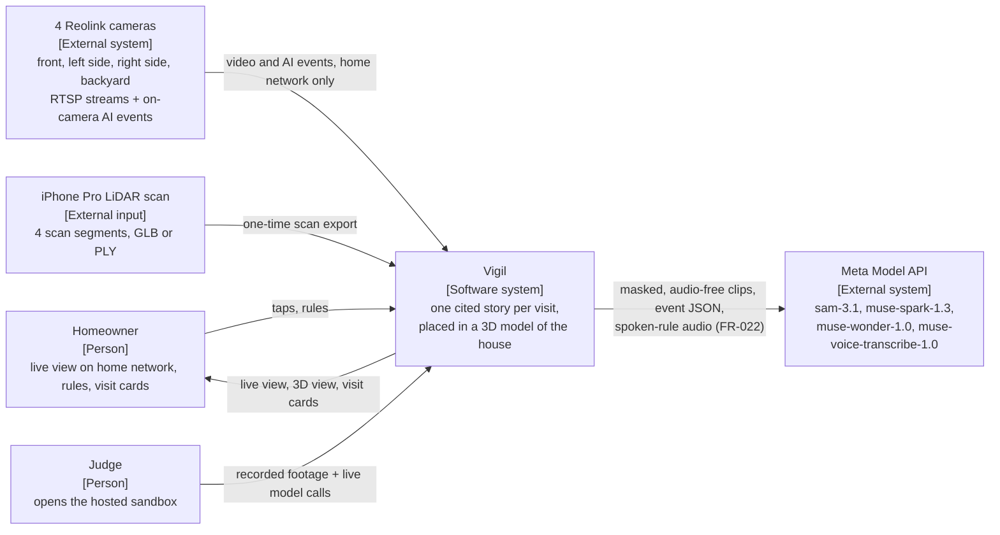

### 5.2 C4 level 2: containers

The home PC runs capture, Reolink events, the pipeline and the LAN app. The hosted sandbox runs the same `vigil` package on an exported bundle, makes only 4 kinds of live call (protect, transcribe voice, compile rule, re-run story), and never connects to the house.


### 5.3 C4 level 3: components of the `vigil` package

Each box is one file in section 9. All model calls go through `meta/client.py`, which owns retries, caching and the spend ledger.

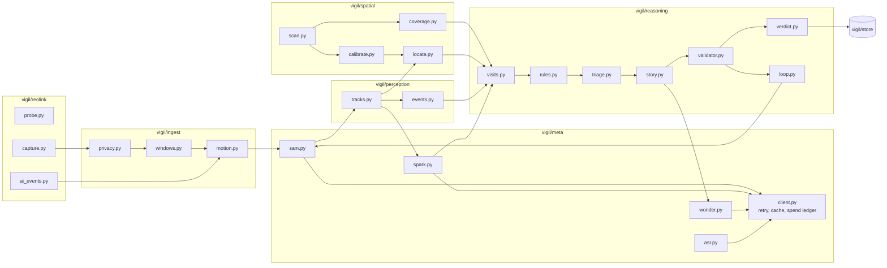

### 5.4 Sequence: processing one window

The motion gate decides whether any model is called; SAM 3.1 takes one noun phrase per request, so `person`, `car` and each watch are separate calls on one uploaded file.

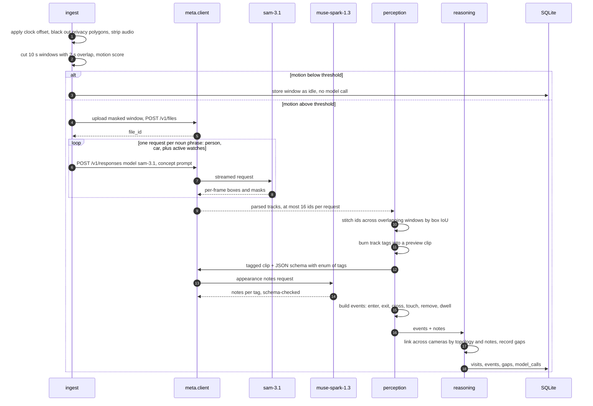

### 5.5 Sequence: story, validation and verdict

Wonder writes; code checks and decides. Gap sentences never come from the model.

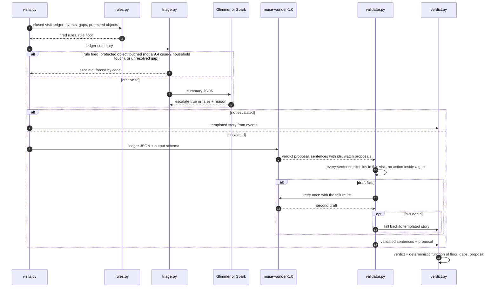

### 5.6 Sequence: tap-to-protect and voice rule

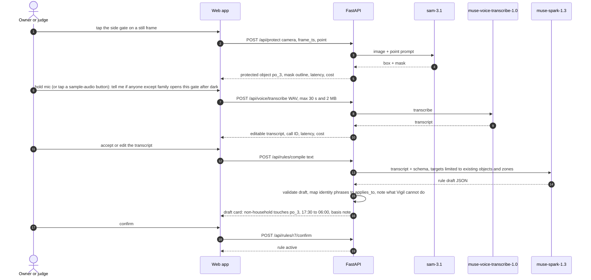

### 5.7 Sequence: the closed loop (Wonder steers SAM 3.1)

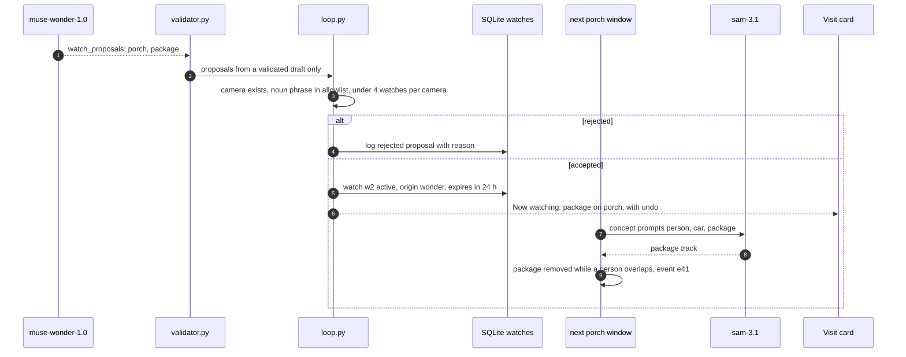

### 5.8 Data flow and AI inference pipeline, with the privacy boundary

Wonder never sees pixels; it reasons over the event ledger, which is also what makes its claims checkable.

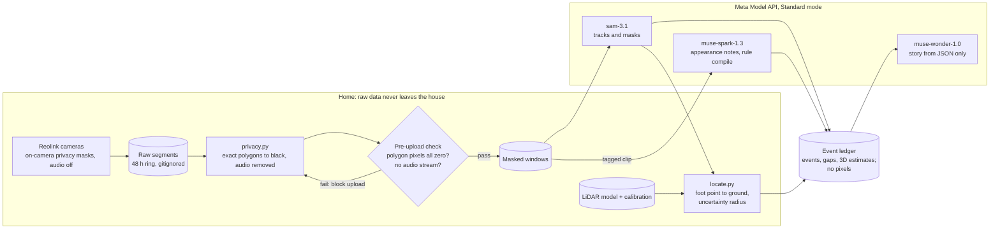

### 5.9 State machine: visit lifecycle

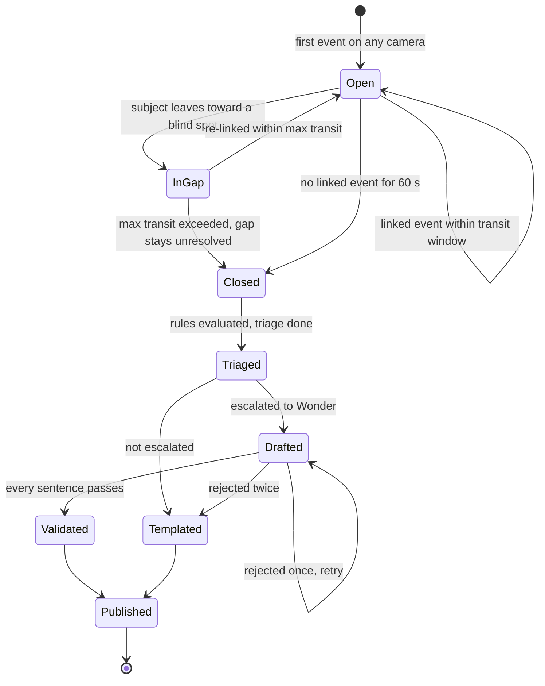

### 5.10 State machines: rules and watches

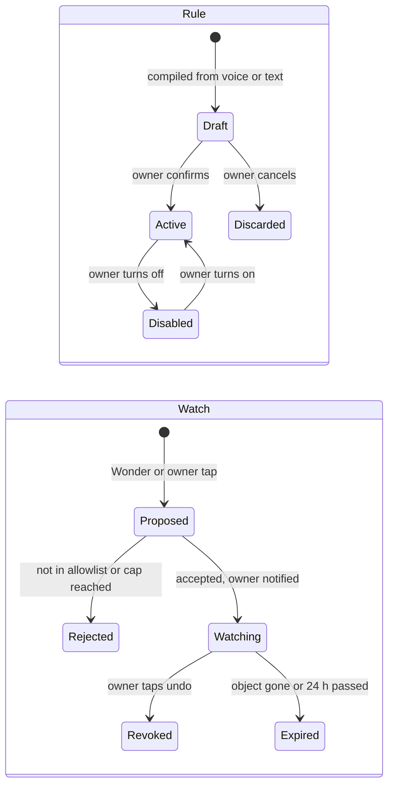

### 5.11 Deployment

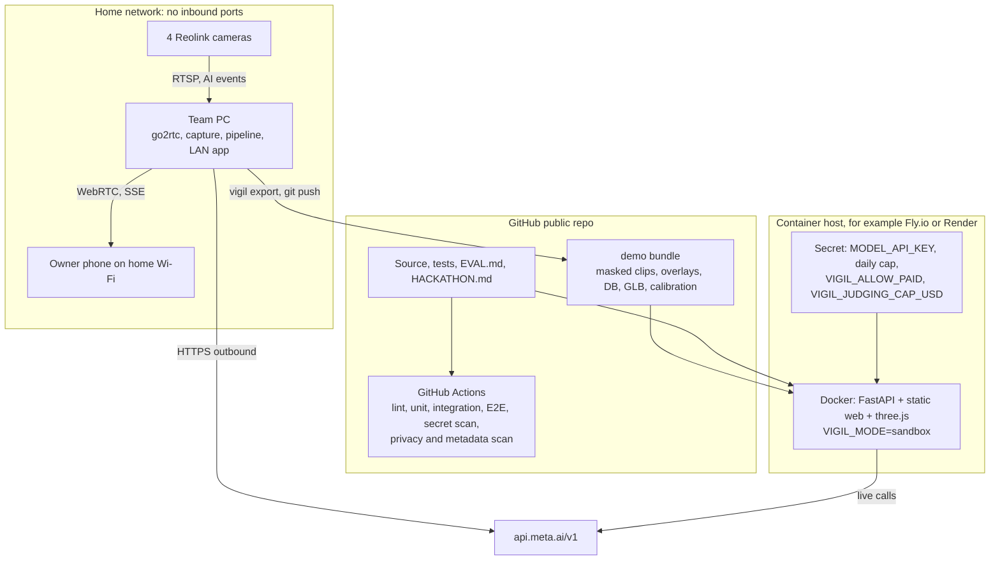

### 5.12 Spatial build and calibration pipeline

Every gate has a measured acceptance value and a fallback, so a weak scan or calibration lowers accuracy, never the demo.

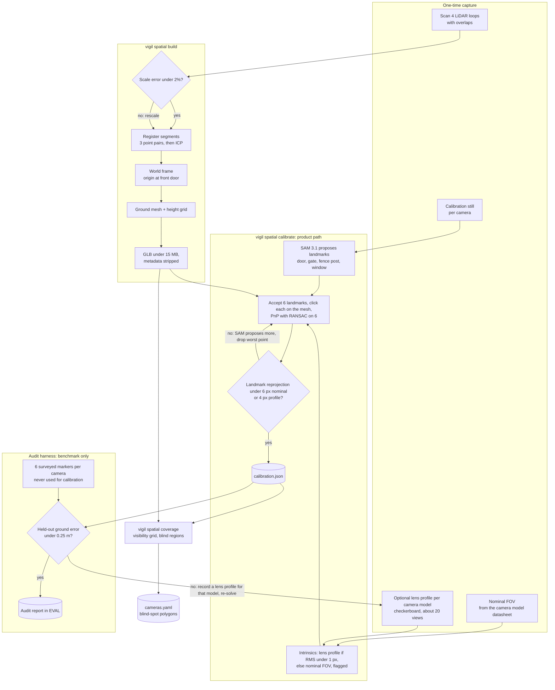

### 5.13 Sequence: live near-real-time mode at home

The Reolink event reaches the 3D view first, with no position; SAM 3.1 tracks and 3D estimates follow when the segment closes and is processed. The lag is measured and shown on screen.

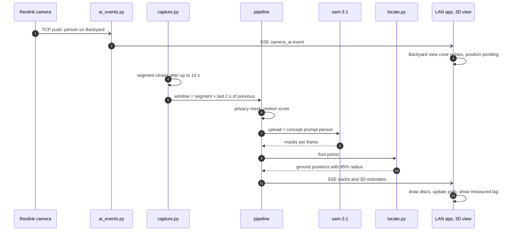

### 5.14 Verified Meta API facts this design depends on

| Fact | Design consequence | Source |
| --- | --- | --- |
| SAM 3.1 is called on `POST /v1/responses` with model `sam-3.1`; video by `file_id` from `POST /v1/files` | Upload each window once, reuse the `file_id` for every noun phrase | [Segmenting with prompts](https://dev.meta.ai/docs/sam/segmenting) |
| A concept prompt is one noun phrase; comma lists return zero matches | One request per class or watch | same |
| Video tracks up to 16 objects; up to 15,000 frames per request; MP4 or MOV, H.264/H.265 | 10 s windows at 10 fps; split a window when 16 IDs are used | same |
| Point and box prompts exist, with `w` and `h` matching the media's aspect ratio | Tap-to-protect sends a point prompt with the still's exact size | same |
| `include_confidence` must be the string `"true"`; parsers `meta-sam-parser` 0.0.6+ / `@meta-sam/parser` 0.0.13+ read it | Pin parser versions | same; [meta-sam](https://github.com/meta-models/meta-sam) |
| SAM 3.1 video: $0.20 per 1,000 frames, minimum 50 per request; Spark 1.3 $1.25/$4.25 and Wonder $4/$20 per million tokens; Voice Transcribe $0.18 per hour | One 10 s window and one phrase costs about $0.02 | [Pricing and rate limits](https://dev.meta.ai/docs/pricing-rate-limits) |
| Standard mode: content not used for training; Contributor mode is | Never use `-contributor` IDs (NFR-004) | same |
| Rate limits: 3,000 RPM for Spark, Wonder and SAM | Not a constraint at demo scale | same |

⚠️ Not yet verified; check today with a one-call smoke test each: (1) whether `muse-wonder-1.0` accepts a strict JSON schema; if not, use JSON mode plus the validator, which already handles malformed output; (2) the exact request fields of Voice Transcribe's batch endpoint (`POST /v1/asr/transcribe` is named in [a secondary source](https://www.orcarouter.ai/blog/muse-api)). If batch is unavailable, call the realtime WebSocket from the server. If neither works by T-03, FR-022 is reported as missed: the 3 fixture buttons ship on cached transcripts, typing remains, and the README says so; (3) Muse Spark 1.3 video input with a strict schema, which [Guestlist](https://github.com/DanielSensual/guestlist) reports using.

## 6. Reolink integration (real-world environment)

Vigil runs on the 4 home Reolink cameras (front entrance, left side, right side, backyard) through a home edge service. It records continuously in 10 s segments and uses Reolink's on-camera person and vehicle detection as the instant trigger. SAM 3.1 then adds masks and tracks seconds to tens of seconds later. That is **near-real-time**, and the README and video must say so. The "real-time" claim applies only to the camera's own AI events.

### Hardware compatibility (check first: `scripts/reolink_probe.py`)

| Camera type | Continuous stream | On-camera AI events | Fit for Vigil |
| --- | --- | --- | --- |
| PoE or plug-in Wi-Fi cameras | Yes: `rtsp://user:pass@IP:554/Preview_01_main` and `Preview_01_sub` | Yes | Full support |
| Cameras on a Reolink NVR | Yes, per channel: `Preview_0N_main` | Yes, through the NVR | Full support |
| Battery cameras (Argus, Altas) | Only through a Home Hub or NVR, and the preview drops after 5 min | Through Hub or NVR | Event clips only; not continuous |
| LTE cameras (Go series) | Not supported by the Home Assistant integration | No | Not usable |
| Any camera bound to a Reolink cloud account | Local login unavailable until switched to local | No | Switch to local first |

Sources: [Reolink RTSP introduction](https://support.reolink.com/hc/en-us/articles/900000630706-Introduction-to-RTSP/), [Home Assistant Reolink integration](https://www.home-assistant.io/integrations/reolink/). **Open item:** the 4 camera models, and whether an NVR is in use. A battery camera on any side changes that side to event clips only.

### Streams

- **Main stream** (up to 4K H.265 on some models; RTSP is the only protocol that carries 4K): used for processing; re-encoded to 1280 px H.264 at 10 fps for SAM 3.1.
- **Sub stream** (H.264, low resolution): used for the motion gate and live view.
- **FLV** is the lightest protocol on the camera, and the fallback if RTSP connections drop (per the Home Assistant page).
- Browsers cannot play RTSP, so the LAN app uses an open-source restreamer such as go2rtc (WebRTC or MSE). It also keeps one connection per camera, which reduces camera load. ⚠️ Check go2rtc's licence and set it up on day 1.

### Detection layers (never mixed in the UI)

| Layer | Source | Latency | What it gives | Shown as |
| --- | --- | --- | --- | --- |
| Camera AI event | Reolink on-camera AI through [reolink\_aio](https://pypi.org/project/reolink_aio/) TCP push (MIT) | ⚠️ seconds; measure on day 1 | Person or vehicle present on camera X; no box, no position | The camera's view cone pulses; badge "Reolink AI: person" |
| Segmentation and tracks | SAM 3.1 on 10 s windows | ⚠️ target 30 s behind live; measured | Masks, boxes, track IDs per frame | Outlines on the video |
| 3D estimate | Vigil code: foot point projected onto the LiDAR ground (section 7) | Adds milliseconds | Position with an uncertainty radius | Translucent disc in the 3D view |
| Story and verdict | Spark, Wonder, validator, rules | After the visit closes | Cited story and verdict | Visit card |

Reolink's events also give a free cross-check: the share of Reolink person events matched by a SAM person track is reported in EVAL, and so are the mismatches.

### Near-real-time pipeline on the edge machine

1. The restreamer holds one connection per camera.
2. ffmpeg records the main stream into contiguous 10 s segments, audio removed. A processing window is a segment plus the last 2 s of the one before, giving the 2 s overlap that track stitching needs (FR-007).
3. A window is processed when a Reolink AI event overlaps it or the motion gate fires.
4. Privacy polygons are applied when the window is built (FR-003), then the normal pipeline runs.
5. New events, tracks and 3D estimates are pushed to the LAN app over server-sent events.
6. Raw segments are deleted after 48 h; only masked windows chosen for the demo are kept.

### Security and privacy for real cameras

- **Two privacy layers.** On-camera privacy masks (rectangles) over the street and neighbouring properties apply to live view and recordings ([Reolink](https://support.reolink.com/hc/en-us/articles/360003493454--How-to-Set-up-Privacy-Mask-for-Reolink-Cameras)). ⚠️ Confirm in VLC that the RTSP stream carries the mask. Vigil's exact polygons (FR-003) remain the second layer. The side cameras are the most likely to see neighbours.
- **Audio off** on the cameras for the hackathon period, and removed again by ffmpeg.
- **Credentials** only in `.env` on the edge machine; a unique password; a low-privilege user if the model supports user roles (⚠️ check).
- **No exposure.** No port forwarding and no public RTSP; remote access only through a private VPN; the hosted sandbox never connects to the house.
- **No address leakage.** Strip GPS metadata from scan exports; mask the house number; no street-facing frames in the repo.

### What judges get versus what the video shows

- **Judges** get the hosted sandbox: real Reolink footage replayed in the 3D model, with cached results and live model calls. It never connects to the house.
- **The video** shows the live LAN mode at home: the Reolink event pulses at once, and SAM tracks and 3D positions follow, with the measured lag shown on screen.

## 7. Spatial model: LiDAR scan, calibration and 3D viewer

An iPhone LiDAR scan gives the house a metric 3D model. Each camera is calibrated into it, so every SAM 3.1 detection can be projected to a ground position with a stated uncertainty. The viewer always separates what a camera saw from where Vigil estimates someone stood. This also places Vigil in the "Push the Frontier" theme (understanding a physical space), alongside "Build for Your World".

### Scan capture

- **Device:** an iPhone Pro with LiDAR. **App:** Scaniverse (free; exports GLB, OBJ, PLY and LAS, among others ([review](https://www.structuralbasics.com/?p=3713))). ⚠️ Confirm the export keeps metric scale by measuring 2 known distances.
- **Known limits:** about 5 m range and good local precision (about 0.5 cm on flat surfaces), but drift grows on large or complex walks. In one study only two rooms (about 200 m²) stayed consistent ([ISPRS 2022](https://isprs-archives.copernicus.org/articles/XLIII-B4-2022/303/2022/isprs-archives-XLIII-B4-2022-303-2022.pdf)). Roofs and upper floors will be missing; ground, walls, fences and the shed are what matter.
- **Method:** place the audit markers first (6 per camera, surveyed; benchmark only), then scan 4 short closed loops (front, left side, right side, backyard). Each loop overlaps its neighbour by at least 3 fixed features (corners, posts, steps). Scan in shade or late afternoon ⚠️, walk slowly, and keep the phone 1 to 3 m from surfaces.

### Processing: `vigil spatial build`

1. Load the 4 segments (Open3D). Check scale against 2 tape-measured distances; accept under 2% error, otherwise rescale.
2. Register the segments: coarse alignment from 3 clicked point pairs, then ICP refinement; record the fit error.
3. Build the world frame: origin at the front-door threshold (a scanned landmark), +X along the front wall, +Y up (glTF convention).
4. Extract the ground: keep the ground mesh as the ray-cast target, and a 0.1 m height grid for fast lookup (yards slope).
5. Simplify and compress the mesh to a GLB under 15 MB, downscale textures, and strip GPS and device metadata.

### Camera calibration
Two separate protocols. The **product path** is what a homeowner does. The **audit harness** is how the benchmark proves the product path's accuracy. The demo never claims an accuracy figure that the audit harness has not measured.

| Step | Product path (every home) | Accept when | Fallback |
| --- | --- | --- | --- |
| Intrinsics | **Nominal FOV** from the camera model's datasheet: focal length from the horizontal FOV at 1280 px, centred principal point, no distortion, flagged `fov_nominal`. If a **lens profile** exists for the model (one checkerboard session of about 20 views on any unit of that model), use it instead | Profile RMS under 1.0 px; nominal FOV is always accepted, but flagged | Nominal FOV |
| Extrinsics | **SAM 3.1-assisted landmarks:** SAM proposes fixed-landmark masks on the camera still (`door`, `gate`, `fence post`, `window`, then mask corners); the installer accepts 6 points and clicks each once on the mesh; PnP with RANSAC on the 6 | Landmark reprojection under 6 px (nominal FOV) or under 4 px (lens profile) at 1280 px | Planar homography from 4 or more ground-level landmarks if the mesh is unusable |
| Record | `config/calibration.json`: camera matrix, distortion, model, `intrinsics_source` (`fov_nominal` or `lens_profile`), rotation, translation, image size, landmark error, audit errors (when measured), date | Loads and passes `test_calibrate.py` | none |

| Audit harness (benchmark only) | Method | Target |
| --- | --- | --- |
| Held-out ground error (NFR-024) | 6 surveyed markers per camera, tape-measured into the world frame and never used for calibration; their projections are compared with their surveyed positions | Under 0.25 m |
| Position accuracy and r95 honesty (NFR-025, NFR-026) | A person stands on the same 6 markers; locate() estimates are compared with the surveyed positions | ⚠️ Median under 0.5 m within 10 m of the camera; at least 90% inside the stated r95 |
| Scale (FR-035) | 2 tape-measured distances | Under 2% |

**Expected accuracy trade-off.** Reolink lenses are wide (about 80° to 110° horizontal). With nominal-FOV intrinsics and no distortion model, image-edge error grows. r95 must widen accordingly: `locate()` adds the camera's audit-harness error where it was measured (otherwise its landmark reprojection error, which is all a product home has), and adds a per-pixel radial term when `intrinsics_source = fov_nominal`, so stated radii stay truthful (NFR-026) even where they are larger. If the audit shows a camera misses NFR-024, record a lens profile for that model (about 15 minutes, once per model) and re-solve. The "±0.4 m" label in the demo is used only where the audit measured it.

Re-calibrate a camera if it is moved; `vigil spatial check` compares a reference still against the current view (P2).

### From detection to 3D position

1. **Foot point:** the median x and maximum y of the lowest 5% of the SAM mask's pixels, undistorted.
2. **Ray cast:** cast a ray from the camera centre through the foot point and intersect it with the ground mesh.
3. **Occlusion:** if the mask touches the image's bottom edge or is clipped, the feet are hidden. Use the top of the mask with a 1.7 ± 0.15 m height prior instead, and flag the estimate as low confidence.
4. **Uncertainty:** sample the foot pixel 50 times with 3 px noise, plus the camera's audit-harness error where measured (otherwise its landmark reprojection error), plus a per-pixel radial term when `intrinsics_source = fov_nominal`. Re-cast each sample and report the 95% radius.
5. **Smoothing:** positions at 2 Hz with a 1 s median filter. Nothing is ever interpolated across a gap.
6. **Two cameras:** when linked tracks overlap in time, take the inverse-variance weighted mean. If the two estimates are more than 1 m apart, keep both and flag them as inconsistent.
7. **Accuracy test:** a person stands on 6 surveyed markers per camera that were not used for calibration. ⚠️ The target (median error under 0.5 m within 10 m of the camera) is pre-registered in EVAL.md before measuring.

### Coverage map and blind spots

On a 0.25 m ground grid, a cell counts as visible to a camera when it projects inside the image, is outside every privacy polygon, and has a clear line of sight (mesh ray cast). Cells no camera sees form the blind regions, such as "behind the shed". They are written to `cameras.yaml` as blind-spot polygons, so the topology and gap logic (FR-010, FR-011) come from measured geometry instead of guesses.

### 3D viewer (`web/twin/`)

- three.js with the GLTF loader and orbit controls, version pinned and vendored. Layers: mesh, per-camera coverage, blind regions (hatched grey), camera view cones.
- One timeline is shared by the 3D view, the video players and the visit card. Clicking a disc opens its evidence frame; clicking a citation moves the 3D view to that moment.
- Targets: 60 fps on a laptop and at least 30 fps on a mid-range phone, with the GLB loaded in under 5 s on 50 Mbps.

**Visual encoding: seen versus estimated** (legend always visible; text plus shape, never colour alone)

| What | Meaning | Shown as |
| --- | --- | --- |
| Camera AI event | Reolink says someone is on camera X; no position | The camera's view cone pulses; label "Presence on camera, position pending" |
| Camera detection | SAM 3.1 mask in that camera's image | Outline on the video; matching camera cone highlighted |
| Estimated position | Ray-cast estimate | Translucent disc, dashed edge, radius = uncertainty; label "Estimated ±\<r95> m from Side camera" |
| Estimate from 2 cameras | Fused estimate | Double ring; label "Estimated from 2 cameras ±\<r95> m" |
| Low-confidence estimate | Height-prior fallback | Hollow disc; label "Low confidence" |
| Observed path | Estimates no more than 1 s apart | Solid line |
| Gap | No camera sees the subject | Dotted grey straight line, labelled "Not observed · 41 s"; no positions drawn inside it |

### Fallback ladder for the 3D model

1. All 4 scan segments registered into one mesh.
2. Segments kept separate, each aligned to a tape-measured site plan.
3. No usable scan: a site plan built from tape measurements (house footprint, fences, shed as boxes). Calibration uses the ground plane and homographies, so positions still work on flat ground. The demo survives at every level.

## 8. Optional: Wi-Fi sensing beyond the cameras

**Recommendation: leave Wi-Fi sensing out of the hackathon submission, and run one small experiment after Nov 4.** It uses no Meta model, so it adds nothing to the 25% tooling criterion. It cannot be shown to judges remotely, and it needs at least a day of placement and tuning. It also raises an indoor-occupant privacy question that the current design avoids.

### Projects evaluated

| Project | Hardware | What it senses | Evidence of accuracy | Integration effort | Verdict |
| --- | --- | --- | --- | --- | --- |
| [ESPectre](https://github.com/francescopace/espectre) | One ESP32 board per room (C6, C5, C3, S3, S2 or classic), 2.4 GHz Wi-Fi 4 | Motion and a movement score. It does not identify or count people, and does not prove a room is empty | No figures on the README; a separate performance report exists (not reviewed) | Low to medium: browser flashing; MQTT, Home Assistant, Matter or a local HTTP API | **Best candidate** for a later experiment |
| [Espressif ESP-CSI](https://github.com/espressif/esp-csi) | ESP32 family; 1 board with a router, 3+ boards, or a dedicated sender | Raw CSI; presence and motion demo with on-site training | No figures published; the dedicated-sender setup is described as most accurate | Medium to high: building blocks, not a product | Use only if ESPectre falls short |
| [Nexmon CSI](https://github.com/seemoo-lab/nexmon_csi) | Raspberry Pi 3B+, 4B or 5 (bcm43455c0), some phones, one Asus router | Raw per-frame CSI; no presence detection | None for presence | High: patched firmware and drivers tied to kernel versions | Research only; reject |
| RuView ("WiFi DensePose") | 3 to 6 ESP32-S3 nodes | Claims pose, breathing, heart rate, through-wall presence | Claims unverified; an independent developer reported placeholder random data in earlier code ([CNX Software](https://www.cnx-software.com/2026/03/26/ruview-project-leverages-esp32-nodes-for-presence-detection-pose-estimation-and-breathing-heart-rate-monitoring/)) | Unclear | **Reject** |

Consumer routers generally do not expose CSI; commercial Wi-Fi motion products were not evaluated (⚠️ not researched).

### Where it would genuinely add value

Vigil's cameras are outdoors, and Wi-Fi sensing works best indoors. The useful overlap is enclosed spaces next to the yard that no camera sees: the shed and the garage. In scenario C, a sensor in the shed could add one fact to the 41 s gap: "Motion was detected inside the shed during this time." That is still motion, not a person, and the story must say exactly that.

### If the experiment goes ahead (after Nov 4)

1. Two ESPectre boards: shed and garage. Confirm 2.4 GHz coverage from the router at both spots first.
2. Vigil subscribes over MQTT and stores `radio_motion` events with a source badge "Wi-Fi motion (not a camera)".
3. These events can annotate a gap; they never raise a verdict on their own.
4. Measure for one week against camera-confirmed entries into the shed: hits, misses, false alarms. Publish the numbers before relying on the signal.
5. **Privacy:** sensors only in outbuildings, never in living spaces; household members told and agree; raw CSI collection off. ESPectre's firmware is GPLv3, which is fine because Vigil only talks to it over MQTT as a separate program.

## 9. Engineering implementation plan

One Python package (`vigil`) and one static web app, built in the order of the task table below, with every task closed by a named test. The task table assumes 2 or more people on parallel tracks. If one person builds alone, T-25 and the baseline (FR-025) become optional, and the gates in the table decide the cuts.

### 9.1 Repository structure

```text
vigil/
├── README.md            value line, video, sandbox link, EVAL table, model table
├── HACKATHON.md         dates, commit range, prior work, contributors, consent record
├── EVAL.md              targets committed first, results appended after
├── Makefile             setup, test, e2e, demo, eval, export, deploy
├── pyproject.toml  Dockerfile  .env.example
├── config/
│   ├── cameras.yaml     cameras, stream paths, offsets, zones, lines, blind regions, topology
│   ├── calibration.json intrinsics, extrinsics, errors per camera
│   ├── privacy/<cam>.json
│   ├── rules.default.json
│   ├── role_phrases.json  role_banned_words.json   validator check 7
│   ├── audio_fixtures.json   SHA-256 of the 3 voice fixtures (NFR-002)
│   └── allowlist.json   watch noun phrases
├── infra/go2rtc.yaml    restreamer config (credentials from env)
├── vigil/
│   ├── settings.py  cli.py
│   ├── reolink/     probe.py  capture.py  ai_events.py
│   ├── ingest/      sync.py  privacy.py  windows.py  motion.py
│   ├── meta/        client.py  budget.py  cache.py  sam.py  sam_local.py  spark.py  wonder.py  asr.py  glimmer.py  prompts/
│   ├── perception/  tracks.py  events.py  overlays.py
│   ├── spatial/     scan.py  calibrate.py  coverage.py  locate.py
│   ├── reasoning/   topology.py  visits.py  rules.py  triage.py  story.py
│   │                validator.py  verdict.py  loop.py  templates.py
│   ├── store/       schema.sql  db.py  export.py
│   ├── api/         app.py  routes.py  live.py  guards.py
│   └── eval/        run.py  metrics.py  baseline.py  spatial_eval.py
├── web/
│   ├── index.html  app.js  cards.js  player.js  styles.css
│   ├── twin/        viewer.js  layers.js  legend.js  vendor/three/
│   └── calibrate/   index.html  calibrate.js   (LAN only)
├── eval/labels/<scenario>.json   eval/results.json
├── demo/                masked clips, overlays, exported DB, GLB, calibration
│   └── voice/           3 consented WAV fixtures + cached transcripts (FR-022)
├── data/                raw segments, scans, landmark stills, audit-marker survey, optional lens-profile frames (gitignored)
├── scripts/             smoke_meta.py  gpu_probe.py  bench_sam_local.py  privacy_scan.py  metadata_scan.sh
├── tests/               unit/  integration/  e2e/  fixtures/
└── .github/workflows/ci.yml
```

### 9.2 Dependencies (pin exact versions in `pyproject.toml` on day 1)

| Area | Choice | Why |
| --- | --- | --- |
| Runtime | Python 3.12, ffmpeg | `reolink_aio` needs 3.11+ |
| Web | FastAPI, uvicorn, sse-starlette, pydantic 2 | Typed contracts, server-sent events |
| HTTP | httpx | Streaming responses from Meta |
| Video and vision | opencv-python-headless, numpy | Masking, motion, calibration, PnP |
| SAM output | `meta-sam-parser` 0.0.6 or later | Reads masks and confidence |
| Cameras | `reolink-aio` (MIT), go2rtc binary | TCP push events; restreaming |
| 3D | Open3D (registration, ray casting), gltf-transform CLI (compression) | Proven, scriptable |
| Front end | three.js (vendored, pinned), plain JS, no build step | Fewer moving parts |
| CLI | typer | `vigil ingest`, `process`, `spatial`, `eval`, `export` |
| Tests | pytest, respx, hypothesis, Playwright (Python), ruff | Unit, recorded HTTP, property tests, E2E |
| CI scans | gitleaks, exiftool, `scripts/privacy_scan.py` | NFR-001, NFR-014, NFR-032 |

### 9.3 Data model (`vigil/store/schema.sql`)

```sql
CREATE TABLE cameras(id TEXT PRIMARY KEY, name TEXT, width INT, height INT, offset_s REAL);
CREATE TABLE windows(id TEXT PRIMARY KEY, camera_id TEXT, t0 REAL, t1 REAL, path TEXT,
  file_id TEXT, motion REAL, trigger TEXT, status TEXT);
CREATE TABLE camera_ai_events(id TEXT PRIMARY KEY, camera_id TEXT, kind TEXT, t0 REAL, t1 REAL);
CREATE TABLE tracks(id TEXT PRIMARY KEY, camera_id TEXT, cls TEXT, t_first REAL, t_last REAL,
  origin_zone TEXT, overlay_path TEXT);
CREATE TABLE subjects(id TEXT PRIMARY KEY, visit_id TEXT, track_ids_json TEXT,
  actor_role TEXT CHECK(actor_role IN ('household_insider','expected_visitor','external_visitor','unknown')),
  role_basis TEXT);
CREATE TABLE track_windows(track_id TEXT, window_id TEXT, sam_obj_id INT);
CREATE TABLE appearance(track_id TEXT PRIMARY KEY, notes_json TEXT, call_id TEXT);
CREATE TABLE positions(track_id TEXT, t REAL, x REAL, y REAL, z REAL, r95 REAL,
  method TEXT CHECK(method IN ('footpoint','height_prior','fused')), cameras TEXT, flags TEXT);
CREATE TABLE protected_objects(id TEXT PRIMARY KEY, camera_id TEXT, label TEXT, mask_path TEXT,
  bbox_json TEXT, footprint_json TEXT, call_id TEXT, created_at TEXT);
CREATE TABLE watches(id TEXT PRIMARY KEY, camera_id TEXT, phrase TEXT, origin TEXT, status TEXT,
  expires_at TEXT, source_visit_id TEXT);
CREATE TABLE events(id TEXT PRIMARY KEY, visit_id TEXT, camera_id TEXT, track_id TEXT, subject_id TEXT,
  type TEXT, t0 REAL, t1 REAL, target TEXT, actor_role TEXT, clip_t0 REAL, clip_t1 REAL);
CREATE TABLE expected_windows(id TEXT PRIMARY KEY, label TEXT, starts_at TEXT, ends_at TEXT,
  cameras_json TEXT, zones_json TEXT,
  state TEXT CHECK(state IN ('scheduled','active','expired','cancelled')), created_at TEXT);
CREATE TABLE checkins(id TEXT PRIMARY KEY, session_id TEXT, starts_at TEXT, expires_at TEXT,
  bound_subject TEXT, revoked INT);
CREATE TABLE visits(id TEXT PRIMARY KEY, scenario TEXT, t0 REAL, t1 REAL, state TEXT, floor TEXT,
  proposal TEXT, verdict TEXT, escalated INT, story_json TEXT);
CREATE TABLE gaps(id TEXT PRIMARY KEY, visit_id TEXT, kind TEXT, t0 REAL, t1 REAL,
  from_camera TEXT, to_camera TEXT, region_id TEXT, resolved INT);
CREATE TABLE rules(id TEXT PRIMARY KEY, json TEXT,
  applies_to TEXT CHECK(applies_to IN ('anyone','external_visitor_only','non_household')),
  source TEXT, state TEXT, created_at TEXT);
CREATE TABLE rule_hits(rule_id TEXT, visit_id TEXT, event_id TEXT);
CREATE TABLE model_calls(id TEXT PRIMARY KEY, model TEXT, purpose TEXT, visit_id TEXT, req_hash TEXT,
  latency_ms INT, in_tokens INT, out_tokens INT, units REAL, cost_usd REAL, cached INT, ok INT,
  error TEXT, backend TEXT, gpu_s REAL, feature TEXT,
  funding TEXT CHECK(funding IN ('credit','paid')), created_at TEXT);
CREATE TABLE validations(visit_id TEXT, attempt INT, passed INT, failures_json TEXT);
```

Times are seconds on the aligned session clock; wall-clock time is derived from the session start for display. Expected windows and check-ins are stored in wall-clock ISO-8601 with the camera timezone, because they are set before the session clock exists.

### 9.4 Contracts

**`config/cameras.yaml` (excerpt)** — zones now carry a `kind`, which drives FR-008 origin tagging:

```yaml
timezone: America/Los_Angeles
cameras:
  - id: front
    name: Front entrance
    zones:
      front_door_egress: {kind: egress,    polygon: [[560, 300], [700, 300], [700, 560], [560, 560]]}
      porch:             {kind: interior_yard, polygon: [[420, 380], [860, 380], [860, 720], [420, 720]]}
      driveway_entry:    {kind: perimeter, polygon: [[0, 300], [180, 300], [180, 720], [0, 720]]}
  - id: side_left
    name: Left side
    zones:
      side_alley: {kind: perimeter, polygon: [[200, 300], [420, 300], [420, 720], [200, 720]]}
    lines: {side_gate: [[812, 410], [870, 655]]}
    exits: {to_shed_back: [[1100, 380], [1280, 380], [1280, 720], [1100, 720]]}
  - id: backyard
    name: Backyard
    zones:
      back_door_egress: {kind: egress, polygon: [[600, 260], [760, 260], [760, 520], [600, 520]]}
blind_regions:
  - {id: shed_back, name: behind the shed, polygon_m: [[4.1, 9.0], [7.3, 9.0], [7.3, 11.2], [4.1, 11.2]]}
topology:
  - {from: side_left, exit: to_shed_back, to: shed_back, blind: true}
  - {from: shed_back, to: side_left, min_s: 5, max_s: 180, blind: true}
  - {from: front, to: side_left, min_s: 2, max_s: 20}
```

Zone `kind`s are `egress` (a door of the house itself), `perimeter` (where outsiders enter: street, driveway entry, side alley) and `interior_yard` (everything else). A plain polygon list is still accepted as `interior_yard`. A garage door, or any opening an outsider can reach without first appearing on a camera, is `interior_yard`, never `egress`.

**Rule**

```json
{"id": "r7", "name": "Side gate after dark",
 "target": {"kind": "protected_object", "id": "po_side_gate"},
 "trigger": "touch", "min_dwell_s": null,
 "active": {"start": "17:30", "end": "06:00"},
 "severity": "needs_attention", "applies_to": "non_household", "state": "active"}
```

`applies_to` is one of `anyone`, `external_visitor_only`, `non_household` (default `anyone`). Which roles each one fires on — `unknown` always fails closed:

| `applies_to` \ `actor_role` | `household_insider` | `expected_visitor` | `external_visitor` | `unknown` |
| --- | --- | --- | --- | --- |
| `anyone` | fires | fires | fires | fires |
| `non_household` | — | fires | fires | fires |
| `external_visitor_only` | — | — | fires | fires |

**Role, window and event additions**

```json
{"event": {"id": "e7c1a2b3d4", "type": "touch", "camera_id": "side_left", "track_id": "side_left-person-1",
           "target": "po_side_gate", "actor_role": "external_visitor"},
 "track": {"id": "side_left-person-1", "origin_zone": "side_alley"},
 "subject": {"id": "s1", "track_ids": ["side_left-person-1", "side_left-person-2"],
             "actor_role": "external_visitor", "role_basis": "perimeter:side_alley"},
 "expected_window": {"id": "w3", "label": "deliveries", "start": "2026-11-03T13:00:00-08:00",
                     "end": "2026-11-03T17:00:00-08:00", "cameras": ["front"], "state": "active"},
 "checkin": {"id": "c1", "by": "owner_session", "start": "...", "expires": "... +30 min", "bound_subject": "s4"}}
```

`actor_role` is one of `household_insider`, `expected_visitor`, `external_visitor`, `unknown`. `role_basis` is one of `egress:<zone>`, `checkin:<id>`, `window:<id>`, `perimeter:<zone>`, `group:<role>`, `gap_unresolved:<gap_id>`, `ambiguous_link:<track_id>`, `origin_null:<track_id>`. A check-in's `bound_subject` is `null` until it binds a chain. Rules and roles never use a face, voice or body template: no person-related schema (appearance, tracks, subjects, events, positions) has any field NFR-003 bans (face, age, gender, skin, ethnicity, height, gait, body-measurement, voice-feature or name). Camera and object metadata such as `cameras.name` are not about people.

**Appearance notes** (Spark, strict schema; `tag` is an enum of the burned-in track tags; colours are a fixed list plus `unknown`)

```json
{"tracks": [{"tag": "T3", "class": "person", "upper_color": "navy", "lower_color": "grey",
  "carrying": ["backpack"], "vehicle_color": null, "vehicle_body": null}]}
```

**Story** (Wonder; `verdict_proposal` can only be normal or noteworthy; gap sentences are inserted by code)

```json
{"verdict_proposal": "noteworthy",
 "sentences": [{"text": "A person touched the side gate at 6:14 PM.", "event_ids": ["e17"]}],
 "gap_after_sentence": [{"gap_id": "g4", "after": 0}],
 "watch_proposals": [{"camera_id": "front", "phrase": "package", "reason_event_id": "e9"}]}
```

**Verdict function.** `compose()` is unchanged. Roles act earlier, when the floor is set:

```python
ORDER = {"normal": 0, "noteworthy": 1, "needs_attention": 2}

def compose(floor: str, unresolved_gap: bool, proposal: str | None, proposal_cited: bool) -> str:
    if floor == "needs_attention":          # only rules can set this
        return "needs_attention"
    if unresolved_gap:                      # no rule fired, subject vanished
        return "cant_confirm"
    if proposal == "noteworthy" and proposal_cited:
        return max(floor, "noteworthy", key=ORDER.get)
    return floor                            # Wonder can never lower the floor
```

How a protected-object event (`touch` or `removed`) sets the floor. A rule is *in force* for an event when its state is `active` and the event time is inside its time window.
1. A rule in force whose `applies_to` covers the event's `actor_role` fires: its severity sets the floor.
2. Rules are in force on the object, every one of them excludes the actor's role, and the role is `household_insider`: the floor stays **normal**, because the owner scoped the rule.
3. Otherwise (no rule in force on the object, or a rule in force excludes an `expected_visitor`): the floor is **noteworthy**.

The visit floor is the maximum over all its events.

**Validator checks** (`validator.py`; any failure rejects the draft)

1. Schema valid; 1 to 6 sentences.
2. Every sentence cites at least 1 event, and every cited event belongs to this visit.
3. Every clock time in a sentence is within 60 s of a cited event and outside every gap.
4. Every camera name in a sentence belongs to a cited event.
5. No banned words: gender, age, ethnicity, or judgements such as "suspicious", "intruder" or "thief". The subject is always "a person", "they", or a phrase from the role phrase list (check 7).
6. Every `gap_id` exists in this visit.
7. Role claims are backed by the ledger. `config/role_phrases.json` maps each allowed phrase to one role: "someone who came out of the house" → `household_insider` with basis `egress:<zone>` only (check-in and group subjects get no role phrase); "an expected visitor" → `expected_visitor`; "someone who arrived from outside the property" → `external_visitor`. `unknown` has no phrase. Matching is case-insensitive on whole words. A sentence containing a role phrase must cite at least one event, and every event it cites must belong to a subject holding the mapped role; a sentence about subjects with different roles fails. After the allowed phrases are removed, a sentence containing any word in `config/role_banned_words.json` (household, family, resident, owner, guest, visitor, courier, delivery, stranger, neighbour, neighbor, dad, mum, mom, son, daughter, wife, husband, ...) fails. The ledger sent to Wonder contains no person names; any capitalised token that is not sentence-initial and is not a camera, zone or object name in the ledger, a weekday, a month, or `AM`/`PM` fails.

---

**Position estimate** (`locate.py`)

```python
def locate(track_frame: Mask, cam: Calibration, ground: RaycastScene, rng: Generator
           ) -> Position | None:
    """Foot point -> undistort -> ray -> ground hit. 50 noisy samples give r95.
    Clipped or bottom-touching masks use the height prior and are flagged."""
```

### 9.5 Module interfaces

```python
# vigil/reolink
async def probe(cam: CameraCfg) -> ProbeReport
async def run_capture(cams: list[CameraCfg], out_dir: Path, segment_s: int = 10) -> None
async def stream_ai_events(cams: list[CameraCfg]) -> AsyncIterator[CameraAiEvent]
# vigil/meta (every call goes through MetaClient: retries, cache, spend cap, ledger)
class MetaClient:
    def upload(self, path: Path) -> str
    def responses(self, model: str, body: dict, purpose: str, visit_id: str | None = None,
                  stream: bool = False) -> RawResponse
def track_concept(c: MetaClient, w: Window, phrase: str) -> list[SamObject]
def segment_point(c: MetaClient, still: Path, x: int, y: int) -> Mask
def appearance_notes(c: MetaClient, tagged_clip: Path, tags: list[str]) -> dict[str, Appearance]
def compile_rule(c: MetaClient, text: str, catalog: TargetCatalog) -> RuleDraft
def triage(c: MetaClient, summary: VisitSummary) -> TriageDecision
def write_story(c: MetaClient, ledger: VisitLedger, failures: list[str] | None = None) -> StoryDraft
def transcribe(c: MetaClient, wav: bytes) -> Transcript
def propose_landmarks(c: MetaClient, still: Path) -> list[LandmarkProposal]
# vigil/perception
def stitch(objs: list[WindowObjects]) -> list[Track]
def origin_zone(track: Track, cfg: Config, first_s: float = 1.0) -> str | None
def build_events(tracks: list[Track], cfg: Config, protected: list[ProtectedObject],
                 watches: list[Watch]) -> list[Event]
# vigil/spatial
def build_model(segments: list[Path], measured: list[Distance]) -> SpatialModel
def intrinsics_from_fov(hfov_deg: float, width: int, height: int) -> Intrinsics  # fov_nominal, primary
def calibrate_intrinsics(frames: list[Path], fisheye: bool) -> Intrinsics  # optional lens profile, once per camera model
def calibrate_extrinsics(landmarks: list[PixelPoint3D], k: Intrinsics) -> Extrinsics  # 6 landmark pairs, PnP + RANSAC
def audit_error(cal: Calibration, markers: list[SurveyedMarker]) -> AuditReport  # benchmark only
def coverage(model: SpatialModel, cams: list[Calibration], cell_m: float = 0.25) -> Coverage
# vigil/reasoning
def assemble_visits(events, tracks, notes, positions, topology) -> list[Visit]
def assign_roles(visit: Visit, windows: list[ExpectedWindow], checkins: list[CheckIn]) -> list[Subject]
def evaluate_rules(visit: Visit, rules: list[Rule]) -> RuleResult
def validate(draft: StoryDraft, ledger: VisitLedger) -> ValidationResult
def accept_watches(proposals, catalog, allowlist, active) -> list[Watch]
```

### 9.6 HTTP API (FastAPI)

| Method and path | Request | Response | Mode | Guard |
| --- | --- | --- | --- | --- |
| `GET /api/health` | none | mode, spend today, credit cap, judging cap remaining | all | none |
| `GET /api/scenarios` | none | list of scenarios | all | none |
| `GET /api/scenarios/{id}` | none | cameras, clip URLs, visits | all | none |
| `GET /api/visits/{id}` | none | verdict, sentences with citations and badges, events, gaps, trace | all | none |
| `GET /api/visits/{id}/positions` | none | positions with method, r95, cameras, flags | all | none |
| `GET /api/twin` | none | GLB URL, camera poses and view cones, coverage, blind regions | all | none |
| `GET /api/calls?visit_id=` | none | model call ledger rows | all | none |
| `GET /api/eval` | none | `eval/results.json` | all | none |
| `POST /api/protect` | camera\_id, frame\_ts, point {x, y}, label | protected object, mask outline, 3D footprint, latency, cost | live or cached preset | rate limit, spend cap, judging cap |
| `POST /api/voice/transcribe` | audio/wav, at most 30 s and 2 MB, or `fixture_id` | transcript, call ID, latency, cost | live or cached preset | rate limit, spend cap, judging cap, size limit |
| `GET /api/voice/fixtures` | none | 3 fixture IDs, WAV URLs, cached transcripts | all | none |
| `POST /api/rules/compile` | text (transcript as edited) | rule draft with `applies_to`, basis note, limits note | live or cached preset | rate limit, spend cap, judging cap |
| `POST /api/rules/{id}/confirm` | none | rule state | all | none |
| `POST /api/visits/{id}/rerun` | stage: story | job ID; result through `GET /api/jobs/{id}` | live | rate limit, spend cap, judging cap |
| `POST /api/visits/{id}/feedback` | kind: expected | stored; verdict unchanged | all | rate limit |
| `GET /api/windows` | none | expected windows | all | none |
| `POST /api/windows` | start, end (at most 12 h), cameras or zones, label | window | LAN only (preset in the sandbox) | bound to LAN interface |
| `DELETE /api/windows/{id}` | none | window state cancelled | LAN only | bound to LAN interface |
| `POST /api/checkin` | none (owner session) | check-in ID; binds at most one chain in the next 120 s; expires unused after 30 min | LAN only | bound to LAN interface |
| `GET /api/live/stream` | none | server-sent events: camera\_ai, tracks, positions, visits | LAN only | bound to LAN interface |
| `POST /api/spatial/landmarks` | camera\_id | SAM 3.1 landmark proposals | LAN only | bound to LAN interface |
| `POST /api/spatial/pairs` | camera\_id, pixel, world point | updated extrinsics and errors | LAN only | bound to LAN interface |

### 9.7 Tasks in order (times PT; tracks: A pipeline, B models and reasoning, C app and 3D, D field work and evidence)

Sunset Mon Nov 2 is **4:55 PM PT** (owner-supplied; about 4:59 PM if the house is in Los Angeles). Field tasks that need daylight come first. Software tasks whose offline code already landed in the bootstrap (Nov 2) keep their slot for **real-data acceptance only**.

| Task | Track | Done by | Depends on | Files | Done when |
| --- | --- | --- | --- | --- | --- |
| T-01 Audit repo ✓; claim credits and set the spend limit; pick track; commit EVAL.md targets | D | Mon 13:00 | none | `EVAL.md`, `HACKATHON.md` | Audit done (`docs/audit/2026-11-02-repo-audit.md`); credits claimed; $140 limit set |
| T-02 Scaffold and CI ✓ | A | done | T-01 | `pyproject.toml`, `Makefile`, `ci.yml` | CI green (commit `3d53d05`) |
| H-01 GPU probe ✓ | B | done | none | `eval/hardware/3090.json` | Ready: CUDA 13.0, about 64 TFLOPS burn, 67 °C peak |
| **Daylight block (13:00 – 16:55)** |  |  |  |  |  |
| T-04 Reolink probe; on-camera privacy masks; audio off | D | **Mon 13:45** | T-01 | `reolink/probe.py`, `config/cameras.yaml` | FR-030 passes; mask confirmed in the RTSP stream; zone `kind`s drawn (egress, perimeter) |
| T-05 Restreamer and capture service | A | Mon 14:30 | T-04 | `reolink/capture.py`, `infra/go2rtc.yaml` | Capturing before T-07a starts; 2 h test runs overnight. Fallback: NVR or camera recording export |
| T-03 Meta smoke tests; resolve the 3 open API questions (incl. Voice WAV) | B | Mon 14:30 | T-01 (credits) | `scripts/smoke_meta.py` | One recorded response per model |
| T-06 LiDAR loops; **6 landmark pairs per camera** (nominal FOV); place and survey **6 audit markers per camera**; 2 scale distances | D | **Mon 15:45** | T-04 | `data/scan/`, `data/calib/` | Exports on disk; landmarks visible in each still; marker survey sheet written |
| T-07a Film **daytime** scenarios A, B, B′ (and the other daytime benchmark scenarios) with consent; labels written before processing; audio fixtures for FR-022 recorded | D | **Mon 16:50** | T-05 | `eval/labels/` | Daytime scenarios recorded and labelled before sunset; A is filmed before B and B′, and nobody, the A actor included, crosses the front-door egress polygon from outside in the 10 min before the take: the A actor goes into the house another way, or waits 10 min (FR-008 egress voiding); 3 consented WAV fixtures in `demo/voice/`, their SHA-256 in `config/audio_fixtures.json` |
| **Night block (17:15 setup; filming after about 17:55, nautical dusk, once the cameras are in IR – 19:00)** |  |  |  |  |  |
| T-07b Film **night** scenarios A′ (front-door egress, side-gate touch after 17:30) and C (side-alley entry, gate touch, 41 s shed gap), and the other night scenarios, after dark; optional labelled take of a household member returning through the side alley without a check-in (the documented false-alert case) | D | **Mon 19:00** | T-07a | `eval/labels/` | Night scenarios recorded and labelled; r7 window 17:30–06:00 covers both A′ and C; for at least 10 min before A′, no person who did not come out of the front door is seen on the front door zone (FR-008 egress voiding), so the A′ actor goes inside at least 10 min before the take |
| T-08 Privacy, windows, motion gate on real footage | A | Mon 20:00 | T-07a | `ingest/*.py` | Offline code landed in the bootstrap; FR-003 to FR-005 pass on real footage |
| T-09 SAM concept tracking on the 5 demo scenarios | B | Mon 21:00 | T-03, T-07b | `meta/sam.py` | Real SAM tracks for A, A′, B, B′, C (API or local) |
| T-10 3D model build | C | Mon 20:00 | T-06 | `spatial/scan.py` | FR-035 passes |
| T-11 Track stitching and overlays on real tracks | A | Mon 22:00 | T-09 | `perception/*.py` | FR-007 passes on real tracks |
| T-12 Landmark tool (SAM proposals + mesh clicks) and solver | C | Mon 23:00 | T-10 | `spatial/calibrate.py`, `web/calibrate/` | FR-036 (nominal or profile) for 4 cameras |
| H-02 Local SAM 3.1 benchmark (**gate**) | B | Mon 22:00 | H-01 | `scripts/bench_sam_local.py` | Chunk settings chosen, or API fallback |
| **G1** | all | **Mon 23:00** |  |  | Footage and labels committed; SAM tracks for A, A′, B, B′, C; GLB built |
| T-13 Event builder with origin tagging (real tracks) | A | Tue 09:00 | T-11 | `perception/events.py` | FR-008 on real tracks; origins match labels |
| T-15 Audit-harness marker walk (daylight) | D | Tue 10:30 | T-06 | `eval/spatial/` | Person on 6 markers per camera, recorded |
| T-14 Extrinsics from landmarks accepted, or switch to the fallback | C | **Tue 10:00 cut-off** | T-12 | `config/calibration.json` | FR-037 passes, or the site-plan fallback is active |
| T-16 Appearance notes | B | Tue 10:00 | T-11 | `meta/spark.py` | FR-009 passes |
| T-17 Coverage and blind regions | C | Tue 11:00 | T-14 | `spatial/coverage.py` | FR-038 passes |
| T-18 Topology, visits, gaps, **roles** | B | Tue 12:00 | T-13, T-16, T-17 | `reasoning/visits.py` | FR-010, FR-011, FR-044 pass on real data |
| T-19 Position estimates | C | Tue 12:00 | T-14 | `spatial/locate.py` | FR-039 unit tests pass; audit radii applied |
| T-20 Rules (with `applies_to`), story, validator (check 7), verdict | B | Tue 13:00 | T-18 | `reasoning/*.py`, `meta/wonder.py` | FR-012, FR-014 to FR-016 pass |
| **G2** | all | **Tue 13:00** |  |  | Scenario C end to end, including 3D positions, the gap and its role |
| T-21 API, export, cards, synced player | C | Tue 15:00 | G2 | `api/`, `store/export.py`, `web/*.js` | FR-017, FR-018, FR-027 pass |
| T-22 Tap-to-protect; **voice and typed rules** (mic, 3 audio fixture buttons, typing); expected windows and owner check-in | B | Tue 16:00 | G2 | `api/routes.py`, `meta/spark.py`, `meta/asr.py` | FR-019, FR-021, FR-022, FR-029 pass |
| T-23 Triage and closed loop | B | Tue 17:00 | T-20 | `triage.py`, `loop.py` | FR-013, FR-020 pass |
| T-24 3D viewer | C | Tue 17:30 | T-21, T-19 | `web/twin/` | FR-040 passes |
| T-25 Guards (incl. judging cap) and telemetry panel | C | Tue 18:00 | T-21 | `api/guards.py`, `web/cards.js` | FR-023 UI, FR-026, FR-043 pass |
| **G3 MVP freeze** | all | **Tue 18:00** |  |  | The 5 blocking P0 CI suites (12.1) pass |
| T-26 Reolink events, live loop, LAN live view | A | Tue 21:00 | G3 | `reolink/ai_events.py`, `api/live.py` | FR-032 to FR-034 pass |
| T-27 Benchmark, audit harness, baseline, unit-economics measurements (11.9) | D | Tue 22:00 | G3, T-15 | `eval/*.py`, `EVAL.md` | Results committed, misses included; Tier 0/1 rates measured |
| T-28 Deploy sandbox with judging config (`VIGIL_ALLOW_PAID=1` from window end, `VIGIL_JUDGING_CAP_USD=25`, `VIGIL_JUDGING_END`); E2E in CI | C | Tue 23:00 | G3 | `Dockerfile`, `tests/e2e/` | Live URL passes E2E from CI; the judging cap is verified by test |
| **G4** | all | **Tue 23:00** |  |  | Evidence complete; sandbox opened on a phone |
| T-29 Record live home clip; edit video; README; HACKATHON.md | D | Wed 12:00 | G4 | `README.md`, `HACKATHON.md`, video | Video under 3:00, link tested privately |
| T-30 Final scans and submission | D | Wed 14:00 | T-29 | none | Section 13 checklist all ticked; submitted |

## 10. Compute plan: RTX 3090 first, DGX Spark only if a gate fails

Every planned workload fits on the RTX 3090 or the CPU, so **no phase currently requires the DGX Spark**. One conditional phase may need it: full-length SAM 3.1 video tracking, if the 3090 benchmark at the **Mon 22:00 PT** gate fails. If that happens, you get the notice below at least 10 hours before the Spark would be needed, and nothing else waits on it. Neither GPU is assumed to work until H-01 has run on it.

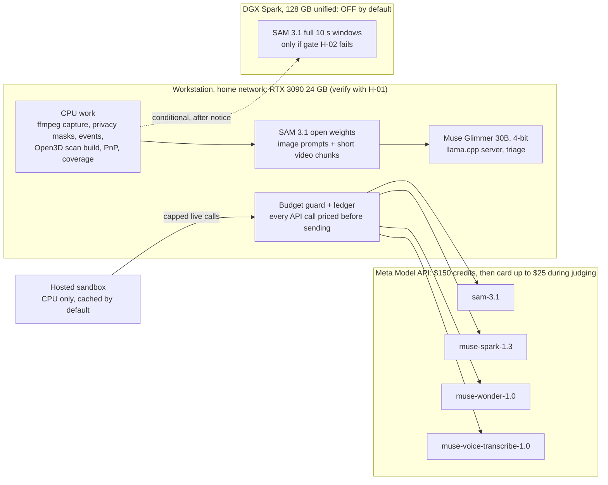

### 10.1 Why the 3090 changes the plan

- **Local SAM 3.1** (open weights) handles live home mode and bulk benchmark processing at no API cost and without upload delay. The API version of SAM 3.1 stays for the hosted sandbox, which has no GPU, and for a parity check.
- **Local Muse Glimmer** (Apache 2.0, 30B dense) handles triage. Unsloth lists its 4-bit GGUF at about 17 GB of memory ([Unsloth](https://unsloth.ai/docs/models/muse-glimmer)), which fits in 24 GB. Running it on your own hardware also makes Vigil eligible for the open-weights bonus as the event guide copy describes it. FR-028 moves from Modal to the 3090 and from P2 to P1.
- **Not on any local machine:** Muse Spark Open (816B parameters) fits neither the 3090 nor the Spark's 128 GB; Muse Wonder is closed.
- **The memory risk is real.** One user's RTX 4090 (24 GB) ran out of memory on SAM 3.1 video after 16 of 63 frames; the suggested fix is lower resolution or shorter clips ([sam3 issue 511](https://github.com/facebookresearch/sam3/issues/511)). Vigil already stitches overlapping windows (FR-007), so on the 3090 it tracks 2 to 3 s chunks with 1 s overlap at reduced resolution. H-02 measures whether that costs accuracy.
- **SAM and Glimmer do not share the GPU.** Glimmer's 17 GB plus a SAM video chunk will not fit together. Live home mode runs local SAM with Spark triage (API); the benchmark runs SAM first, then a separate Glimmer triage pass.
- **Workstation OS:** if Windows, run SAM 3.1 under WSL2 Ubuntu with CUDA (⚠️ confirm the sam3 repo builds there) and Glimmer through llama.cpp's Windows CUDA build or the same WSL2.

### 10.2 Hardware verification tasks (added to section 9)

| Task | Done by (PT) | What it runs | Done when |
| --- | --- | --- | --- |
| H-01 GPU probe | Mon 12:30 | `scripts/gpu_probe.py`: `nvidia-smi`, driver, CUDA, `torch.cuda` check, free VRAM, a 30 s matrix-multiply burn to confirm clocks and temperatures | Report saved to `eval/hardware/3090.json`; 3090 marked Ready or Not ready |
| H-02 Local SAM 3.1 benchmark | Mon 22:00 (**gate**) | sam3 install, checkpoint download (licence accepted on Hugging Face), image prompt test, then video chunks of 2, 3, 5 and 10 s at 640 and 960 px, 5 and 10 fps | Table of peak VRAM, seconds per window, out-of-memory failures; chosen chunk settings |
| H-03 Local Glimmer benchmark | Tue 12:00 | llama.cpp server with the 4-bit GGUF and vision projector; 20 triage fixtures | Tokens per second, peak VRAM, JSON-valid rate, agreement with Spark on the 20 fixtures |
| H-04 Local versus API SAM parity | Tue 12:00 | Same 20 windows through both backends | Mean mask IoU and ID-switch counts; target mean IoU at least 0.8 ⚠️, pre-registered in EVAL.md |

**Gate H-02 (Mon 22:00).** The 3090 passes if a 10 s window from one camera, processed in chunks, finishes in 10 s or less (keeps up with live), and if chunking adds no more than 1 ID switch per window compared with the API. If it passes, the DGX Spark stays off. If it fails, live mode and the benchmark fall back to API SAM (costed in section 11), and the DGX Spark phase below becomes optional.

### 10.3 Hardware dependency matrix

| Phase or task | Workload | Hardware | Estimated compute | Fallback | Readiness |
| --- | --- | --- | --- | --- | --- |
| T-02, T-03 Scaffold, CI, smoke tests | Tooling, 1 API call per model | CPU | Negligible | none | Ready |
| T-05 Capture and windows | ffmpeg stream copy; re-encode only triggered windows | CPU (NVENC on the 3090 optional) | 4 streams, low CPU in stream copy (NFR-033 measures it) | CPU encode | Unverified |
| T-08 Privacy and motion | OpenCV masks and frame differences | CPU | Seconds per window | none | Ready |
| T-09 Perception (development) | SAM 3.1 video tracking | **RTX 3090** local; API for parity | VRAM per H-02; about 1 window per 10 s target | API SAM | Unverified until H-02 |
| T-10 3D model build | Open3D registration and meshing | CPU (RAM heavy) | Minutes; ⚠️ 8 to 16 GB RAM estimated | Site-plan model | Unverified |
| T-12, T-14 Calibration | Nominal-FOV intrinsics, SAM 3.1 landmark proposals, PnP on 6 landmarks (optional lens profile per model) | CPU, plus SAM 3.1 image prompts (3090 locally or API) | Seconds per camera | Site-plan homography | Unverified |
| T-16 Appearance notes | Video understanding with track tags | Meta API (Spark) | Tokens per clip measured in T-03 | Glimmer on keyframes (3090) for development only | Unverified |
| T-17, T-19 Coverage and positions | Ray casting | CPU | Under 1 min for the yard grid | none | Ready |
| T-20 Story | Wonder over JSON | Meta API | About 6k tokens in, 0.8k out per visit (estimate) | Template story | Unverified |
| T-22 Tap-to-protect | SAM image prompt | 3090 locally; API in the hosted sandbox | Under 1 s GPU (estimate) | Cached preset masks | Unverified |
| T-23 Triage | Glimmer 4-bit | **RTX 3090** | About 17 GB VRAM | Spark via API | Unverified until H-03 |
| T-24 3D viewer | WebGL | Viewer's browser | GLB under 15 MB | 2D map | Ready |
| T-26 Live home mode | SAM chunks while the loop runs | **RTX 3090** | Must keep up with 4 cameras' triggered windows | API SAM with live spend cap | Unverified until H-02 |
| T-27 Benchmark | SAM pass, then Glimmer pass, then API stages | **RTX 3090** + API | Hours of GPU time at most (estimate) | API SAM | Unverified |
| T-28 Hosted sandbox | Web and cached data | Host CPU | Small container | Screen recording | Ready |
| D-1 (conditional) Full-window SAM | SAM 3.1 on 10 s windows unchunked | **DGX Spark** | Up to tens of GB per window (estimate) | API SAM | **Off; needs your connection** |

### 10.4 Advance notice: DGX Spark phase D-1 (conditional, not yet triggered)

- **When.** Tue 08:00 to 12:00 PT, only if gate H-02 fails at Mon 22:00, and only after G1 (footage and API-SAM parity fixtures exist). If it is triggered, connect the Spark by Tue 08:00.
- **Why.** SAM 3.1 video memory grows with the frames tracked. If 2 to 3 s chunks on 24 GB cause ID switches or cannot keep up, the Spark's 128 GB of unified memory holds full 10 s windows at full resolution. The trade-off: its memory bandwidth is 273 GB/s ([StorageReview](https://www.storagereview.com/review/nvidia-dgx-spark-review-the-ai-appliance-bringing-datacenter-capabilities-to-desktops)), so it may be slower per frame. It fixes a capacity problem, not a speed problem. It is never used for Muse Spark Open, which does not fit.
- **Setup.** Ethernet (10GbE port) on the home network with a fixed address; SSH key from the workstation; DGX OS (Ubuntu, Arm64). Run an NGC PyTorch container for Arm64, plus the sam3 repo and the SAM 3.1 checkpoint (licence accepted). Add a small `sam-worker` service with the same interface as the local backend (`POST /track` with a window file), reachable only from the workstation's address. Sync masked windows with rsync; set `VIGIL_SAM_BACKEND=remote` and `VIGIL_SAM_URL`.
- **Validation.** Run H-02's windows on the Spark: no out-of-memory failures on 10 s windows; ID switches at most the API's; mean IoU with the API at least 0.8; seconds per window recorded. If it is not better than the API on the metric that failed, stay on the API and power the Spark down.

Not planned for the Spark: Glimmer at 8-bit or BF16 (34 GB and 58 GB per Unsloth). A 4-bit versus 8-bit quality comparison would not move any judging score in the time left.

## 11. Meta API Credit Plan & Commercial Unit Economics

The plan spends about **$55 to $95** of the $150 credits, depending on whether local SAM passes gate H-02. That leaves at least $55 of the credits unspent (at least $45 below the **$140** hard cap on credit spend enforced in code), plus a separate $25 cap on card-paid spend during judging (11.8).

The largest risk is timing, not the amount. The Official Rules say the credits are "valid for a 10-day development window", and judging (Nov 5 to 10 PT) probably falls after it. **Decided by the owner on Nov 2: live calls stay on during judging.** `VIGIL_ALLOW_PAID=1` is set from the window end, with a hard `VIGIL_JUDGING_CAP_USD=25` ($5 per day) on post-window spend, charged to the card on file, and no paid call after `VIGIL_JUDGING_END` (Nov 10, 23:59 PT) (11.6, 11.8). Without `VIGIL_ALLOW_PAID=1`, Vigil switches to cached-only when the window ends. Before Nov 4, 9 PM ET, set `VIGIL_CREDIT_WINDOW_END` to the exact end of the credit window.

### 11.1 What is verified about the credits

| Term | Status | Source |
| --- | --- | --- |
| $150 in Meta Model API credits per selected participant | Verified | Official Rules (your copy) |
| Valid for a 10-day development window | Verified wording; exact start and end time **not published** | Official Rules |
| A separate "Credit Terms" document applies | Verified that it exists; its text is behind the Cerebral Valley login and was **not read** | Official Rules |
| Each person claims individually, by Nov 4, 9 PM ET, through a form | Mirror only | [Event guide copy](https://github.com/meta-ai-hackathon/meta-hack/blob/main/info/event%20guide.md) |
| A credit card must be on the account, with a temporary pre-authorisation | Mirror only | Same |
| A spend limit can be set on the Billing page | Mirror only; ⚠️ whether it hard-stops calls is unverified | Same |
| What happens after credits run out or expire | **Unknown**: assume the card is charged | none |

### 11.2 Coverage matrix

| Service | Covered by the $150? | Basis | Vigil uses it? |
| --- | --- | --- | --- |
| Model API, Standard mode: `muse-spark-1.3`, `muse-wonder-1.0`, `sam-3.1`, `muse-voice-transcribe-1.0`, `muse-image-1.0` | Expected yes, ⚠️ per-model coverage unconfirmed | Credits are "Meta Model API credits"; all are Model API models ([models](https://dev.meta.ai/docs/models)) | Yes, except Muse Image |
| Model API Contributor-mode IDs | Probably, ⚠️ unconfirmed | Same API | **No**: content would be used for training; home footage rules it out |
| Web search grounding ($2.50 per 1,000 queries) | Probably, ⚠️ unconfirmed | Billed through Model API | No |
| Muse Code subscriptions | **No**: separate billing | [Models page](https://dev.meta.ai/docs/models) | No |
| Open weights on own hardware (Glimmer, SAM 3.1 weights) | **Not applicable**: never billed by Meta | Same | Yes: electricity only |
| Partner inference (Baseten, Modal, Fireworks) | **No**: separate partner credits, granted by each partner | [Event page](https://cerebralvalley.ai/e/meta-ai-developer-hackathon) | No |
| Hosting, domain, GitHub | No | none | Host on a free or existing plan |

**Confirm today:** run T-03 smoke tests, then check that the Billing balance dropped by the logged amount for each model. That turns "expected" into "verified" for the 4 models Vigil uses.

### 11.3 Unit prices used

Source: [Pricing and rate limits](https://dev.meta.ai/docs/pricing-rate-limits), Standard mode:

- SAM 3.1: $0.20 per 1,000 video frames (minimum 50 per request); $2.50 per 1,000 images.
- Muse Spark 1.3: $1.25 per million input tokens, $4.25 per million output tokens.
- Muse Wonder 1.0: $4 input and $20 output per million tokens.
- Muse Voice Transcribe: $0.18 per hour of audio.

⚠️ The largest unknown is how many tokens a 10 s video clip costs Muse Spark. The plan assumes 30,000 input tokens per clip (about $0.04) until T-03 measures it; then `vigil cost estimate` recomputes every line below.

### 11.4 Cost by feature

| Feature | Paid calls | Volume assumption | Estimated cost | Free alternative used |
| --- | --- | --- | --- | --- |
| Smoke tests (T-03) | 1 to 3 per model | Small | About $1 | none |
| Perception for the 5 demo scenarios (A, A′, B, B′, C) through the API | SAM 3.1 video | 5 scenarios × 4 cameras × 60 s active × 10 fps × 3 phrases ≈ 36,000 frames | About $7 (the 11.5 development line absorbs the extra ≈ $3) | Local SAM for everything else |
| Perception for all 12 scenarios through the API (only if H-02 fails) | SAM 3.1 video | 12 × 4 cameras × 75 s active × 10 fps × 3 phrases ≈ 108,000 frames (25% above the demo-scenario rate for longer benchmark scenarios) | About $22 | Local SAM if H-02 passes: $0 |
| Appearance notes | Spark video | About 290 clips in the benchmark plus about 100 in development | About $16 ⚠️ | Glimmer on keyframes during development |
| Stories | Wonder | About 100 calls (development, benchmark, retries) at about 6k in, 0.8k out | About $4 | Template for non-escalated visits |
| Triage | Spark, only as fallback | About 50 calls | Under $1 | Glimmer on the 3090: $0 |
| Rule compile and tap-to-protect tests | Spark text, SAM image | About 50 calls | Under $1 | Local SAM for tap during development |
| Naive baseline | Spark video | About 70 clips | About $3 ⚠️ | none |
| Voice rules (FR-022, P0, incl. the 3 fixture buttons in the sandbox) | Voice Transcribe | About 1 hour of audio across T-03, development, live smoke and the sandbox (fixtures are at most 30 s each, ≈ $0.0015 per clip) | Under $0.20 (judging use comes out of the $25 cap) | Cached fixture transcripts; typed rules |
| Hosted sandbox, live buttons until the window ends | All | Capped | Up to $10 per day × 2 days = $20 | Cached mode |
| Hosted sandbox during judging (Nov 5–10 PT, after the window) | All | `VIGIL_JUDGING_CAP_USD=25`, $5 per day | Up to $25, charged to the card, not the credits | Cached result with notice |
| Video recording live calls | All | A few | About $2 | none |
| Live home testing through the API (only if H-02 fails) | SAM 3.1 video | Capped | Up to $15 | Local SAM |

### 11.5 Phased usage plan and balance

| Phase | When (PT) | Spend if local SAM passes | Spend if API SAM is needed | Balance after (pass / fail) |
| --- | --- | --- | --- | --- |
| Start | Now | $0 (check prior spend on the Billing page first) | $0 | $150 / $150, minus prior spend |
| Smoke tests, T-03 | Mon 12:30 | $1 | $1 | $149 / $149 |
| Development to G2 | Mon to Tue 13:00 | $12 | $16 | $137 / $133 |
| Benchmark and baseline, T-27 | Tue evening | $18 | $40 | $119 / $93 |
| Sandbox live caps | Tue night to Nov 4 | up to $20 | up to $20 | $99 / $73 |
| Video live calls | Wed | $2 | $2 | $97 / $71 |
| Live home testing through the API | Only if H-02 fails | $0 | up to $15 cap | $97 / $56 |
| Judging live calls (card, outside credits) | Nov 5–10 | up to $25 | up to $25 | credits unchanged: $97 / $56 |
| **Reserve** |  | **at least $90** | **at least $55** |  |

The $140 credit cap sits above both columns. Separately, at most $25 is charged to the card during judging. Worst-case total out of pocket: $25.

### 11.6 Safeguards

1. **Billing-page spend limit at $140**, set before T-03 and reset when the credit window ends (11.8). ⚠️ Confirm with a test whether it hard-stops calls.
2. **Budget guard in `meta/client.py`.** Every call is priced from the 11.3 table before it is sent. A call is refused if it would cross the credit cap ($140, `credit`-tagged spend only), its feature budget (11.4), or the daily cap; after the window, the judging cap (item 6) applies instead. Warnings show at 50%, 75% and 90%.
3. **Pre-flight estimate.** Batch commands (`vigil process`, `vigil eval`) print frames, tokens and cost first, and require `--confirm` above $5.
4. **Cache first.** Identical requests are never paid for twice; benchmark re-runs read the cache unless told otherwise.
5. **Model allowlist.** Only the 4 Standard-mode IDs are allowed: no `-contributor`, no web-search tool, no Muse Image.
6. **Sandbox and judging limits.**
   - **Before the credit window ends:** 10 live requests per minute per IP and $10 per day, both from the credits.
   - **During judging (Nov 5–10 PT):** live calls stay **ON**, with `VIGIL_ALLOW_PAID=1` set by the owner (approved Nov 2). A dedicated `VIGIL_JUDGING_CAP_USD=25.00` hard cap applies to post-window spend: $5 per day, still 10 requests per minute per IP. The $25 total binds before the daily caps (6 days × $5 = $30). No paid call after `VIGIL_JUDGING_END` (Nov 10, 23:59 PT).
   - **Fallback:** if a cap is reached, or a call times out after 20 s or fails, the request degrades to the cached result with the telemetry notice. A judge never sees a blank or disabled screen; they see "Live budget for today used; recorded result shown" or "Live call failed; recorded result from \<date> shown".
7. **Daily reconciliation.** Compare the ledger total with the Billing page and log both in `eval/budget.md`. A drift over 10% means updating the price table before spending more.
8. **Separate keys.** One key for development and one for the sandbox, so the public one can be revoked alone. ⚠️ Check whether per-project limits exist (the billing URL suggests projects).

### 11.7 If credits run out or expire

- **Credits expired (window ended):** with `VIGIL_ALLOW_PAID=1`, live calls continue on the card up to $5 per day and $25 in total (NFR-037); at either cap, after `VIGIL_JUDGING_END`, or with the flag unset, the sandbox serves cached results with the notice, and every flow still works (NFR-009).
- **Credits exhausted ($140 reached before the window ends):** cached results only.
- Perception runs on local SAM; triage runs on Glimmer; non-escalated stories use templates; Wonder stories for the 3 demo scenarios are already cached.
- Voice rules fall back to the 3 fixture buttons with cached transcripts, then typing.

### 11.8 Notice: decisions that could cost beyond the $150
- **Live calls during judging (Nov 5–10 PT): decided ON by the owner (Nov 2).** Calls after the credit window are charged to the card on file, up to a **hard $25 in total** ($5 per day) and never after `VIGIL_JUDGING_END` (Nov 10, 23:59 PT); the $25 total binds before the daily caps (6 days × $5 = $30). The budget guard counts this spend separately from the $140 credit cap: the ledger tags each call `credit` or `paid`, and the post-window check refuses any call that would cross $25 or the day's $5. Worst-case exposure: **$25**.
- **Before Nov 4, 9 PM ET:** confirm the credit window's exact end time in the Credit Terms and set `VIGIL_CREDIT_WINDOW_END` to it. Confirm the card on file. At the moment the credit window ends, set the Billing-page spend limit to (credit spend shown on the Billing page at window end) + $25, or to $25 if the limit counts only card charges. ⚠️ Check which one the Billing page measures before Nov 4, 9 PM ET.
- **Nothing else in this plan exceeds $150.** If T-03 shows video tokens far above the assumption, so that the projected total passes $140, this is flagged before the benchmark runs. The fallback is notes at 2 fps and 480 px, or on keyframes.

### 11.9 Commercial unit economics (new): why the edge-plus-cloud cascade wins

**Unit:** one home with 4 cameras recording 24/7, per month (30.4 days). Prices are the spec 11.3 Standard-mode prices. Token counts are the plan's assumptions until T-03 measures them, and `vigil cost estimate` recomputes this table from the measured values. **Everything below is an estimate, not a measurement.** T-27 measures the Tier 0 and Tier 1 rates on the recorded evening and publishes them in EVAL.md.

**Per-call costs (from 11.3):**
- One Spark video clip (about 30k tokens in, 0.4k out): $0.0375 + $0.0017 ≈ **$0.039**.
- One Wonder story at spec size (6k in, 0.8k out): $0.024 + $0.016 = **$0.040**.
- One Wonder story with a compact ledger (3k in, 0.5k out): $0.012 + $0.010 = **$0.022**.

| Approach | How it works | Cost per home per month | Notes |
| --- | --- | --- | --- |
| Naive continuous cloud VLM (the FR-025 baseline) | One Spark video call per motion window (W windows per day) | W × $0.039 × 30.4: **$59 at W = 50; $119 at W = 100; $356 at W = 300** | A figure of about $65–110 corresponds to W ≈ 55–93. Busier homes cost more. Not viable for a consumer subscription |
| Human-in-the-loop guard service (for example, SimpliSafe Active Guard outdoor monitoring) | Monitoring agents review outdoor camera events | **≈ $50 per month overnight only (Pro, 8 PM–6 AM); ≈ $80 per month for 24/7 (Pro Plus)**, plus the vendor's outdoor cameras (third-party reviews, Nov 2026; ⚠️ confirm on simplisafe.com before quoting) | Labour-bound, so margins are low; outdoor only |
| **Vigil three-tier cascade** | Tier 0 discards idle windows; Tier 1 resolves routine visits on the local GPU; Tier 2 calls the cloud only for escalated visits | Tier 2 at E escalated visits per day:<br>(a) compact Wonder story only: E × $0.022 → **$1.34–$2.68 at E = 2–4**<br>(b) spec-size story: **$2.43–$4.86**<br>(c) story plus 2 Spark appearance clips per visit: **$7.2–$14.3** | **(a) and (b) need Tier 1 to produce the appearance notes locally** (Glimmer on keyframes). A "~$0.06 per day" Tier 2 cost holds for (a) at E ≈ 2.7 |

**The three tiers:**
1. **Tier 0: motion gate and Reolink edge trigger ($0).** Hypothesis: about 85% of windows are idle and skipped. Measured in T-27 as the skipped-window share.
2. **Tier 1: local SAM 3.1 plus Muse Glimmer 30B on the edge GPU ($0 API).** Hypothesis: about 90% of the remaining visits resolve without the cloud. Measured as 1 − the escalation rate (FR-013).
3. **Tier 2: cloud Muse Spark and Muse Wonder.** Called only on escalated visits; the hypothesis is 2–4 per day.

**Reduction against the naive baseline at W = 100 ($119 per month):**
- Case (a): **97.7–98.9%**.
- Case (b): **95.9–98.0%**.
- Case (c): 87.9–94.0%.

The **"about 96% cloud inference cost reduction" claim holds only at W ≈ 100 or more and only when appearance notes run locally** (cases a and b; at W = 50 case b falls to about 92%). It does not hold if Spark annotates every escalated visit (case c).

**Gross margin at $14.99 per month:**

Formula: GM = 1 − (Tier 2 API + cloud hosting + payment fees) / $14.99. The cost assumptions are:
- Cloud hosting: ≈ $0.50 per home per month for cards, escalated masked clips with 30-day retention, and egress (⚠️ estimate).
- Payment fees: 2.9% + $0.30 ≈ $0.73.

| Tier 2 per month | GM including payment fees | GM excluding payment fees |
| --- | --- | --- |
| $1.01 | **85.0%** (break-even point for 85%) | 89.9% |
| $1.80 (the "$0.06 per day" case) | 79.8% | 84.7% |
| $2.68 | 73.9% | 78.8% |
| $4.86 | 59.3% | 64.2% |

**Business verdict.**
- A $14.99 per month subscription gives about **78–83% gross margin including payment fees (83–88% excluding them)** at 2–3 escalations per day, with Wonder on a compact ledger and appearance notes kept local.
- Reaching **over 85% including fees** needs Tier 2 at or below about $1.01 per month (about 1.5 escalations per day). Otherwise the price must rise: about $17.69 at E = 2, $21.49 at the "$0.06 per day" case ($1.80) and $23.19 at E = 3 (compact ledger, local notes).

**Edge-cost caveat.** These margins **exclude the edge hardware**, which the homeowner owns and powers.
- The team's RTX 3090 GPU measured about 48 W idle and 349 W under load (nvidia-smi, H-01; the whole box draws more). A 3090-class box running 24/7 costs the homeowner roughly **$15–26 per month in electricity** (80–120 W average at $0.25–0.30 per kWh; ⚠️ the average is an estimate, not measured).
- A 3090 is a development box, not the product. The commercial path assumes a low-power edge accelerator (⚠️ a hypothesis, not tested) running a smaller local triage model.
- This is the main open risk in the business case, and the README must say so.

## 12. Quality and verification

CI runs every automated test below on each pull request with recorded model responses, so it costs nothing and is deterministic. Live tests run by hand before each gate, and their results go to EVAL.md. A requirement counts as Verified only when its test is green in CI or its manual check is logged with a date.

### 12.1 Test suites

**Prioritized lanes (Nov 2 correction).** CI runs two lanes.
- **Blocking lane:** lint, secret scan and the 5 P0 suites. They must pass on every push from now on, and by G3 at the latest. A red P0 suite blocks the merge.
- **Report-only lane:** every other suite still runs in CI, with `continue-on-error`. Failures are visible in the run summary and EVAL, but they never block the 3D viewer, the demo bundle export or the video.

Run time stays cheap, and nothing silently rots. Field and live checks run by hand before each gate.

| Tier | Suite | Files | What it proves | Requirements |
| --- | --- | --- | --- | --- |
| **P0 blocking 1** | Privacy | `tests/unit/test_privacy.py` + `scripts/privacy_scan.py demo` + metadata scan | 0 pixels inside polygons; no audio stream in any video; no audio file anywhere in the repo except the allowlisted voice fixtures under `demo/voice/`; no GPS or device metadata | FR-003, NFR-001, NFR-002, NFR-032 |
| **P0 blocking 2** | Citation validator | `tests/unit/test_validator.py` | Planted failures caught, incl. role claims (check 7) | FR-015, NFR-003 |
| **P0 blocking 3** | Verdict and rules (with roles) | `tests/unit/test_verdict.py`, `tests/unit/test_rules.py` | Every floor × gap × proposal combination; every `applies_to` × `actor_role` pair, `household_insider` vs `external_visitor`, `unknown` fails closed; midnight windows | FR-012, FR-016, FR-044 |
| **P0 blocking 4** | Guards and budget | `tests/integration/test_guards.py` (+ `tests/unit/test_budget.py`) | Spend caps, the $25 judging cap, rate limit 429, size limit 413, no contributor IDs, key never served | FR-026, FR-043, NFR-004, NFR-013 to NFR-015, NFR-037 |
| **P0 blocking 5** | Judge path E2E | `tests/e2e/test_judge_path.py` against the Docker sandbox | The 8 judge steps incl. voice fixture buttons and the cached fallback with an invalid key | FR-017, FR-018, FR-022, FR-027, FR-040, NFR-009, NFR-018, NFR-022 |
| P1 report-only | Config, ingest, perception, Meta client faults, visits/gaps/roles, story, loop, spatial, golden pipeline, determinism, Reolink, mobile E2E, eval metrics | all other files under `tests/` | As listed in the original 12.1 table | FR-001 to FR-044 (others), NFR-010, NFR-011, NFR-017 |
| P2 report-only | Performance | `tests/e2e/test_perf.py` | First card under 2.5 s; GLB load | NFR-005, NFR-030 |
| Manual (by gate) | Live smoke, live latency, field calibration and audit harness, capture endurance, exposure check, benchmark | as in the original 12.1 table | Real-data acceptance | as listed |

Definition of done (12.3) is unchanged, except that "CI green" means the blocking lane is green. Any report-only red has an open issue.

**Full suite catalogue** (all lanes):

| Suite | Files | What it proves | Requirements | Runs |
| --- | --- | --- | --- | --- |
| Unit: config and topology | `tests/unit/test_config.py`, `test_topology.py` | Bad references fail clearly; edges and blind regions load | FR-001, FR-010 | CI |
| Unit: privacy | `test_privacy.py` | Every pixel inside every polygon is 0 on synthetic frames; no audio stream | FR-003, NFR-001, NFR-002 | CI |
| Unit: windows and motion | `test_windows.py`, `test_motion.py` | Window edges within 1 frame; 2 s overlap; idle windows skipped | FR-004, FR-005, FR-031 | CI |
| Unit: SAM parsing | `test_sam_parse.py` | Recorded streams become tracks; empty result; 400 surfaced; window split at 16 IDs | FR-006 | CI |
| Unit: stitching and events | `test_tracks.py`, `test_events.py` | One track across windows; touch, cross, removed and dwell on synthetic tracks; `origin_zone` = `front_door_egress` for a track born in it; `null` mid-yard, after a skipped window or outage, or after a non-egress track near that door; one touch event per overlapping track | FR-007, FR-008 | CI |
| Unit: appearance schema | `test_spark_schema.py` | Unknown tag rejected; no sensitive fields exist | FR-009, NFR-003 | CI |
| Property: visits, gaps and roles | `test_visits.py` (hypothesis), `test_roles.py` | Links only inside transit windows; ambiguity never links; every out-of-view interval becomes a gap; role truth table over origin × check-in × window × link outcome; an ambiguous re-link gives `unknown`; household roles never carry across a blind spot on transit time alone; check-in binds at most one chain; same-role group rule | FR-010, FR-011, FR-044 | CI |
| Truth table: rules and verdict | `test_rules.py`, `test_verdict.py` | Midnight-crossing windows; every combination of floor, gap and proposal; every `applies_to` × `actor_role` pair; `unknown` fails closed; a scoped-out household touch keeps the floor normal | FR-012, FR-016, FR-044 | CI |
| Adversarial: validator | `test_validator.py` | Planted failures caught: missing ID, foreign ID, time inside a gap, wrong camera, banned words, malformed JSON; a role phrase not backed by the cited subject's `actor_role` (check 7); family or relationship words | FR-015, NFR-003 | CI |
| Adversarial: loop | `test_loop.py` | Off-list phrase, unknown camera and cap overflow are rejected and logged | FR-020, NFR-016 | CI |
| Spatial: synthetic camera | `test_calibrate.py` | Nominal-FOV intrinsics from HFOV and width; projects known 3D points through a known pose with noise; PnP on 6 landmarks recovers it within 2 cm and 0.5°; the lens-profile distortion model round-trips | FR-036, FR-037 | CI |
| Spatial: locate | `test_locate.py` | On a synthetic slope, the foot-point ray hits the known point; a clipped mask uses the height prior and is flagged; no positions inside gaps | FR-039 | CI |
| Property: uncertainty | `test_locate_coverage.py` (hypothesis) | On synthetic noise, the true point is inside r95 at least 93% of the time | FR-039, NFR-026 | CI |
| Spatial: coverage | `test_coverage.py` | A synthetic wall blocks line of sight; privacy polygons remove cells; blind regions form connected polygons | FR-038 | CI |
| Integration: golden pipeline | `tests/integration/test_golden.py` | Recorded responses for scenarios A, B, C produce the labelled visits, verdicts, gaps and positions | FR-004 to FR-016, FR-039 | CI |
| Integration: determinism | `test_determinism.py` | Two runs give byte-identical `visits.json` | NFR-011 | CI |
| Integration: fault injection | `test_client_faults.py` (respx) | 429, 500, timeout and malformed JSON trigger retry, then fallback; never a blank result | FR-026, NFR-010 | CI |
| Integration: guards and budget | `test_guards.py`, `tests/unit/test_budget.py` | At the spend cap, the cached result is shown with a notice; the 11th call in a minute gets 429; oversized audio gets 413; no `-contributor` model ID; after the window, refusal without `VIGIL_ALLOW_PAID`; $5/day and $25 judging caps refuse; refusal after `VIGIL_JUDGING_END`; ledger tags `credit`/`paid` | FR-026, FR-043, NFR-004, NFR-013, NFR-015, NFR-037 | CI |
| Unit: voice and expected windows | `test_asr.py`, `test_expected_windows.py` | Recorded transcribe responses parse; WAV at most 30 s and 2 MB; fixtures map to cached transcripts; windows persist, expire and cap at 12 h; a perimeter arrival 1 s after the end, or outside the window's scope, is `external_visitor` | FR-022, FR-029 | CI |
| Integration: Reolink | `test_reolink.py` | Recorded TCP-push payloads become `camera_ai` events; capture restarts after a dropped stream (simulated) | FR-031, FR-032 | CI |
| E2E (Playwright) | `tests/e2e/test_judge_path.py` | The 8 judge steps of section 4 against the cached build, including every citation chip, players within 0.2 s, 3D layers and legend, the gap label, and badges; step 6 through each of the 3 voice fixture buttons | FR-017, FR-018, FR-022, FR-027, FR-040, NFR-018, NFR-022 | CI |
| E2E: offline API | same suite with `MODEL_API_KEY=invalid` | Every cached flow still passes; live buttons show the fallback notice | NFR-009 | CI |
| E2E: mobile | `test_mobile.py` (390 px viewport) | Verdict and first sentence visible without scrolling; legend readable | NFR-017 | CI |
| Performance | `test_perf.py` | First card under 2.5 s (p95 of 20 loads); GLB under 15 MB and loaded under 5 s | NFR-005, NFR-030 | CI and deployed URL |
| Security scans | `ci.yml` steps | gitleaks clean; key absent from every served file; exiftool finds no GPS; privacy scan over `demo/`; repository-wide audio allowlist check | NFR-001, NFR-002, NFR-014, NFR-032 | CI |
| Live smoke | `scripts/smoke_meta.py --live` | One real call per model succeeds and is logged | FR-006, FR-009, FR-014, FR-019, FR-021, FR-022 | Before each gate |
| Live latency | `vigil eval --latency` | Measured p50 and p90 for tap, re-run, Reolink pulse and live lag | NFR-006, NFR-007, NFR-027, NFR-028 | G3, G4 |
| Field: calibration and accuracy | `vigil eval --spatial` on the marker walk | Held-out error, median and p90 position error, share inside r95 | NFR-024 to NFR-026 | After T-15 |
| Field: capture endurance | 2 h capture plus a cable pull | No gap over 1 s; reconnect under 30 s; CPU logged | NFR-029, NFR-033 | Mon night |
| Field: exposure check | Phone on cellular tries the edge and camera ports | Nothing reachable | NFR-031, FR-034 | Before recording the video |
| Benchmark | `vigil eval` | All EVAL metrics against the pre-registered targets, misses included; the role miss rate (FR-044: assigned vs labelled role per subject, day and night separately, and the alerts it caused), pre-registered in EVAL.md before the run | FR-024, FR-044, NFR-023 | G4 |

### 12.2 CI pipeline (`.github/workflows/ci.yml`)

1. ruff lint and format check (blocking).
2. gitleaks secret scan (blocking; NFR-014).
3. Blocking P0 suites 1–4: `pytest -m "not live" tests/unit/test_privacy.py tests/unit/test_validator.py tests/unit/test_verdict.py tests/unit/test_rules.py tests/unit/test_budget.py tests/integration/test_guards.py`.
4. Privacy scan and exiftool metadata scan over `demo/`, plus a repository-wide audio check over `git ls-files` against `config/audio_fixtures.json` (blocking; part of P0 suite 1).
5. Report-only: every other unit, property and integration test (`pytest -m "not live"` minus the files in step 3), `continue-on-error: true`.
6. Report-only: determinism check (pipeline twice, diff).
7. Build the Docker image; start it with `VIGIL_MODE=sandbox` and an invalid key (blocking).
8. Blocking P0 suite 5: `tests/e2e/test_judge_path.py` against the container, offline. Report-only: `test_mobile.py`, `test_perf.py`.
9. Upload Playwright traces and screenshots as artifacts. These double as demo evidence.

### 12.3 Definition of done for any task

- [ ] Code merged through a pull request with CI green
- [ ] Its tests named in the table above exist and pass
- [ ] Status in sections 1 and 2 updated to Verified by test, or Done with the manual check dated
- [ ] Any number it produces is written to EVAL.md, not only to chat or notes
- [ ] No raw footage, credentials or location metadata added to the repo

## 13. Final readiness

Vigil is ready to submit when every row of the traceability matrix has a green test and the demo evidence it names. Today every row is planned and unverified. The open blockers in 13.4 must be cleared today, or the schedule in section 9 does not hold.

### 13.1 Traceability matrix

| Criterion | Requirement | Use case | Code module | Test | Demo evidence |
| --- | --- | --- | --- | --- | --- |
| Impact | FR-016, FR-017, FR-024: fewer, better alerts | UC-04, UC-06 | `verdict.py`, `web/cards.js`, `eval/metrics.py` | `test_verdict`, `test_judge_path`, `vigil eval` | Step 1 counts; a quiet Normal card |
| Impact | FR-044, FR-012, FR-008: spatial-origin roles, no identification; the same gate touch gives opposite outcomes | UC-03, UC-06, UC-08 | `perception/events.py`, `reasoning/visits.py`, `reasoning/rules.py` | `test_events`, `test_roles`, `test_rules`, `test_verdict`, `vigil eval` (role miss rate) | Scenarios A′ and C; `role_basis` in the step 4 trace |
| Impact | FR-029: Expected Guest / Delivery Window and owner check-in | UC-08 | `api/routes.py`, `reasoning/visits.py` | `test_expected_windows`, `test_roles` | Scenario B′ card shows the window |
| Impact | FR-030, FR-031: real home cameras | UC-11 | `vigil/reolink/` | `test_reolink`, capture endurance | Real footage; live clip in the video |
| Impact | FR-003, NFR-001, NFR-031, NFR-032: privacy that can be checked | UC-01 | `ingest/privacy.py`, CI scans | `test_privacy`, privacy and metadata scans | Black areas in every view; HACKATHON.md consent note |
| Tooling | FR-006, FR-019: SAM 3.1 tracking and tap-to-protect | UC-02, UC-06 | `meta/sam.py` | `test_sam_parse`, live smoke | Outlines; live mask in step 5 |
| Tooling | FR-039: SAM masks become 3D positions | UC-06 | `spatial/locate.py` | `test_locate`, `test_locate_coverage` | Step 3: outline and disc together |
| Tooling | FR-009: Spark refers to SAM's own track tags | UC-05 | `meta/spark.py` | `test_spark_schema` | Trace shows notes per tag |
| Tooling | FR-014, FR-020: Wonder writes the story and steers SAM | UC-05, UC-06 | `meta/wonder.py`, `reasoning/loop.py` | `test_golden`, `test_loop` | Card B "Now watching: package"; step 7 |
| Tooling | FR-021: rules compiled from plain language | UC-03 | `meta/spark.py` | Reference phrasings, `test_rules` | Step 6 |
| Tooling | FR-022: Muse Voice Transcribe rules (5-model loop) | UC-03 | `meta/asr.py`, `api/routes.py` | `test_asr`, `test_judge_path` (3 fixture buttons, invalid key), live smoke | Step 6 transcript with model and call ID |
| Tooling | FR-037: SAM 3.1 proposes calibration landmarks | UC-10 | `spatial/calibrate.py`, `web/calibrate/` | `test_calibrate` | Benchmark tab: landmark and audit errors per camera |
| Depth | FR-015, FR-016: code decides, claims are checked | UC-06 | `validator.py`, `verdict.py` | `test_validator`, `test_verdict` | Step 4 trace with any rejected sentence |
| Depth | FR-010, FR-011, FR-038: gaps from measured geometry | UC-06, UC-10 | `visits.py`, `spatial/coverage.py` | `test_visits`, `test_coverage` | Dotted "Not observed · 41 s" in step 2 |
| Depth | FR-036, FR-037, NFR-024 to NFR-026: calibration and honest uncertainty | UC-10 | `spatial/calibrate.py`, `locate.py` | `test_calibrate`, field accuracy test | Benchmark tab, step 8 |
| Depth | FR-024, FR-025: pre-registered benchmark and baseline | none | `vigil/eval/` | `vigil eval` | Step 8; EVAL.md commit dates |
| Demo | FR-026, FR-027: works with no setup, survives failures | UC-09 | `api/guards.py`, `store/export.py` | Offline E2E, fault injection | Whole judge path |
| Demo | FR-040: 3D viewer | UC-09, UC-11 | `web/twin/` | E2E, `test_perf` | Steps 1 to 3 |
| Demo | FR-023: telemetry | UC-09 | `meta/client.py`, `web/cards.js` | `test_guards`, E2E | Latency and cost on every live call |
| Demo | FR-032 to FR-034: live home mode | UC-11 | `reolink/ai_events.py`, `api/live.py` | `test_reolink`, field tests | Live clip with measured lag in the video |

| Criterion | Requirement | Use case | Code module | Test | Demo evidence |
| --- | --- | --- | --- | --- | --- |
| Tooling | FR-028, FR-042: open weights on own hardware (Glimmer, SAM 3.1) alongside the hosted API | UC-04, UC-11 | `meta/glimmer.py`, `meta/sam.py` backends | H-02 to H-04, `test_golden` | Trace badges "Glimmer on RTX 3090"; parity table in EVAL |
| Depth | FR-043, NFR-036, NFR-037: cost discipline, including the $25 judging cap | none | `meta/client.py` budget guard | `test_guards`, `test_budget` | Cost per scenario and total spend in EVAL and README |

### 13.2 Missing functionality (as of Nov 2, 12:52 PM PT)

- Everything in sections 1 and 2 is **Not verified** on real data; the audit (T-01) found an empty repository and the offline core is in integration (`docs/readiness.md`).
- Three Meta API behaviours are unconfirmed (section 5.14): Wonder's strict schema, the Voice Transcribe batch endpoint, Spark video with a strict schema.
- Reolink camera models, firmware and any NVR are unknown, so continuous capture on all 4 sides is not yet confirmed.
- No scan, calibration or footage exists yet.

### 13.3 Critical risks

| Risk | Likelihood | Impact | Mitigation | Decision point |
| --- | --- | --- | --- | --- |
| Spatial work overruns the schedule | High | Late MVP | Hard cut-off; site-plan fallback (section 7) | Tue 10:00 AM |
| Night footage is infrared and greyscale, so colour notes become "unknown" and linking weakens | High | Lower link precision at night; roles may fall to `unknown` across gaps (fails closed: a household or expected role never carries across a blind spot on transit time alone) | Test scenario C windows Monday night; linking relies on transit time when colours are unknown; report night and day results separately | Mon 19:00 (T-07b) |
| A household member arrives from the street or driveway without a check-in (check-in is LAN-only), so is `external_visitor`; r7 (17:30–06:00) covers the evening commute | High | False alert on `non_household` rules (fails closed: more alerts, never fewer) | Draft card states it; README limit; EVAL reports the role miss rate and the alerts it caused (FR-044); optional labelled night take (T-07b) | Design rule |
| A person who entered the house or garage unobserved walks out of a door | Low | Missed alert on a `non_household` rule | Egress origin voided after a non-egress track near that door (FR-008); garage doors are never `egress`; `anyone` rules unaffected; README limit; trace shows `role_basis` | Design rule |
| LiDAR drift or sunlight degrades the scan | Medium | 3D accuracy | Short loops with overlaps, shade, scale check | Mon 20:00 |
| A camera is battery-powered, with no continuous RTSP | Unknown | One side has event clips only | Probe first; Home Hub or NVR route; document it | Mon 12:30 |
| Wonder rejects a strict schema | Medium | Parsing failures | JSON mode plus the validator; template fallback | Mon 12:30 |
| Live lag is long | Medium | Weaker live claim | Show measured lag honestly; the cached sandbox is unaffected | Tue 21:00 |
| Privacy leak: neighbour, plate, house number, GPS metadata | Medium | Waiver breach; disqualification risk | Two masking layers, CI scans, manual review of every published frame | Every export |
| Home network exposed | Low | Severe | LAN only, no port forwarding, cellular port check | Before the video |
| Code from before Oct 26 in the demo | Unknown | Disqualification | Audit; disclose or remove | Mon 11:30 |
| Credits run out | Low | Live calls continue only under the $25 judging cap, then cached | Cache, spend caps, ledger; Standard-mode pricing checked | Daily |

**Added risks (compute and credits)**

| Risk | Likelihood | Impact | Mitigation | Decision point |
| --- | --- | --- | --- | --- |
| SAM 3.1 video runs out of memory on 24 GB | Medium | Live mode and benchmark move to the API | Chunking; API fallback; DGX Spark phase D-1 only after notice | Mon 22:00 (gate H-02) |
| Glimmer and SAM compete for the 3090 | High | Slow or failed jobs | Never co-resident: live mode uses Spark triage; benchmark runs SAM then Glimmer | Design rule |
| Credits expire before judging | High | Card charges for judges' live calls | Decided Nov 2: live stays ON with a $25 hard judging cap ($5/day); cached fallback with notice | Set `VIGIL_CREDIT_WINDOW_END` before Nov 4, 9 PM ET |
| Video tokens far above the 30,000-token assumption | Medium | Budget overrun | Measure in T-03; reduce fps and resolution; keyframes | Mon 12:30 |
| Spend limit on the Billing page is not a hard stop | Unknown | Overrun | Budget guard in code is the real stop | Mon 12:30 |

### 13.4 Blockers to clear today

- [x] Repo access and audit: done Nov 2 (empty repository, no prior work)
- [ ] Reolink models for the 4 cameras, and whether an NVR or Home Hub is used
- [ ] An iPhone Pro with LiDAR available this afternoon, before dusk
- [ ] Track (Indie or Startup) and team members confirmed
- [ ] Consent from everyone who will appear on camera
- [ ] API credits claimed and the spend limit set (claim deadline Nov 4, 9 PM ET per the event guide copy)

* [ ] Read the Credit Terms (behind the Cerebral Valley login): exact expiry, per-model coverage, what happens at zero balance
* [ ] Check the Billing page for any spend since Oct 26, and set the $140 spend limit
* [x] Run H-01 on the RTX 3090: **Ready** (Windows 11; `eval/hardware/3090.json`)
* [x] Decide on live calls during judging: **ON with a $25 hard cap** (owner decision, Nov 2)

### 13.5 Submission checklist (Wed 2:00 PM PT)

- [ ] All P0 requirements Verified by test in CI; P1 results written in EVAL.md, including misses
- [ ] Sandbox URL opens on a phone and a laptop in a private window; the offline E2E run is green
- [ ] Video under 3:00: judge path, live home clip with measured lag, benchmark table; public link tested
- [ ] Sandbox env set: `VIGIL_ALLOW_PAID=1` from window end, `VIGIL_JUDGING_CAP_USD=25`, `VIGIL_JUDGING_END` (Nov 10, 23:59 PT), `VIGIL_CREDIT_WINDOW_END` confirmed; the judging-cap test is green
- [ ] README: value line, video, sandbox link, model table with file paths, EVAL table, honest limits (near-real-time, uncertainty radii, IR at night, roles are spatial origin not identity, household members arriving from the street without a check-in can trigger `non_household` rules, 5- or 4-model configuration used, edge-hardware power cost)
- [ ] HACKATHON.md: build window, commit range, any prior work, contributors, consent statement
- [ ] EVAL.md: targets commit earlier than the results commit
- [ ] Privacy scan, metadata scan and gitleaks clean; no raw footage or credentials in the repo
- [ ] Cellular port check passed; live mode turned off on the edge machine after recording
- [ ] Form submitted with track, team members and links; confirmation saved
