# Vigil — Engineering Specification and Build Plan

Nov 2, 2026 · @Lord Solutions

## 0. Baseline and scoring logic

This plan defines 41 functional requirements, 31 of them for the MVP, which can be built, tested and demoed by **Wed Nov 4, 2:00 PM PT**. Every requirement traces to a module, a test and a piece of demo evidence. The existing repository could not be opened from this session, so every status starts at **Not verified** until the 20-minute audit below is done.

**Scope change (Nov 2).** Four core additions:

- The 4 home Reolink cameras become the testing environment (section 6).
- An iPhone LiDAR scan becomes a 3D model of the house (section 7).
- Each camera is calibrated into that model (section 7).
- A 3D viewer becomes the main view, replacing the 2D yard map.

Wi-Fi sensing was evaluated and stays out of the submission (section 8). These additions are the biggest schedule risk, about 1 to 1.5 days of work. Voice rules move to P2 to make room. The spatial work has a hard cut-off: if extrinsic calibration has not passed by **Tue 10:00 AM PT**, switch to the measured site-plan fallback (section 7) and keep going.

### What exists versus what is planned

| Item | Status | Source |
| --- | --- | --- |
| Product definition, cut list, 3 demo scenarios, verdict model | Decided | [Final proposal](https://claude.ai/artifact/1CQ5fcYtqS9vZbLZaY27wg) |
| Code in the Vigil repository | **Unknown**: repo not reachable (no GitHub account linked to this session) | Audit below |
| Footage of the 12 scenarios | Unknown | Audit below |
| Meta API facts used in this plan | Verified on Nov 2 against Meta's docs | Section 5 notes |
| Everything in sections 1 to 13 | Planned unless the audit marks it Done | This doc |

### 20-minute repo audit (run first, then update the Status column in section 1)

Run in CMD at the repo root:

```bat
git log --since="2026-10-26" --pretty=format:"%h %ad %an %s" --date=iso > audit_commits.txt
git log --until="2026-10-26" --oneline > audit_before_event.txt
dir /s /b *.py *.js *.html *.sql *.yaml > audit_files.txt
```

1. Open `audit_before_event.txt`. Any code committed before Oct 26 must be listed as prior work in HACKATHON.md, or kept out of the demo.
2. For each FR in section 1, find the file listed in section 9. If it runs and its test passes, mark it **Done**; if only partly built, **In progress**.
3. Where the existing code differs from section 9, keep the existing names and update this doc, rather than renaming working code.

### Scoring logic behind every choice

| Criterion (weight) | What earns the score | Where this plan delivers it |
| --- | --- | --- |
| Impact (30%) | A real, relatable problem; a usable product; theme fit | Alert-fatigue problem, visit cards, measured alert reduction (FR-024) |
| Use of Meta AI tooling (25%) | Beyond basic integration; unexpected capabilities | Five models in distinct roles; Spark citing SAM's own track tags; Wonder steering SAM (FR-020) |
| Technical depth (20%) | Sound engineering, refinement, craft | Code-owned verdicts, validator, topology linking, gaps as data, tests, pre-registered benchmark |
| Demo (25%) | Works, impressive, holds up live, good video | Hosted sandbox with cached and live modes, telemetry panel, fallbacks per step |

**A 10/10 cannot be promised.** The plan instead removes every known reason to lose points, and makes each claim checkable by a judge in one click.

## 1. Functional requirements

The MVP is the 31 P0 requirements; P1 adds the closed loop, the baseline and the live Reolink mode, which together lift the tooling, depth and demo scores; P2 is built only if G3 (Tue 6 PM PT) passes early. Each requirement is done only when its acceptance test passes in CI.

**Priority key.** P0: required for a working demo. P1: required for a top score. P2: optional.

| ID | Pri | Requirement and expected behavior | Depends on | Acceptance criteria | Status |
| --- | --- | --- | --- | --- | --- |
| FR-001 | P0 | **Camera config.** `cameras.yaml` defines cameras, zones and lines (polygons), blind spots, and topology edges with min and max transit seconds | none | Loader rejects unknown camera or zone references with a named error; `test_config.py` passes | Not verified |
| FR-002 | P0 | **Clock alignment.** Each camera gets a time offset measured from one sync event (a hand clap with a phone flash) filmed by all cameras at session start | FR-001 | The sync event's aligned times agree within 0.2 s across cameras on every session | Not verified |
| FR-003 | P0 | **Privacy at source.** Fixed polygons are blacked out and audio removed before anything is stored for upload | FR-001 | Every pixel inside a polygon is 0 in every output frame; ffprobe finds no audio stream; upload is refused otherwise | Not verified |
| FR-004 | P0 | **Windowing.** Clips are cut into 10 s windows with 2 s overlap, re-encoded to H.264 MP4, 10 fps, at most 1280 px wide, faststart | FR-002, FR-003 | Window edges match the plan to one frame; SAM 3.1 accepts every window (no 400) | Not verified |
| FR-005 | P0 | **Motion gate.** Frame differencing outside masked areas; windows below a per-camera threshold make no model calls | FR-004 | On the 12 labelled scenarios, no labelled event falls in a skipped window | Not verified |
| FR-006 | P0 | **SAM 3.1 tracking.** Upload each active window once, then one request per noun phrase (`person`, `car`, plus active watches) with confidence; parse with `meta-sam-parser`; cache by request hash | FR-005 | Recorded responses parse into tracks; zero matches give an empty result, not an error; a 400 is surfaced with its body | Not verified |
| FR-007 | P0 | **Track stitching.** IDs are joined across overlapping windows by box overlap (IoU) on shared frames | FR-006 | A person crossing 3 windows on one camera is 1 track in the fixture | Not verified |
| FR-008 | P0 | **Event builder.** Emits `enter`, `exit`, `cross`, `touch` (person mask overlaps a protected object), `removed` (watched object disappears while a person overlaps it) and `dwell`; each event has an ID, camera, times, track and clip range | FR-007, FR-019 | Synthetic-track unit tests pass; each demo scenario yields its labelled events | Not verified |
| FR-009 | P0 | **Appearance notes.** Muse Spark reads a clip with SAM's track tags drawn on it and returns JSON whose tag field is an enum of those tags. Fields: class, upper and lower clothing colour, carried items, vehicle colour and body. No face, age, gender or ethnicity fields exist | FR-007 | 100% of responses pass schema validation; an unknown tag is rejected | Not verified |
| FR-010 | P0 | **Visit assembly.** Tracks are linked across cameras only when the gap fits a topology edge and the notes agree; two or more candidates means no link | FR-008, FR-009 | Link precision at least 90% on the labelled set | Not verified |
| FR-011 | P0 | **Gaps.** Every interval with a visit's subject out of view is stored with type (`blind_spot`, `ambiguous_link`), times and cameras | FR-010 | Scenario C records the shed gap at 41 s, within 1 s of the label | Not verified |
| FR-012 | P0 | **Rules engine.** Rule JSON with target, trigger, time window (crossing midnight) and severity, plus 2 default rules: watched package removed; anyone in the backyard 23:00 to 05:00 | FR-008 | Truth-table tests pass, including windows across midnight | Not verified |
| FR-013 | P1 | **Triage.** Code forces escalation when a rule fired, a protected object was touched, or a gap is unresolved; otherwise Spark decides. Visits not escalated get a story built from a template | FR-012 | Forced cases always escalate; the escalation rate is reported in EVAL | Not verified |
| FR-014 | P0 | **Story.** Muse Wonder receives the visit ledger as JSON (no pixels) and returns sentences citing event IDs, a verdict proposal and watch proposals. Gap sentences are written by code, not by the model | FR-011, FR-013 | Schema-valid output on all 12 scenarios | Not verified |
| FR-015 | P0 | **Citation validator.** Each sentence cites at least one event in this visit; clock times in the text match a cited event within 60 s; camera names match cited events. Failure triggers one retry with the reasons, then the template | FR-014 | Planted bad sentences are all caught; zero uncited sentences ship | Not verified |
| FR-016 | P0 | **Verdict.** A pure function: rules set the floor; only a rule can produce Needs your attention, and a protected-object touch with no rule gives Noteworthy; an unresolved gap with no rule fired gives Can't confirm; Wonder may raise Normal to Noteworthy, never lower | FR-012, FR-015 | Truth-table test covers every combination | Not verified |
| FR-017 | P0 | **Visit cards.** List and detail views: verdict as icon plus word, story with citation chips, gap bars, event timeline, path in the 3D view (FR-040), a source badge per sentence | FR-016 | E2E test opens each demo card and finds every element | Not verified |
| FR-018 | P0 | **Synced player.** 3 to 4 videos play in step; a canvas draws SAM boxes and outlines from overlay JSON; a citation click seeks all players and highlights the right camera | FR-017 | After a seek, players differ by under 0.2 s (Playwright reads `currentTime`) | Not verified |
| FR-019 | P0 | **Tap-to-protect.** A click on a still frame sends a SAM 3.1 point prompt; the mask is stored as a protected object and drawn on the feed | FR-006 | Live call returns a mask; cached mode returns stored masks for preset points | Not verified |
| FR-020 | P1 | **Closed loop.** Wonder's watch proposals pass an allowlist and a cap of 4 per camera, expire after 24 h, show the owner a notice with undo, and add the prompt to that camera's next windows | FR-014, FR-006 | In scenario B the package watch activates and later windows track the package | Not verified |
| FR-021 | P0 | **Typed rules.** Spark compiles text into rule JSON whose targets are limited to existing objects and zones; a draft card states what Vigil cannot do (it never identifies people); the owner confirms | FR-012, FR-019 | At least 9 of 10 reference phrasings compile to the expected JSON; an unresolvable target asks a question | Not verified |
| FR-022 | P2 | **Voice rules.** Browser records up to 30 s; Muse Voice Transcribe returns text the owner can edit before compiling | FR-021 | 5 of 5 spoken reference phrasings compile correctly | Not verified |
| FR-023 | P0 | **Call ledger and telemetry.** Every model call logs model, purpose, latency, billed units, cost, cached or live, and success; each card has a "How this was decided" trace | FR-006 | 100% of calls appear; the panel total matches the ledger | Not verified |
| FR-024 | P0 | **Evaluation harness.** Labels are written before running; `vigil eval` computes the EVAL metrics and writes `eval/results.json` and the table in EVAL.md | FR-016 | Re-running from cache gives identical results | Not verified |
| FR-025 | P1 | **Naive baseline.** One Spark call per motion window asking whether anything is wrong; alerts and unsupported claims are counted for the 3 demo scenarios | FR-005 | Side-by-side table committed | Not verified |
| FR-026 | P0 | **Sandbox modes and guards.** Cached by default; live buttons; daily spend cap; per-IP rate limit; any live failure falls back to cached with a visible notice | FR-023 | With an invalid API key, every cached E2E flow still passes | Not verified |
| FR-027 | P0 | **Export and scenario switcher.** `vigil export` writes a demo bundle (masked clips, overlays, DB); the sandbox switches between scenarios A, B and C | FR-017 | A clean clone plus `make demo` serves all 3 scenarios | Not verified |
| FR-028 | P1 | **Glimmer triage.** Muse Glimmer 30B (4-bit, llama.cpp) on the local RTX 3090 handles triage, with automatic Spark fallback (section 10) | FR-013 | Agrees with Spark on at least 10 of 12 scenarios; latency logged | Not verified |
| FR-029 | P2 | **Owner label.** "This was expected" marks one visit Normal for that visit only and is logged as feedback | FR-017 | Label persists; no other visit changes | Not verified |

### Added for the real-world environment (Nov 2)

FR-022 (voice rules) moves from P1 to P2 to make room. Typed rules (FR-021) still show the rule compiler.

| ID | Pri | Requirement and expected behavior | Depends on | Acceptance criteria | Status |
| --- | --- | --- | --- | --- | --- |
| FR-030 | P0 | **Reolink connection and probe.** `cameras.yaml` lists the 4 cameras (host or NVR channel, stream paths); credentials come from `.env`. `vigil reolink probe` reports model, firmware, RTSP or FLV reachability and AI-event support | FR-001 | Probe passes for all 4 cameras; credentials never appear in logs | Not verified |
| FR-031 | P0 | **Continuous capture.** A restreamer holds one connection per camera; ffmpeg writes 10 s segments by stream copy, audio removed; raw segments kept 48 h; windows built with 2 s overlap | FR-030, FR-004 | 2 h run with no segment gap over 1 s; reconnects within 30 s after a cable is pulled | Not verified |
| FR-032 | P1 | **Reolink AI events.** Person and vehicle events via reolink\_aio TCP push are stored as `camera_ai` events and pushed to the UI | FR-030 | At least 9 of 10 staged walk-ins produce an event; latency measured | Not verified |
| FR-033 | P1 | **Near-real-time loop.** Windows overlapping a Reolink event or motion are processed automatically, in order, once each | FR-031, FR-006 | Median and 90th-percentile lag reported; no window processed twice | Not verified |
| FR-034 | P1 | **LAN live view.** WebRTC video from the restreamer, plus server-sent updates to cards and the 3D view; bound to the home network only | FR-033, FR-040 | Works on a phone on home Wi-Fi; unreachable from a phone on cellular | Not verified |
| FR-035 | P0 | **3D model build.** `vigil spatial build`: scale check, segment registration, world frame, ground mesh and height grid, compressed GLB, metadata stripped | none | Scale error under 2%; GLB under 15 MB loads in the viewer; no GPS metadata | Not verified |
| FR-036 | P0 | **Intrinsic calibration** per camera from checkerboard views (standard or fisheye model) | FR-030 | RMS under 1.0 px, or the field-of-view fallback is used and flagged | Not verified |
| FR-037 | P0 | **Extrinsic calibration.** Calibration tool for clicking marker pairs (still and mesh); PnP with RANSAC on 6 points, 2 held out; saved to `calibration.json` | FR-035, FR-036 | Mean reprojection under 4 px at 1280 px; held-out ground error under 0.25 m | Not verified |
| FR-038 | P0 | **Coverage and blind regions.** A 0.25 m ground grid with per-camera visibility (image bounds, privacy polygons, mesh line of sight); blind regions written to `cameras.yaml` and used by FR-010 and FR-011 | FR-037 | The region behind the shed is found; a walk test along its edge agrees | Not verified |
| FR-039 | P0 | **3D position estimates.** Foot point ray-cast to the ground with a 95% radius; height-prior fallback flagged low confidence; two-camera fusion with an inconsistency flag; no positions inside gaps | FR-037, FR-007 | Pre-registered accuracy target met or reported as missed; at least 90% of test points inside their stated radius | Not verified |
| FR-040 | P0 | **3D viewer.** three.js view with mesh, coverage, blind regions, camera cones, discs, paths and gaps, encoded as in section 7; shared timeline with video and cards; click-through to evidence | FR-035, FR-039, FR-017 | E2E: scenario C shows the dotted 41 s gap, discs with radius and the cone pulse; at least 30 fps on a mid-range phone | Not verified |
| FR-041 | P2 | **Wi-Fi motion annotation** (after the hackathon): ESPectre over MQTT, annotation only, never a verdict on its own | FR-011 | As in section 8 | Not verified |

### Added for compute and budget (Nov 2)

| ID | Pri | Requirement and expected behavior | Depends on | Acceptance criteria | Status |
| --- | --- | --- | --- | --- | --- |
| FR-042 | P1 | **Local inference backends.** `VIGIL_SAM_BACKEND=local\|api\|remote` and `VIGIL_TRIAGE_BACKEND=glimmer\|spark` switch implementations behind one interface. Local SAM 3.1 runs in chunks on the RTX 3090; Glimmer runs through a llama.cpp server. The ledger records backend and GPU seconds | FR-006, FR-013 | H-02 to H-04 pass, or the API fallback is used and documented; parity IoU reported | Not verified |
| FR-043 | P0 | **Budget guard.** Prices every call before sending; enforces the total, feature and daily caps; warns at 50, 75 and 90%; pre-flight estimates for batch commands; disables live calls after the credit window unless approved | FR-023 | Unit tests: refusal at each cap; window-end switch; estimate within 10% of the Billing page after T-03 | Not verified |

## 2. Non-functional requirements

Every target below is checked by a script or test, and the result is published even when it is missed. Latency targets marked ⚠️ are first estimates: Meta does not publish response times, so record the first measured values in EVAL.md before the benchmark run and keep the targets fixed after that.

| ID | Area | Requirement | Target | Validation method |
| --- | --- | --- | --- | --- |
| NFR-001 | Privacy | No unmasked pixel inside a privacy polygon in any uploaded or committed frame | 0 pixels | `scripts/privacy_scan.py` checks every frame of every file in `demo/` and every file before upload; CI fails on any non-zero pixel |
| NFR-002 | Privacy | No audio leaves the house or enters the repo | 0 audio streams | ffprobe check in the same scan |
| NFR-003 | Privacy, fairness | The appearance schema has no face, age, gender, skin or ethnicity fields, and the UI never shows such words | 0 such fields; 0 such words in the 12 stories | Schema unit test; word-list scan over generated stories |
| NFR-004 | Privacy | All Meta calls use Standard mode (content not used for training); no `-contributor` model ID appears | 0 contributor calls | Ledger query plus a code grep in CI |
| NFR-005 | Performance | Cached sandbox: first visit card visible after page load | p95 under 2.5 s on a 50 Mbps connection | Playwright timing over 20 loads |
| NFR-006 | Inference latency | Live tap-to-protect: click to mask drawn | ⚠️ p50 under 5 s | `model_calls.latency_ms` over 20 calls |
| NFR-007 | Inference latency | Live story re-run with cached perception: triage + Wonder + validation | ⚠️ p50 under 30 s | Ledger timing over 10 runs |
| NFR-008 | Inference latency | Offline processing: from end of visit to published card | Report median per scenario | `vigil eval` timing columns |
| NFR-009 | Reliability | The sandbox works with the Meta API unreachable | 100% of cached E2E flows pass | E2E run with `MODEL_API_KEY=invalid` |
| NFR-010 | Reliability | Live failures degrade, never blank: 2 retries with backoff on 429 and 5xx, then cached result plus notice | 0 blank or broken screens | Fault-injection integration test with respx (429, 500, timeout, malformed JSON) |
| NFR-011 | Reliability | Determinism: re-running on cached model responses gives identical visits | Byte-identical `visits.json` | CI step runs the pipeline twice and diffs |
| NFR-012 | Cost | Full benchmark (12 scenarios) within the API credit | Under $25 | Ledger sum, published in EVAL.md |
| NFR-013 | Cost | Sandbox spend is capped per day | $10 per day; live buttons disable at the cap | Unit test on the cap; manual check on the deployed site |
| NFR-014 | Security | API key is server-side only; no secret is ever committed | 0 findings | gitleaks in CI; test asserts the key never appears in any served file |
| NFR-015 | Security | Live endpoints are rate-limited and inputs bounded | 10 live requests per minute per IP; audio up to 30 s and 2 MB; JSON up to 64 KB | Integration tests for 429 and 413 responses |
| NFR-016 | Security | Model output cannot trigger actions beyond the allowlist | 0 non-allowlisted watches created | Injection test: Wonder fixture proposes an off-list prompt; it is rejected and logged |
| NFR-017 | Usability | On a 390 px wide phone the verdict and first story sentence show without scrolling; verdicts use icon plus word, never colour alone | Pass on 3 demo cards | Playwright mobile viewport screenshot test |
| NFR-018 | Usability | Any story sentence leads to its evidence clip in 1 click | 100% of sentences | E2E clicks every citation chip in the 3 demo cards |
| NFR-019 | Resources | The pipeline also runs CPU-only (API backends) when no GPU is available | Peak memory under 2 GB on the CPU path; the GPU path is measured in section 10 | `/usr/bin/time -v` on the full benchmark |
| NFR-020 | Scalability (estimate only) | Cost and work per camera-day projected from measured numbers, labelled as an estimate | Published with method | Script multiplies measured per-window cost by measured active-window rate |
| NFR-021 | Reproducibility | A clean clone serves the cached sandbox | Under 10 min from clone to running | Timed run on a fresh machine or Codespace |
| NFR-022 | Provenance | Every displayed model output shows model ID and call ID | 100% of sentences and masks | E2E checks badge presence |
| NFR-023 | Accuracy | Pre-registered EVAL targets: alert reduction at least 80%; correct verdict at least 10 of 12; link precision at least 90%; 0 claims inside gaps; 0 uncited sentences shipped | As stated | `vigil eval` on labels committed before the run |

### Added for the real-world environment (Nov 2)

| ID | Area | Requirement | Target | Validation method |
| --- | --- | --- | --- | --- |
| NFR-024 | Spatial accuracy | Camera calibration quality | Intrinsics RMS under 1.0 px; extrinsics mean reprojection under 4 px at 1280 px; held-out ground error under 0.25 m | Calibration report written by `vigil spatial calibrate` and committed |
| NFR-025 | Spatial accuracy | 3D position error for people | ⚠️ Median under 0.5 m within 10 m of the camera; 90th percentile reported | A person stands on 6 surveyed markers per camera, not used in calibration |
| NFR-026 | Spatial honesty | Stated uncertainty is truthful | At least 90% of test points fall inside their stated 95% radius | Same marker test |
| NFR-027 | Inference latency | Reolink AI event to cone pulse in the UI | ⚠️ p50 under 3 s | 10 staged walk-ins timed against a clap on video |
| NFR-028 | Inference latency | Live lag: start of movement to SAM track and 3D disc on screen | ⚠️ p50 under 45 s; p90 reported | Ledger and SSE timestamps over 20 walk-ins |
| NFR-029 | Reliability | Continuous capture from 4 cameras | 2 h with no segment gap over 1 s; reconnect within 30 s | Capture log and ffprobe timestamps; cable-pull test |
| NFR-030 | Performance | 3D viewer | GLB under 15 MB; loads in under 5 s at 50 Mbps; 60 fps on a laptop, at least 30 fps on a mid-range phone | Playwright timing plus a manual phone check |
| NFR-031 | Security | Home network exposure | 0 camera or edge ports reachable from the internet; credentials never in logs or repo | Port check from a phone on cellular; gitleaks; log grep test |
| NFR-032 | Privacy | Location leakage | 0 GPS or device metadata in committed scans and images; no house number or street-facing frames | exiftool scan in CI plus manual review of every demo frame set |
| NFR-033 | Resources | Edge machine load while capturing 4 cameras | Stream copy only for segments; re-encode only triggered windows; average CPU reported | Resource log over the 2 h capture test |

### Added for compute and budget (Nov 2)

| ID | Area | Requirement | Target | Validation method |
| --- | --- | --- | --- | --- |
| NFR-034 | Hardware | No GPU is used before a runtime probe confirms it | Probe report exists for every GPU used | `eval/hardware/*.json` committed (H-01) |
| NFR-035 | Consistency | Local and hosted SAM 3.1 agree | ⚠️ Mean mask IoU at least 0.8 on 20 windows | H-04 |
| NFR-036 | Cost | Total Meta API spend | Under $140; no single feature over its budget in section 11.4 | Ledger plus Billing page, reconciled daily |
| NFR-037 | Cost | No charges after the credit window without approval | 0 paid calls after the window unless `VIGIL_ALLOW_PAID=1` | Unit test on the window-end switch; ledger check on Nov 5 |

**On scalability.** The demo does not prove multi-home scale and should not claim it. NFR-020 gives an honest projection; windows are independent, so processing parallelises by camera, which is the only scaling statement the README should make.

## 3. Use cases and user flows

Four journeys carry Vigil's value and the demo: **J1** protect and set a rule, then catch the night visit with an honest gap; **J2** a delivery that makes Vigil start watching the package on its own; **J3** a judge checking any claim in one click; **J4** at home, a person walking into the backyard shows up in the 3D model as a camera event at once, then as a tracked position. The use cases below are the steps those journeys are made of.

### Actors

| Actor | Goal | Touches |
| --- | --- | --- |
| Owner | Fewer, better alerts; protect what matters | Visit cards, tap-to-protect, rules |
| Installer (the team, at setup) | Cameras, privacy polygons, topology, clock offsets | `cameras.yaml`, `vigil ingest` |
| Judge | Check that it works and that claims hold | Hosted sandbox |
| Visitor or household member | None; they are recorded subjects | Appears only in masked, consented footage |
| Meta Model API | Perception and language | Called by Vigil only |

### UC-01 Set up a home (installer)

- **Trigger:** first run. **Preconditions:** cameras recording; consent from everyone filmed.
- **Main flow:** draw privacy polygons and zones on one still per camera; enter topology edges with transit times; film the sync clap; run `vigil calibrate` to store offsets.
- **Alternatives:** SAM 3.1 proposes a polygon from one still (concept prompt such as `street`) and the installer edits it.
- **Errors:** an edge names an unknown camera → loader error with the line; sync event not found on a camera → that camera is excluded until fixed.
- **Outcome:** valid config; FR-001 to FR-003 pass.

### UC-02 Protect an object (owner)

- **Trigger:** owner taps an object on a camera still. **Preconditions:** UC-01 done.
- **Main flow:** point prompt to SAM 3.1 → mask drawn → owner names it ("side gate") → protected object saved.
- **Alternatives:** the mask is wrong → tap again with a second point or a negative point; or drag a box.
- **Errors:** zero matches → "Nothing found there, try tapping the centre of the object"; API down → preset objects in cached mode, with a notice.
- **Outcome:** object `po_N` active on that camera.

### UC-03 Create a rule (owner)

- **Trigger:** owner types or says a rule. **Preconditions:** the target object or zone exists.
- **Main flow:** (voice) transcribe → editable transcript → Spark compiles JSON → draft card in plain words → owner confirms → rule active.
- **Alternatives:** the rule mentions identity ("anyone except family") → draft drops the exception and says "Vigil doesn't identify people, so this applies to anyone".
- **Errors:** target not found → "Which object do you mean?" with the list; transcription fails → typed input; compile fails twice → the owner fills the form fields directly.
- **Outcome:** active rule `rN`, visible in the rules list.

### UC-04 A routine visit (system)

- **Trigger:** motion on one or more cameras. **Preconditions:** rules and topology loaded.
- **Main flow:** windows → SAM tracks → events → notes → visit → no rule fired, no gap → triage says routine → templated story → verdict Normal.
- **Outcome:** a grey card, no alert. This is the scenario that proves alert reduction.

### UC-05 An expected visitor and the closed loop (system)

- **Trigger:** a courier enters the porch camera and leaves a package.
- **Main flow:** visit assembled → triage escalates (new object) → Wonder story, verdict proposal Noteworthy, watch proposal `package` on porch → validator passes → loop accepts → owner sees "Now watching: package on porch".
- **Alternatives:** the proposal is off the allowlist → logged as rejected, no watch.
- **Outcome:** one Noteworthy card; later windows track the package (feeds UC-08).

### UC-06 Rule broken with a blind spot (system)

- **Trigger:** after 22:00 a person touches the protected side gate, goes behind the shed, reappears.
- **Main flow:** `touch` event on `po_side_gate` → rule r7 fires (floor: Needs your attention) → subject leaves the side-yard view on the blind-spot edge → gap g4 opens → re-linked 41 s later → Wonder writes observed sentences; code inserts the gap sentence → validator passes → verdict Needs your attention.
- **Errors:** Wonder writes "he checked the shed door" citing nothing → rejected, retried, or templated.
- **Outcome:** one red card with a labelled 41 s gap: "Vigil can't confirm what happened".

### UC-07 Review evidence (owner or judge)

- **Trigger:** opens a card.
- **Main flow:** clicks a citation → all players seek to the event, the right camera is highlighted, the SAM outline is drawn → opens "How this was decided" → sees rules fired, model calls, validator results.
- **Outcome:** every claim checked in 1 click (NFR-018).

### UC-08 Package taken (system)

- **Trigger:** a person overlaps the watched package and the package track ends.
- **Main flow:** `removed` event → default rule "watched package removed" fires → Needs your attention card.
- **Alternatives:** the owner had marked the visit expected (FR-029) → Normal for that visit only.

### UC-09 Judge explores the sandbox

- **Trigger:** judge opens the URL. **Preconditions:** bundle deployed.
- **Main flow:** see the evening summary → open the red card → check citations → tap-to-protect live → type a rule → re-run a story live → open the benchmark tab.
- **Errors:** spend cap reached or API failing → buttons show "Live unavailable, showing recorded result" and still work in cached mode.

### UC-10 Build the 3D model and calibrate the cameras (installer)

- **Trigger:** one-time setup, or a camera has moved. **Preconditions:** markers placed; iPhone Pro with LiDAR; checkerboard printed on a rigid board.
- **Main flow:** scan 4 loops → `vigil spatial build` → checkerboard views per camera → `vigil spatial calibrate` (click marker pairs) → `vigil spatial coverage` → blind regions written to the config.
- **Alternatives:** registration fails → align each segment to a tape-measured site plan; scan unusable → build the site-plan model.
- **Errors:** scale error over 2% → rescale from the 2 measured distances; held-out error over 0.25 m → add markers and redo; a marker is hidden in the still → pick another fixed feature.
- **Outcome:** `calibration.json` and the GLB pass their tests (FR-035 to FR-038), and the report is committed.

### UC-11 Live monitoring at home (owner)

- **Trigger:** someone walks into the backyard. **Preconditions:** capture running; LAN app open on a phone on home Wi-Fi.
- **Main flow:** Reolink event → the backyard cone pulses within seconds, "position pending" → the segment closes and is processed → outlines on the live video and a disc in the 3D view, with the measured lag shown → the visit closes → card and verdict.
- **Alternatives:** no Reolink event but motion → the same flow without the pulse; the camera's event fires but SAM finds no person → logged as a mismatch for EVAL, with no card.
- **Errors:** a camera drops → the cone turns grey with "Camera offline", and the time is stored as an outage gap; Meta API slow → the pulse still works and the lag grows on screen; owner off the home network → nothing is reachable, by design.
- **Outcome:** the owner sees presence at once and the full, cited picture shortly after.

### Global error scenarios

| Error | Where | Handling | Test |
| --- | --- | --- | --- |
| SAM returns zero matches | FR-006 | Empty track list; window marked processed | `test_sam_parse_empty` |
| More than 16 objects in a window | FR-006 | Split the window in half and re-run, as Guestlist does | `test_sam_window_split` |
| SAM 400 (aspect ratio, prompt) | FR-006, FR-019 | Do not retry; log the body; show a message | `test_sam_400` |
| 429 or 5xx | all calls | 2 retries with backoff and jitter, then fallback | `test_client_retry` |
| Wonder output not valid JSON or schema | FR-014 | Counts as a validator failure: retry once, then template | `test_wonder_malformed` |
| Camera clocks drift | FR-002 | Re-sync per recording session; reject sessions over 0.5 s residual | `test_sync_residual` |
| Spend cap reached | FR-026 | Live disabled, cached continues | `test_spend_cap` |

## 4. Demo happy path

A judge can verify Vigil's claims in about 4 minutes: the sandbox opens on one recorded evening and walks from the summary to the evidence. Then 3 live actions prove the models really run. The 3-minute video follows the same path (script in the [final proposal](https://claude.ai/artifact/1CQ5fcYtqS9vZbLZaY27wg), section 8) and is recorded from the deployed sandbox, so the video and the product match.

### The recorded evening

One evening on the 4 home Reolink cameras (front entrance, left side, right side, backyard), recorded through Vigil's capture service and placed in the LiDAR model of the house. It contains scenarios A, B and C:

| Scenario | What happens | Expected verdict | Expected evidence |
| --- | --- | --- | --- |
| A Routine | A household member leaves by the front door, gets in the car, drives off | Normal, no alert | Templated story; escalated: no |
| B Delivery | A courier leaves a box on the porch | Noteworthy | Wonder story; watch "package on porch" activated by the loop |
| C Night | 22:14, a person touches the protected side gate, goes behind the shed, reappears 41 s later, leaves | Needs your attention | Rule r7 fired; gap g4 of 41 s; validator log shows a rejected draft if one occurred |

People filmed are consenting adults from the team; vehicles appear with plates covered by paper signs reading "VIGIL-01"; privacy polygons cover the street and neighbouring houses.

### Judge sequence

| Step | Judge does | System responds | AI processing | Visible proof |
| --- | --- | --- | --- | --- |
| 1 (0:00) | Opens the URL | 3D model of the house with 4 camera cones and coverage; evening summary "N motion triggers → 3 visits → 1 alert", with N measured | None (cached) | Real home cameras; coverage and blind regions from measured geometry; Cached badge |
| 2 (0:20) | Opens the red card C | The 3D view moves to the side yard: solid path, discs with uncertainty rings, dotted "Not observed · 41 s" behind the shed; story with citation chips | Cached Wonder story, validator result | Gap drawn as a gap, never a guessed path; gap sentence written by code |
| 3 (0:50) | Clicks a citation chip | Video players seek; side camera highlighted with the SAM outline; the matching disc lights up, labelled "Estimated ±0.4 m from Side camera" | Overlays from cached SAM 3.1; positions from `locate.py` | Seen versus estimated shown side by side; model and call IDs |
| 4 (1:15) | Opens "How this was decided" | Trace: rule r7 fired, triage forced, Wonder draft, validator results, verdict inputs, plus the calibration figures of the cameras involved | Ledger read | Code decides; any rejected sentence is visible |
| 5 (1:45) | Taps the recycling bin on a still, clicks Run live | Mask on the still, and its footprint projected onto the ground in 3D, with latency and cost | Live SAM 3.1 point prompt | Live badge, measured ms, $ cost |
| 6 (2:15) | Types "tell me if anyone touches the bin after 9 PM" | Draft rule card, then active rule | Live Spark compile | Rule JSON; the identity disclaimer when relevant |
| 7 (2:45) | On card C clicks Re-run story live | New wording, same verdict, citations still valid | Live triage + Wonder + validator on cached perception | Cached and live side by side; validator result |
| 8 (3:15) | Opens the Benchmark tab | EVAL table, calibration and 3D-accuracy results, Reolink-versus-SAM agreement, naive baseline, cost per scenario | None | Pre-registration commit date and link |

The live home mode (UC-11) cannot be offered to judges without exposing the house, so it appears only in the video, with the measured lag on screen.

### Fallbacks

| Failure | Fallback the judge sees |
| --- | --- |
| Meta API down, slow (over 20 s) or 429 | "Live call failed: showing the recorded result from \<date>" with the cached output; telemetry shows the error |
| Spend cap reached | Live buttons greyed with "Daily live budget used; recorded results shown" |
| Mask wrong on a live tap | "Try another point" plus 3 preset points that are known to work |
| Wonder re-run fails validation twice | Card shows the templated story and the validator log, which is itself proof of the design |
| 3D view too slow or WebGL unavailable | Top-down 2D map drawn from the same data (camera cones, discs, gaps) |
| Video fails to load on a slow connection | Still frames with overlays, and a lower-bitrate 480p version |
| Host down during judging | README links a 90-second screen recording of the same sequence plus local `make demo` instructions |

### Evidence per criterion

| Criterion | Evidence in the demo | Where |
| --- | --- | --- |
| Impact | Real home cameras; summary counts; one alert instead of many; a Normal card that stays quiet; the house in 3D, readable at a glance | Steps 1, 2 |
| Use of Meta AI tooling | SAM outlines turned into 3D positions; live mask projected into 3D; Spark referring to SAM's tags; Wonder story; Wonder adding a SAM watch | Steps 3, 5, 6; card B |
| Technical depth | Calibration with held-out error, uncertainty radii shown to be truthful, gaps from measured coverage, validator log, benchmark with baseline | Steps 2, 4, 7, 8 |
| Demo | Works with no setup, live calls with telemetry, graceful fallbacks, live home mode in the video | Whole sequence and video |

## 5. Technical architecture

Vigil is a fixed pipeline: Meta models perceive and write, Vigil's code links, checks and decides. Every diagram below maps to files in section 9 and was checked to compile with Mermaid CLI.

### 5.1 C4 level 1: system context

Raw video stays at home; only masked, audio-free clips and event JSON reach Meta.

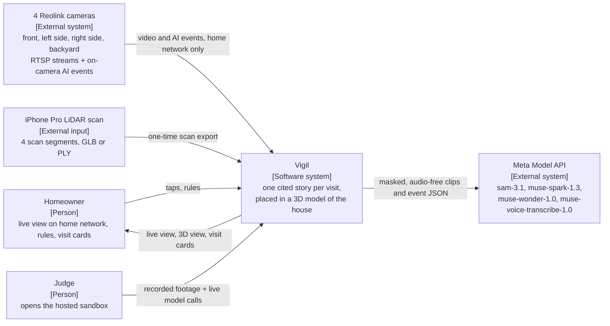

### 5.2 C4 level 2: containers

The home PC runs capture, Reolink events, the pipeline and the LAN app. The hosted sandbox runs the same `vigil` package on an exported bundle, makes only 3 kinds of live call, and never connects to the house.

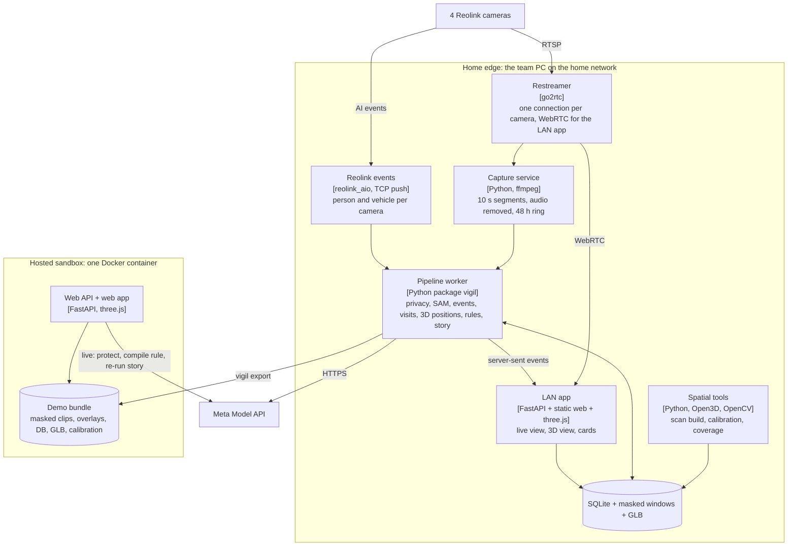

### 5.3 C4 level 3: components of the `vigil` package

Each box is one file in section 9. All model calls go through `meta/client.py`, which owns retries, caching and the spend ledger.

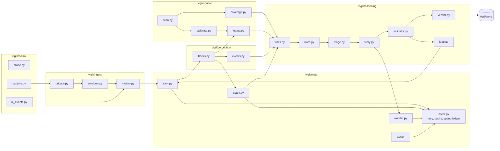

### 5.4 Sequence: processing one window

The motion gate decides whether any model is called; SAM 3.1 takes one noun phrase per request, so `person`, `car` and each watch are separate calls on one uploaded file.

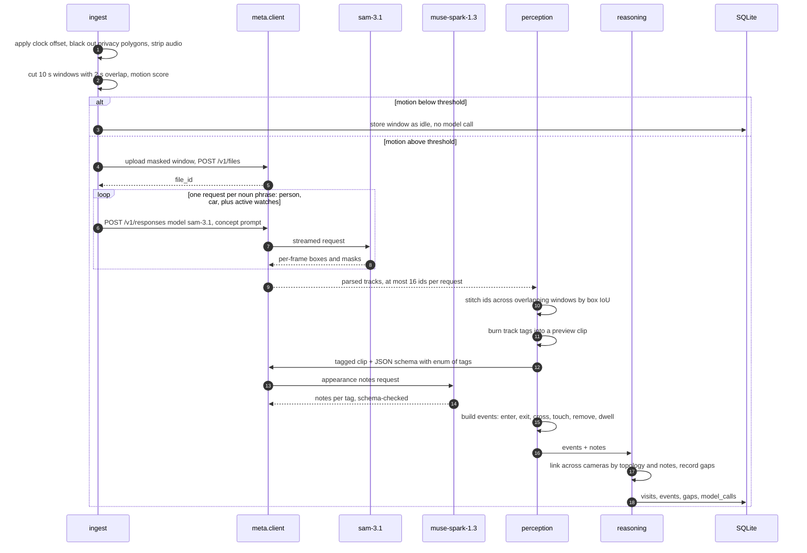

### 5.5 Sequence: story, validation and verdict

Wonder writes; code checks and decides. Gap sentences never come from the model.

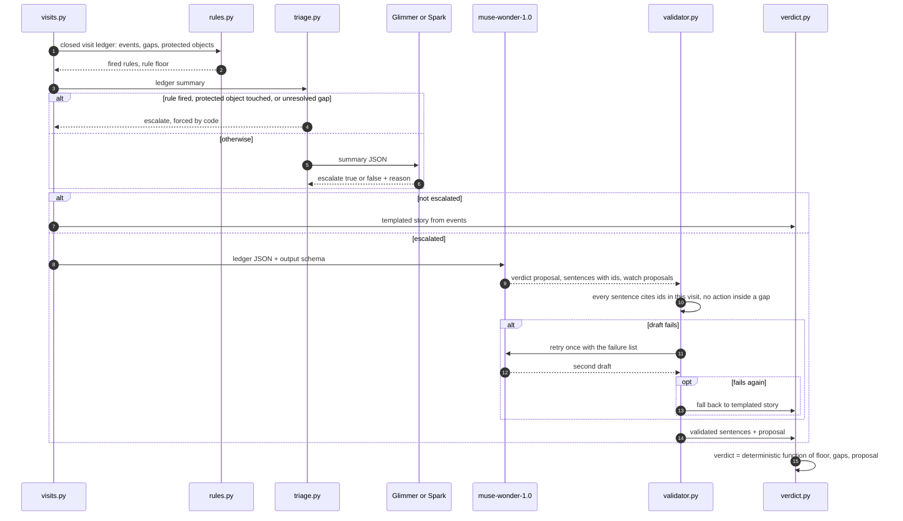

### 5.6 Sequence: tap-to-protect and voice rule

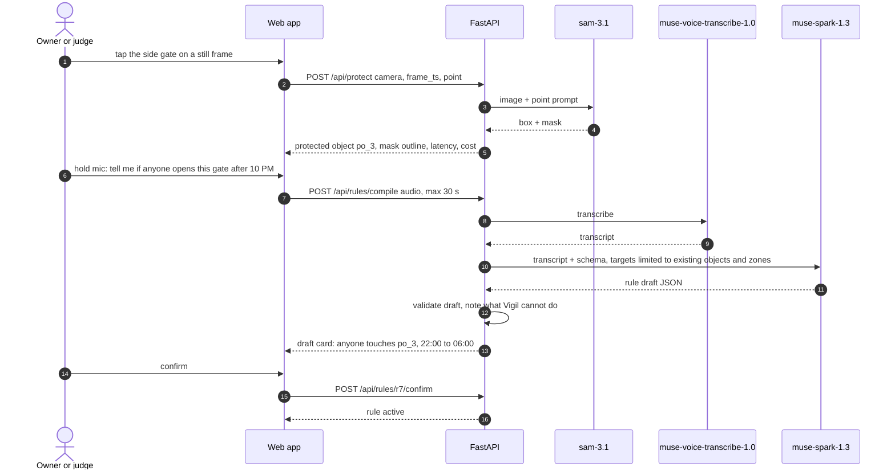

### 5.7 Sequence: the closed loop (Wonder steers SAM 3.1)

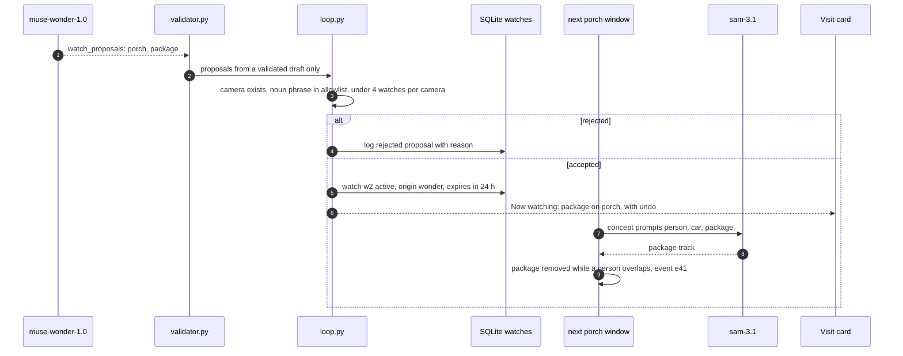

### 5.8 Data flow and AI inference pipeline, with the privacy boundary

Wonder never sees pixels; it reasons over the event ledger, which is also what makes its claims checkable.

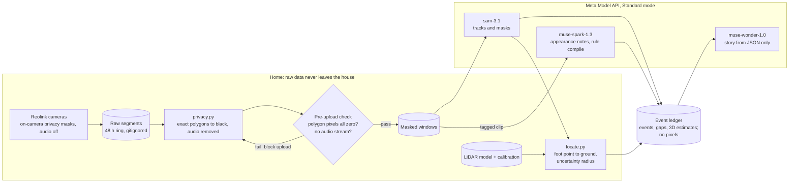

### 5.9 State machine: visit lifecycle

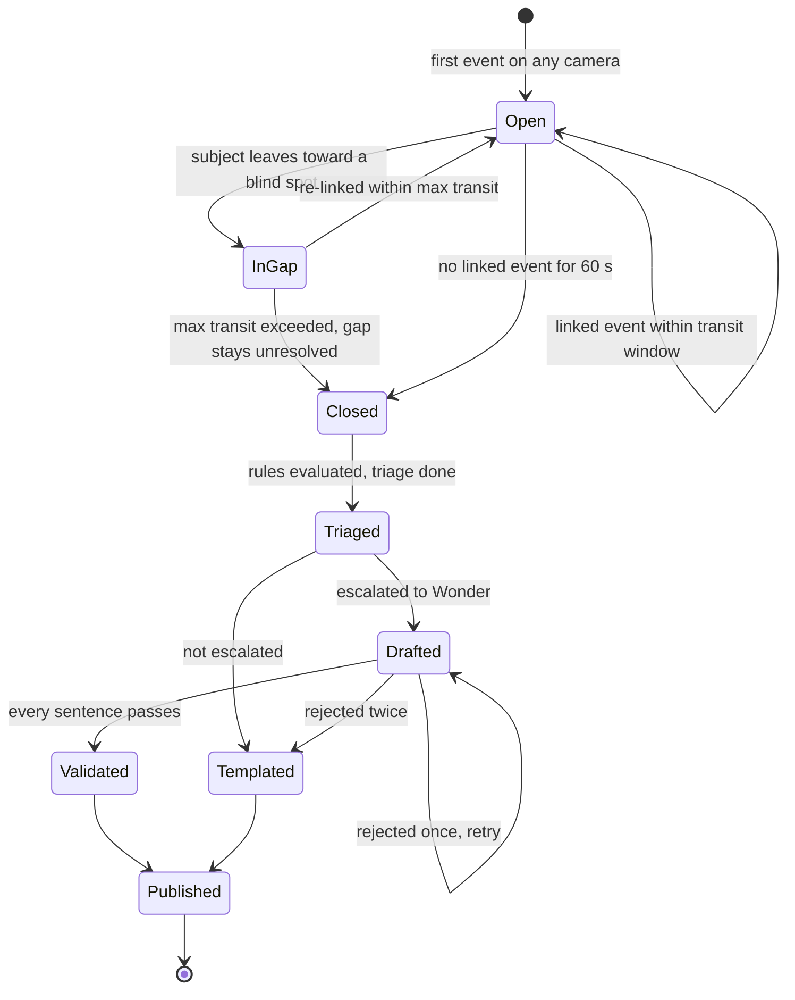

### 5.10 State machines: rules and watches

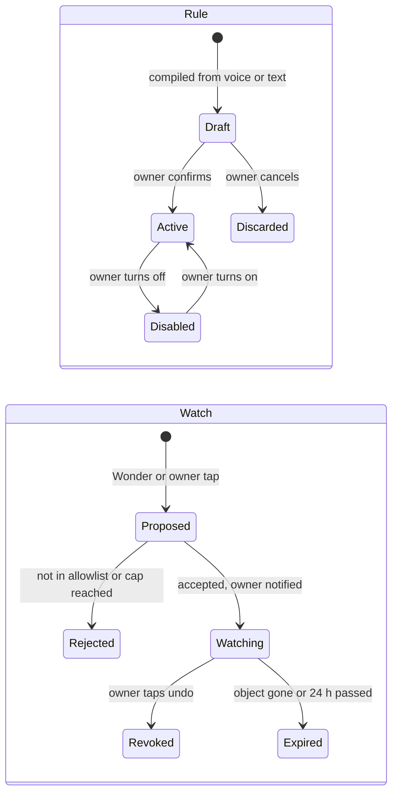

### 5.11 Deployment

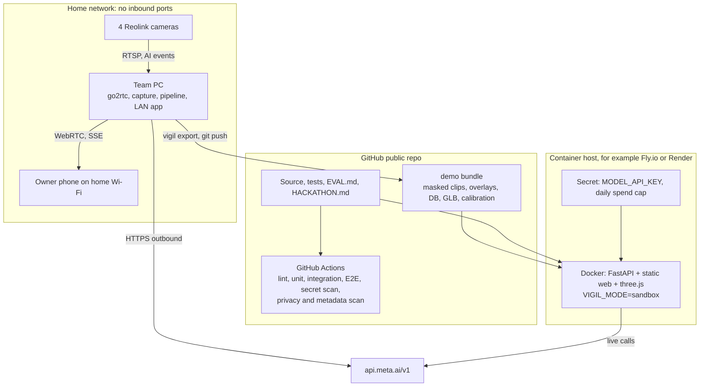

### 5.12 Spatial build and calibration pipeline

Every gate has a measured acceptance value and a fallback, so a weak scan or calibration lowers accuracy, never the demo.

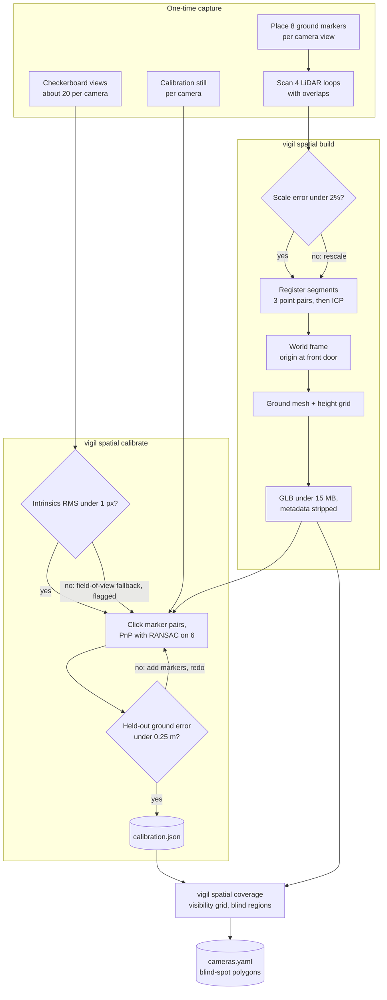

### 5.13 Sequence: live near-real-time mode at home

The Reolink event reaches the 3D view first, with no position; SAM 3.1 tracks and 3D estimates follow when the segment closes and is processed. The lag is measured and shown on screen.

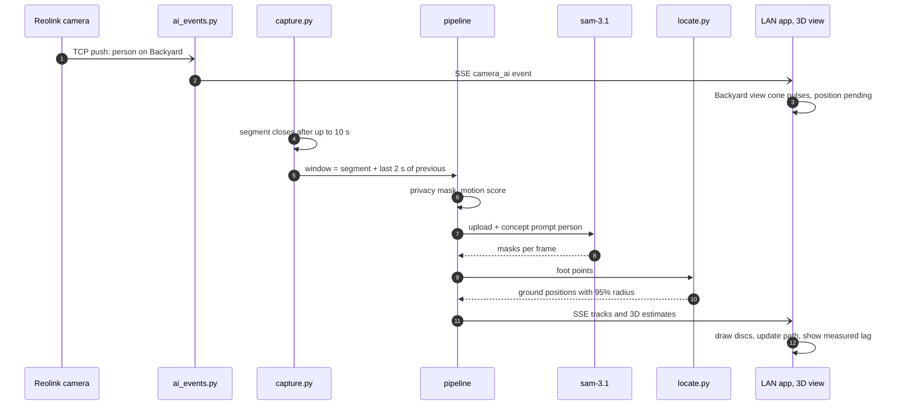

### 5.14 Verified Meta API facts this design depends on

| Fact | Design consequence | Source |
| --- | --- | --- |
| SAM 3.1 is called on `POST /v1/responses` with model `sam-3.1`; video by `file_id` from `POST /v1/files` | Upload each window once, reuse the `file_id` for every noun phrase | [Segmenting with prompts](https://dev.meta.ai/docs/sam/segmenting) |
| A concept prompt is one noun phrase; comma lists return zero matches | One request per class or watch | same |
| Video tracks up to 16 objects; up to 15,000 frames per request; MP4 or MOV, H.264/H.265 | 10 s windows at 10 fps; split a window when 16 IDs are used | same |
| Point and box prompts exist, with `w` and `h` matching the media's aspect ratio | Tap-to-protect sends a point prompt with the still's exact size | same |
| `include_confidence` must be the string `"true"`; parsers `meta-sam-parser` 0.0.6+ / `@meta-sam/parser` 0.0.13+ read it | Pin parser versions | same; [meta-sam](https://github.com/meta-models/meta-sam) |
| SAM 3.1 video: $0.20 per 1,000 frames, minimum 50 per request; Spark 1.3 $1.25/$4.25 and Wonder $4/$20 per million tokens; Voice Transcribe $0.18 per hour | One 10 s window and one phrase costs about $0.02 | [Pricing and rate limits](https://dev.meta.ai/docs/pricing-rate-limits) |
| Standard mode: content not used for training; Contributor mode is | Never use `-contributor` IDs (NFR-004) | same |
| Rate limits: 3,000 RPM for Spark, Wonder and SAM | Not a constraint at demo scale | same |

⚠️ Not yet verified; check today with a one-call smoke test each: (1) whether `muse-wonder-1.0` accepts a strict JSON schema; if not, use JSON mode plus the validator, which already handles malformed output; (2) the exact request fields of Voice Transcribe's batch endpoint (`POST /v1/asr/transcribe` is named in [a secondary source](https://www.orcarouter.ai/blog/muse-api)); if batch is unavailable, use the realtime WebSocket or fall back to typed rules; (3) Muse Spark 1.3 video input with a strict schema, which [Guestlist](https://github.com/DanielSensual/guestlist) reports using.

## 6. Reolink integration (real-world environment)

Vigil runs on the 4 home Reolink cameras (front entrance, left side, right side, backyard) through a home edge service. It records continuously in 10 s segments and uses Reolink's on-camera person and vehicle detection as the instant trigger. SAM 3.1 then adds masks and tracks seconds to tens of seconds later. That is **near-real-time**, and the README and video must say so. The "real-time" claim applies only to the camera's own AI events.

### Hardware compatibility (check first: `scripts/reolink_probe.py`)

| Camera type | Continuous stream | On-camera AI events | Fit for Vigil |
| --- | --- | --- | --- |
| PoE or plug-in Wi-Fi cameras | Yes: `rtsp://user:pass@IP:554/Preview_01_main` and `Preview_01_sub` | Yes | Full support |
| Cameras on a Reolink NVR | Yes, per channel: `Preview_0N_main` | Yes, through the NVR | Full support |
| Battery cameras (Argus, Altas) | Only through a Home Hub or NVR, and the preview drops after 5 min | Through Hub or NVR | Event clips only; not continuous |
| LTE cameras (Go series) | Not supported by the Home Assistant integration | No | Not usable |
| Any camera bound to a Reolink cloud account | Local login unavailable until switched to local | No | Switch to local first |

Sources: [Reolink RTSP introduction](https://support.reolink.com/hc/en-us/articles/900000630706-Introduction-to-RTSP/), [Home Assistant Reolink integration](https://www.home-assistant.io/integrations/reolink/). **Open item:** the 4 camera models, and whether an NVR is in use. A battery camera on any side changes that side to event clips only.

### Streams

- **Main stream** (up to 4K H.265 on some models; RTSP is the only protocol that carries 4K): used for processing; re-encoded to 1280 px H.264 at 10 fps for SAM 3.1.
- **Sub stream** (H.264, low resolution): used for the motion gate and live view.
- **FLV** is the lightest protocol on the camera, and the fallback if RTSP connections drop (per the Home Assistant page).
- Browsers cannot play RTSP, so the LAN app uses an open-source restreamer such as go2rtc (WebRTC or MSE). It also keeps one connection per camera, which reduces camera load. ⚠️ Check go2rtc's licence and set it up on day 1.

### Detection layers (never mixed in the UI)

| Layer | Source | Latency | What it gives | Shown as |
| --- | --- | --- | --- | --- |
| Camera AI event | Reolink on-camera AI through [reolink\_aio](https://pypi.org/project/reolink_aio/) TCP push (MIT) | ⚠️ seconds; measure on day 1 | Person or vehicle present on camera X; no box, no position | The camera's view cone pulses; badge "Reolink AI: person" |
| Segmentation and tracks | SAM 3.1 on 10 s windows | ⚠️ target 30 s behind live; measured | Masks, boxes, track IDs per frame | Outlines on the video |
| 3D estimate | Vigil code: foot point projected onto the LiDAR ground (section 7) | Adds milliseconds | Position with an uncertainty radius | Translucent disc in the 3D view |
| Story and verdict | Spark, Wonder, validator, rules | After the visit closes | Cited story and verdict | Visit card |

Reolink's events also give a free cross-check: the share of Reolink person events matched by a SAM person track is reported in EVAL, and so are the mismatches.

### Near-real-time pipeline on the edge machine

1. The restreamer holds one connection per camera.
2. ffmpeg records the main stream into contiguous 10 s segments, audio removed. A processing window is a segment plus the last 2 s of the one before, giving the 2 s overlap that track stitching needs (FR-007).
3. A window is processed when a Reolink AI event overlaps it or the motion gate fires.
4. Privacy polygons are applied when the window is built (FR-003), then the normal pipeline runs.
5. New events, tracks and 3D estimates are pushed to the LAN app over server-sent events.
6. Raw segments are deleted after 48 h; only masked windows chosen for the demo are kept.

### Security and privacy for real cameras

- **Two privacy layers.** On-camera privacy masks (rectangles) over the street and neighbouring properties apply to live view and recordings ([Reolink](https://support.reolink.com/hc/en-us/articles/360003493454--How-to-Set-up-Privacy-Mask-for-Reolink-Cameras)). ⚠️ Confirm in VLC that the RTSP stream carries the mask. Vigil's exact polygons (FR-003) remain the second layer. The side cameras are the most likely to see neighbours.
- **Audio off** on the cameras for the hackathon period, and removed again by ffmpeg.
- **Credentials** only in `.env` on the edge machine; a unique password; a low-privilege user if the model supports user roles (⚠️ check).
- **No exposure.** No port forwarding and no public RTSP; remote access only through a private VPN; the hosted sandbox never connects to the house.
- **No address leakage.** Strip GPS metadata from scan exports; mask the house number; no street-facing frames in the repo.

### What judges get versus what the video shows

- **Judges** get the hosted sandbox: real Reolink footage replayed in the 3D model, with cached results and live model calls. It never connects to the house.
- **The video** shows the live LAN mode at home: the Reolink event pulses at once, and SAM tracks and 3D positions follow, with the measured lag shown on screen.

## 7. Spatial model: LiDAR scan, calibration and 3D viewer

An iPhone LiDAR scan gives the house a metric 3D model. Each camera is calibrated into it, so every SAM 3.1 detection can be projected to a ground position with a stated uncertainty. The viewer always separates what a camera saw from where Vigil estimates someone stood. This also places Vigil in the "Push the Frontier" theme (understanding a physical space), alongside "Build for Your World".

### Scan capture

- **Device:** an iPhone Pro with LiDAR. **App:** Scaniverse (free; exports GLB, OBJ, PLY and LAS, among others ([review](https://www.structuralbasics.com/?p=3713))). ⚠️ Confirm the export keeps metric scale by measuring 2 known distances.
- **Known limits:** about 5 m range and good local precision (about 0.5 cm on flat surfaces), but drift grows on large or complex walks. In one study only two rooms (about 200 m²) stayed consistent ([ISPRS 2022](https://isprs-archives.copernicus.org/articles/XLIII-B4-2022/303/2022/isprs-archives-XLIII-B4-2022-303-2022.pdf)). Roofs and upper floors will be missing; ground, walls, fences and the shed are what matter.
- **Method:** place calibration markers first (below), then scan 4 short closed loops (front, left side, right side, backyard). Each loop overlaps its neighbour by at least 3 fixed features (corners, posts, steps). Scan in shade or late afternoon ⚠️, walk slowly, and keep the phone 1 to 3 m from surfaces.

### Processing: `vigil spatial build`

1. Load the 4 segments (Open3D). Check scale against 2 tape-measured distances; accept under 2% error, otherwise rescale.
2. Register the segments: coarse alignment from 3 clicked point pairs, then ICP refinement; record the fit error.
3. Build the world frame: origin at a marker on the front-door threshold, +X along the front wall, +Y up (glTF convention).
4. Extract the ground: keep the ground mesh as the ray-cast target, and a 0.1 m height grid for fast lookup (yards slope).
5. Simplify and compress the mesh to a GLB under 15 MB, downscale textures, and strip GPS and device metadata.

### Camera calibration

| Step | Method | Accept when | Fallback |
| --- | --- | --- | --- |
| Intrinsics | Printed checkerboard on a rigid board, about 20 views per camera from the main stream; OpenCV standard model, or the fisheye model for very wide lenses | RMS reprojection under 1.0 px | Focal length from the lens field of view, no distortion; flagged low accuracy |
| Extrinsics | 8 ground markers per camera (tape crosses or cones) visible in both the scan and the camera still. Click each marker in the still and on the mesh in the calibration tool, then solve PnP with RANSAC, using 6 points and holding out 2 | Mean reprojection under 4 px at 1280 px width; held-out ground error under 0.25 m | Planar homography from 4+ markers if the mesh is unusable |
| Record | `config/calibration.json`: camera matrix, distortion, model, rotation, translation, image size, both errors, date | Loads and passes `test_calibration.py` | none |

Re-calibrate a camera if it is moved; `vigil spatial check` compares a reference still against the current view (P2).

### From detection to 3D position

1. **Foot point:** the median x and maximum y of the lowest 5% of the SAM mask's pixels, undistorted.
2. **Ray cast:** cast a ray from the camera centre through the foot point and intersect it with the ground mesh.
3. **Occlusion:** if the mask touches the image's bottom edge or is clipped, the feet are hidden. Use the top of the mask with a 1.7 ± 0.15 m height prior instead, and flag the estimate as low confidence.
4. **Uncertainty:** sample the foot pixel 50 times with 3 px noise plus the camera's held-out calibration error, re-cast each sample, and report the 95% radius.
5. **Smoothing:** positions at 2 Hz with a 1 s median filter. Nothing is ever interpolated across a gap.
6. **Two cameras:** when linked tracks overlap in time, take the inverse-variance weighted mean. If the two estimates are more than 1 m apart, keep both and flag them as inconsistent.
7. **Accuracy test:** a person stands on 6 surveyed markers per camera that were not used for calibration. ⚠️ The target (median error under 0.5 m within 10 m of the camera) is pre-registered in EVAL.md before measuring.

### Coverage map and blind spots

On a 0.25 m ground grid, a cell counts as visible to a camera when it projects inside the image, is outside every privacy polygon, and has a clear line of sight (mesh ray cast). Cells no camera sees form the blind regions, such as "behind the shed". They are written to `cameras.yaml` as blind-spot polygons, so the topology and gap logic (FR-010, FR-011) come from measured geometry instead of guesses.

### 3D viewer (`web/twin/`)

- three.js with the GLTF loader and orbit controls, version pinned and vendored. Layers: mesh, per-camera coverage, blind regions (hatched grey), camera view cones.
- One timeline is shared by the 3D view, the video players and the visit card. Clicking a disc opens its evidence frame; clicking a citation moves the 3D view to that moment.
- Targets: 60 fps on a laptop and at least 30 fps on a mid-range phone, with the GLB loaded in under 5 s on 50 Mbps.

**Visual encoding: seen versus estimated** (legend always visible; text plus shape, never colour alone)

| What | Meaning | Shown as |
| --- | --- | --- |
| Camera AI event | Reolink says someone is on camera X; no position | The camera's view cone pulses; label "Presence on camera, position pending" |
| Camera detection | SAM 3.1 mask in that camera's image | Outline on the video; matching camera cone highlighted |
| Estimated position | Ray-cast estimate | Translucent disc, dashed edge, radius = uncertainty; label "Estimated ±0.4 m from Side camera" |
| Estimate from 2 cameras | Fused estimate | Double ring; label "Estimated from 2 cameras ±0.2 m" |
| Low-confidence estimate | Height-prior fallback | Hollow disc; label "Low confidence" |
| Observed path | Estimates no more than 1 s apart | Solid line |
| Gap | No camera sees the subject | Dotted grey straight line, labelled "Not observed · 41 s"; no positions drawn inside it |

### Fallback ladder for the 3D model

1. All 4 scan segments registered into one mesh.
2. Segments kept separate, each aligned to a tape-measured site plan.
3. No usable scan: a site plan built from tape measurements (house footprint, fences, shed as boxes). Calibration uses the ground plane and homographies, so positions still work on flat ground. The demo survives at every level.

## 8. Optional: Wi-Fi sensing beyond the cameras

**Recommendation: leave Wi-Fi sensing out of the hackathon submission, and run one small experiment after Nov 4.** It uses no Meta model, so it adds nothing to the 25% tooling criterion. It cannot be shown to judges remotely, and it needs at least a day of placement and tuning. It also raises an indoor-occupant privacy question that the current design avoids.

### Projects evaluated

| Project | Hardware | What it senses | Evidence of accuracy | Integration effort | Verdict |
| --- | --- | --- | --- | --- | --- |
| [ESPectre](https://github.com/francescopace/espectre) | One ESP32 board per room (C6, C5, C3, S3, S2 or classic), 2.4 GHz Wi-Fi 4 | Motion and a movement score. It does not identify or count people, and does not prove a room is empty | No figures on the README; a separate performance report exists (not reviewed) | Low to medium: browser flashing; MQTT, Home Assistant, Matter or a local HTTP API | **Best candidate** for a later experiment |
| [Espressif ESP-CSI](https://github.com/espressif/esp-csi) | ESP32 family; 1 board with a router, 3+ boards, or a dedicated sender | Raw CSI; presence and motion demo with on-site training | No figures published; the dedicated-sender setup is described as most accurate | Medium to high: building blocks, not a product | Use only if ESPectre falls short |
| [Nexmon CSI](https://github.com/seemoo-lab/nexmon_csi) | Raspberry Pi 3B+, 4B or 5 (bcm43455c0), some phones, one Asus router | Raw per-frame CSI; no presence detection | None for presence | High: patched firmware and drivers tied to kernel versions | Research only; reject |
| RuView ("WiFi DensePose") | 3 to 6 ESP32-S3 nodes | Claims pose, breathing, heart rate, through-wall presence | Claims unverified; an independent developer reported placeholder random data in earlier code ([CNX Software](https://www.cnx-software.com/2026/03/26/ruview-project-leverages-esp32-nodes-for-presence-detection-pose-estimation-and-breathing-heart-rate-monitoring/)) | Unclear | **Reject** |

Consumer routers generally do not expose CSI; commercial Wi-Fi motion products were not evaluated (⚠️ not researched).

### Where it would genuinely add value

Vigil's cameras are outdoors, and Wi-Fi sensing works best indoors. The useful overlap is enclosed spaces next to the yard that no camera sees: the shed and the garage. In scenario C, a sensor in the shed could add one fact to the 41 s gap: "Motion was detected inside the shed during this time." That is still motion, not a person, and the story must say exactly that.

### If the experiment goes ahead (after Nov 4)

1. Two ESPectre boards: shed and garage. Confirm 2.4 GHz coverage from the router at both spots first.
2. Vigil subscribes over MQTT and stores `radio_motion` events with a source badge "Wi-Fi motion (not a camera)".
3. These events can annotate a gap; they never raise a verdict on their own.
4. Measure for one week against camera-confirmed entries into the shed: hits, misses, false alarms. Publish the numbers before relying on the signal.
5. **Privacy:** sensors only in outbuildings, never in living spaces; household members told and agree; raw CSI collection off. ESPectre's firmware is GPLv3, which is fine because Vigil only talks to it over MQTT as a separate program.

## 9. Engineering implementation plan

One Python package (`vigil`) and one static web app, built in the order of the task table below, with every task closed by a named test. The task table assumes 2 or more people on parallel tracks. If one person builds alone, T-25 and the baseline (FR-025) become optional, and the gates in the table decide the cuts.

### 9.1 Repository structure

```text
vigil/
├── README.md            value line, video, sandbox link, EVAL table, model table
├── HACKATHON.md         dates, commit range, prior work, contributors, consent record
├── EVAL.md              targets committed first, results appended after
├── Makefile             setup, test, e2e, demo, eval, export, deploy
├── pyproject.toml  Dockerfile  .env.example
├── config/
│   ├── cameras.yaml     cameras, stream paths, offsets, zones, lines, blind regions, topology
│   ├── calibration.json intrinsics, extrinsics, errors per camera
│   ├── privacy/<cam>.json
│   ├── rules.default.json
│   └── allowlist.json   watch noun phrases
├── infra/go2rtc.yaml    restreamer config (credentials from env)
├── vigil/
│   ├── settings.py  cli.py
│   ├── reolink/     probe.py  capture.py  ai_events.py
│   ├── ingest/      sync.py  privacy.py  windows.py  motion.py
│   ├── meta/        client.py  budget.py  cache.py  sam.py  sam_local.py  spark.py  wonder.py  asr.py  glimmer.py  prompts/
│   ├── perception/  tracks.py  events.py  overlays.py
│   ├── spatial/     scan.py  calibrate.py  coverage.py  locate.py
│   ├── reasoning/   topology.py  visits.py  rules.py  triage.py  story.py
│   │                validator.py  verdict.py  loop.py  templates.py
│   ├── store/       schema.sql  db.py  export.py
│   ├── api/         app.py  routes.py  live.py  guards.py
│   └── eval/        run.py  metrics.py  baseline.py  spatial_eval.py
├── web/
│   ├── index.html  app.js  cards.js  player.js  styles.css
│   ├── twin/        viewer.js  layers.js  legend.js  vendor/three/
│   └── calibrate/   index.html  calibrate.js   (LAN only)
├── eval/labels/<scenario>.json   eval/results.json
├── demo/                masked clips, overlays, exported DB, GLB, calibration
├── data/                raw segments, scans, checkerboard frames (gitignored)
├── scripts/             smoke_meta.py  gpu_probe.py  bench_sam_local.py  privacy_scan.py  metadata_scan.sh
├── tests/               unit/  integration/  e2e/  fixtures/
└── .github/workflows/ci.yml
```

### 9.2 Dependencies (pin exact versions in `pyproject.toml` on day 1)

| Area | Choice | Why |
| --- | --- | --- |
| Runtime | Python 3.12, ffmpeg | `reolink_aio` needs 3.11+ |
| Web | FastAPI, uvicorn, sse-starlette, pydantic 2 | Typed contracts, server-sent events |
| HTTP | httpx | Streaming responses from Meta |
| Video and vision | opencv-python-headless, numpy | Masking, motion, calibration, PnP |
| SAM output | `meta-sam-parser` 0.0.6 or later | Reads masks and confidence |
| Cameras | `reolink-aio` (MIT), go2rtc binary | TCP push events; restreaming |
| 3D | Open3D (registration, ray casting), gltf-transform CLI (compression) | Proven, scriptable |
| Front end | three.js (vendored, pinned), plain JS, no build step | Fewer moving parts |
| CLI | typer | `vigil ingest`, `process`, `spatial`, `eval`, `export` |
| Tests | pytest, respx, hypothesis, Playwright (Python), ruff | Unit, recorded HTTP, property tests, E2E |
| CI scans | gitleaks, exiftool, `scripts/privacy_scan.py` | NFR-001, NFR-014, NFR-032 |

### 9.3 Data model (`vigil/store/schema.sql`)

```sql
CREATE TABLE cameras(id TEXT PRIMARY KEY, name TEXT, width INT, height INT, offset_s REAL);
CREATE TABLE windows(id TEXT PRIMARY KEY, camera_id TEXT, t0 REAL, t1 REAL, path TEXT,
  file_id TEXT, motion REAL, trigger TEXT, status TEXT);
CREATE TABLE camera_ai_events(id TEXT PRIMARY KEY, camera_id TEXT, kind TEXT, t0 REAL, t1 REAL);
CREATE TABLE tracks(id TEXT PRIMARY KEY, camera_id TEXT, cls TEXT, t_first REAL, t_last REAL,
  overlay_path TEXT);
CREATE TABLE track_windows(track_id TEXT, window_id TEXT, sam_obj_id INT);
CREATE TABLE appearance(track_id TEXT PRIMARY KEY, notes_json TEXT, call_id TEXT);
CREATE TABLE positions(track_id TEXT, t REAL, x REAL, y REAL, z REAL, r95 REAL,
  method TEXT CHECK(method IN ('footpoint','height_prior','fused')), cameras TEXT, flags TEXT);
CREATE TABLE protected_objects(id TEXT PRIMARY KEY, camera_id TEXT, label TEXT, mask_path TEXT,
  bbox_json TEXT, footprint_json TEXT, call_id TEXT, created_at TEXT);
CREATE TABLE watches(id TEXT PRIMARY KEY, camera_id TEXT, phrase TEXT, origin TEXT, status TEXT,
  expires_at TEXT, source_visit_id TEXT);
CREATE TABLE events(id TEXT PRIMARY KEY, visit_id TEXT, camera_id TEXT, track_id TEXT, type TEXT,
  t0 REAL, t1 REAL, target TEXT, clip_t0 REAL, clip_t1 REAL);
CREATE TABLE visits(id TEXT PRIMARY KEY, scenario TEXT, t0 REAL, t1 REAL, state TEXT, floor TEXT,
  proposal TEXT, verdict TEXT, escalated INT, story_json TEXT);
CREATE TABLE gaps(id TEXT PRIMARY KEY, visit_id TEXT, kind TEXT, t0 REAL, t1 REAL,
  from_camera TEXT, to_camera TEXT, region_id TEXT, resolved INT);
CREATE TABLE rules(id TEXT PRIMARY KEY, json TEXT, source TEXT, state TEXT, created_at TEXT);
CREATE TABLE rule_hits(rule_id TEXT, visit_id TEXT, event_id TEXT);
CREATE TABLE model_calls(id TEXT PRIMARY KEY, model TEXT, purpose TEXT, visit_id TEXT, req_hash TEXT,
  latency_ms INT, in_tokens INT, out_tokens INT, units REAL, cost_usd REAL, cached INT, ok INT,
  error TEXT, created_at TEXT);
CREATE TABLE validations(visit_id TEXT, attempt INT, passed INT, failures_json TEXT);
```

Times are seconds on the aligned session clock; wall-clock time is derived from the session start for display.

### 9.4 Contracts

**`config/cameras.yaml` (excerpt)**

```yaml
timezone: America/Los_Angeles
cameras:
  - id: side_left
    name: Left side
    source: {host_env: REOLINK_SIDE_LEFT_HOST, channel: 1}
    offset_s: -0.42
    lines: {side_gate: [[812, 410], [870, 655]]}
    exits: {to_shed_back: [[1100, 380], [1280, 720]]}
blind_regions:            # written by vigil spatial coverage
  - {id: shed_back, name: behind the shed, polygon_m: [[4.1, 9.0], [7.3, 9.0], [7.3, 11.2], [4.1, 11.2]]}
topology:
  - {from: side_left, exit: to_shed_back, to: shed_back, blind: true}
  - {from: shed_back, to: side_left, min_s: 5, max_s: 180, blind: true}
  - {from: front, to: side_left, min_s: 2, max_s: 20}
```

**Rule** (`rules.py`, pydantic model)

```json
{"id": "r7", "name": "Side gate after 10 PM",
 "target": {"kind": "protected_object", "id": "po_side_gate"},
 "trigger": "touch", "min_dwell_s": null,
 "active": {"start": "22:00", "end": "06:00"},
 "severity": "needs_attention", "applies_to": "anyone", "state": "active"}
```

`trigger` is one of touch, cross, enter, removed, dwell; `target.kind` is one of protected\_object, zone, line, watch.

**Appearance notes** (Spark, strict schema; `tag` is an enum of the burned-in track tags; colours are a fixed list plus `unknown`)

```json
{"tracks": [{"tag": "T3", "class": "person", "upper_color": "navy", "lower_color": "grey",
  "carrying": ["backpack"], "vehicle_color": null, "vehicle_body": null}]}
```

**Story** (Wonder; `verdict_proposal` can only be normal or noteworthy; gap sentences are inserted by code)

```json
{"verdict_proposal": "noteworthy",
 "sentences": [{"text": "A person touched the side gate at 10:14 PM.", "event_ids": ["e17"]}],
 "gap_after_sentence": [{"gap_id": "g4", "after": 0}],
 "watch_proposals": [{"camera_id": "front", "phrase": "package", "reason_event_id": "e9"}]}
```

**Verdict function** (`verdict.py`, the whole rule set)

```python
ORDER = {"normal": 0, "noteworthy": 1, "needs_attention": 2}

def compose(floor: str, unresolved_gap: bool, proposal: str | None, proposal_cited: bool) -> str:
    if floor == "needs_attention":          # only rules can set this
        return "needs_attention"
    if unresolved_gap:                      # no rule fired, subject vanished
        return "cant_confirm"
    if proposal == "noteworthy" and proposal_cited:
        return max(floor, "noteworthy", key=ORDER.get)
    return floor                            # Wonder can never lower the floor
```

A protected-object touch with no matching rule sets the floor to noteworthy.

**Validator checks** (`validator.py`; any failure rejects the draft)

1. Schema valid; 1 to 6 sentences.
2. Every sentence cites at least 1 event, and every cited event belongs to this visit.
3. Every clock time in a sentence is within 60 s of a cited event and outside every gap.
4. Every camera name in a sentence belongs to a cited event.
5. No banned words: gender, age, ethnicity, or judgements such as "suspicious", "intruder" or "thief". The subject is always "a person" or "they".
6. Every `gap_id` exists in this visit.

**Position estimate** (`locate.py`)

```python
def locate(track_frame: Mask, cam: Calibration, ground: RaycastScene, rng: Generator
           ) -> Position | None:
    """Foot point -> undistort -> ray -> ground hit. 50 noisy samples give r95.
    Clipped or bottom-touching masks use the height prior and are flagged."""
```

### 9.5 Module interfaces

```python
# vigil/reolink
async def probe(cam: CameraCfg) -> ProbeReport
async def run_capture(cams: list[CameraCfg], out_dir: Path, segment_s: int = 10) -> None
async def stream_ai_events(cams: list[CameraCfg]) -> AsyncIterator[CameraAiEvent]
# vigil/meta (every call goes through MetaClient: retries, cache, spend cap, ledger)
class MetaClient:
    def upload(self, path: Path) -> str
    def responses(self, model: str, body: dict, purpose: str, visit_id: str | None = None,
                  stream: bool = False) -> RawResponse
def track_concept(c: MetaClient, w: Window, phrase: str) -> list[SamObject]
def segment_point(c: MetaClient, still: Path, x: int, y: int) -> Mask
def appearance_notes(c: MetaClient, tagged_clip: Path, tags: list[str]) -> dict[str, Appearance]
def compile_rule(c: MetaClient, text: str, catalog: TargetCatalog) -> RuleDraft
def triage(c: MetaClient, summary: VisitSummary) -> TriageDecision
def write_story(c: MetaClient, ledger: VisitLedger, failures: list[str] | None = None) -> StoryDraft
# vigil/perception
def stitch(objs: list[WindowObjects]) -> list[Track]
def build_events(tracks: list[Track], cfg: Config, protected: list[ProtectedObject],
                 watches: list[Watch]) -> list[Event]
# vigil/spatial
def build_model(segments: list[Path], measured: list[Distance]) -> SpatialModel
def calibrate_intrinsics(frames: list[Path], fisheye: bool) -> Intrinsics
def calibrate_extrinsics(pairs: list[PixelPoint3D], k: Intrinsics) -> Extrinsics
def coverage(model: SpatialModel, cams: list[Calibration], cell_m: float = 0.25) -> Coverage
# vigil/reasoning
def assemble_visits(events, tracks, notes, positions, topology) -> list[Visit]
def evaluate_rules(visit: Visit, rules: list[Rule]) -> RuleResult
def validate(draft: StoryDraft, ledger: VisitLedger) -> ValidationResult
def accept_watches(proposals, catalog, allowlist, active) -> list[Watch]
```

### 9.6 HTTP API (FastAPI)

| Method and path | Request | Response | Mode | Guard |
| --- | --- | --- | --- | --- |
| `GET /api/health` | none | mode, spend today, cap | all | none |
| `GET /api/scenarios` | none | list of scenarios | all | none |
| `GET /api/scenarios/{id}` | none | cameras, clip URLs, visits | all | none |
| `GET /api/visits/{id}` | none | verdict, sentences with citations and badges, events, gaps, trace | all | none |
| `GET /api/visits/{id}/positions` | none | positions with method, r95, cameras, flags | all | none |
| `GET /api/twin` | none | GLB URL, camera poses and view cones, coverage, blind regions | all | none |
| `GET /api/calls?visit_id=` | none | model call ledger rows | all | none |
| `GET /api/eval` | none | `eval/results.json` | all | none |
| `POST /api/protect` | camera\_id, frame\_ts, point {x, y}, label | protected object, mask outline, 3D footprint, latency, cost | live or cached preset | rate limit, spend cap |
| `POST /api/rules/compile` | text, or audio of 30 s and 2 MB at most | transcript, rule draft, limits note | live | rate limit, spend cap, size limit |
| `POST /api/rules/{id}/confirm` | none | rule state | all | none |
| `POST /api/visits/{id}/rerun` | stage: story | job ID; result through `GET /api/jobs/{id}` | live | rate limit, spend cap |
| `GET /api/live/stream` | none | server-sent events: camera\_ai, tracks, positions, visits | LAN only | bound to LAN interface |
| `POST /api/spatial/pairs` | camera\_id, pixel, world point | updated extrinsics and errors | LAN only | bound to LAN interface |

### 9.7 Tasks in order (times PT; tracks: A pipeline, B models and reasoning, C app and 3D, D field work and evidence)

| Task | Track | Done by | Depends on | Files | Done when |
| --- | --- | --- | --- | --- | --- |
| T-01 Audit repo; claim credits and set spend limit; pick track; commit EVAL.md targets, including NFR-025 and NFR-026 | D | Mon 11:30 | none | `EVAL.md`, `HACKATHON.md` | Commit pushed; Status column in section 1 updated |
| T-02 Scaffold and CI (skip what exists) | A | Mon 12:30 | T-01 | `pyproject.toml`, `Makefile`, `ci.yml`, `settings.py` | CI green: ruff, pytest, gitleaks |
| T-03 Meta smoke tests; resolve the 3 open API questions | B | Mon 12:30 | T-01 | `scripts/smoke_meta.py`, `tests/fixtures/meta/` | One recorded response per model; findings written into section 5.14 |
| T-04 Reolink probe; on-camera privacy masks; audio off | D | Mon 12:30 | T-01 | `reolink/probe.py`, `config/cameras.yaml` | FR-030 passes; mask confirmed in the RTSP stream |
| T-05 Restreamer and capture service | A | Mon 14:00 | T-04 | `reolink/capture.py`, `infra/go2rtc.yaml` | 30 min test without gaps; 2 h test runs overnight (NFR-029) |
| T-06 Markers, 4 LiDAR loops, checkerboard views, calibration stills | D | Mon 16:30 (before dusk) | T-04 | `data/scan/`, `data/calib/` | Exports on disk; 2 measured distances written down |
| T-07 Film 12 scenarios with consent; write labels before processing | D | Mon 21:00 | T-05 | `eval/labels/` | 12 labelled scenarios; consent records held privately |
| T-08 Privacy, windows, motion gate, privacy scan | A | Mon 17:00 | T-05 | `ingest/*.py`, `scripts/privacy_scan.py` | FR-003 to FR-005 tests pass |
| T-09 Meta client, cache, ledger; SAM concept tracking | B | Mon 18:00 | T-03 | `meta/client.py`, `cache.py`, `sam.py` | FR-006 and FR-023 tests pass on fixtures |
| T-10 3D model build | C | Mon 20:00 | T-06 | `spatial/scan.py` | FR-035 passes |
| T-11 Track stitching and overlays | A | Mon 21:00 | T-09 | `perception/tracks.py`, `overlays.py` | FR-007 passes |
| T-12 Calibration tool and solver | C | Mon 23:00 | T-10 | `spatial/calibrate.py`, `web/calibrate/` | FR-036 passes for 4 cameras |
| **G1** | all | **Mon 23:00** |  |  | Footage and labels committed; SAM tracks for A, B, C; GLB built |
| T-13 Event builder | A | Tue 09:00 | T-11 | `perception/events.py` | FR-008 passes |
| T-14 Extrinsics accepted, or switch to the fallback | C | **Tue 10:00 cut-off** | T-12 | `config/calibration.json` | FR-037 passes, or the site-plan fallback is active |
| T-15 Marker walk for 3D accuracy | D | Tue 11:00 | T-14 | `eval/spatial/` | Recordings of 6 markers per camera |
| T-16 Appearance notes | B | Tue 10:00 | T-11 | `meta/spark.py` | FR-009 passes |
| T-17 Coverage and blind regions | C | Tue 11:00 | T-14 | `spatial/coverage.py` | FR-038 passes |
| T-18 Topology, visits, gaps | B | Tue 12:00 | T-13, T-16, T-17 | `reasoning/topology.py`, `visits.py` | FR-010, FR-011 pass |
| T-19 Position estimates | C | Tue 12:00 | T-14 | `spatial/locate.py` | FR-039 unit tests pass |
| T-20 Rules, story, validator, verdict | B | Tue 13:00 | T-18 | `rules.py`, `wonder.py`, `story.py`, `validator.py`, `verdict.py` | FR-012, FR-014 to FR-016 pass |
| **G2** | all | **Tue 13:00** |  |  | Scenario C end to end, including 3D positions and the gap |
| T-21 API, export, cards, synced player | C | Tue 15:00 | G2 | `api/`, `store/export.py`, `web/*.js` | FR-017, FR-018, FR-027 pass |
| T-22 Tap-to-protect, typed rules | B | Tue 16:00 | G2 | `api/routes.py`, `meta/spark.py` | FR-019, FR-021 pass |
| T-23 Triage and closed loop | B | Tue 17:00 | T-20 | `triage.py`, `loop.py` | FR-013, FR-020 pass |
| T-24 3D viewer | C | Tue 17:30 | T-21, T-19 | `web/twin/` | FR-040 passes |
| T-25 Guards and telemetry panel | C | Tue 18:00 | T-21 | `api/guards.py`, `web/cards.js` | FR-023 UI and FR-026 pass |
| **G3 MVP freeze** | all | **Tue 18:00** |  |  | All P0 pass in CI |
| T-26 Reolink events, live loop, LAN live view | A | Tue 21:00 | G3 | `reolink/ai_events.py`, `api/live.py` | FR-032 to FR-034 pass |
| T-27 Benchmark, spatial accuracy, baseline | D | Tue 22:00 | G3, T-15 | `eval/*.py`, `EVAL.md` | Results committed, misses included |
| T-28 Deploy sandbox; E2E suite in CI | C | Tue 23:00 | G3 | `Dockerfile`, `tests/e2e/` | Live URL passes E2E from CI |
| **G4** | all | **Tue 23:00** |  |  | Evidence complete; sandbox opened on a phone |
| T-29 Record live home clip; edit video; README; HACKATHON.md | D | Wed 12:00 | G4 | `README.md`, `HACKATHON.md`, video | Video under 3:00, link tested privately |
| T-30 Final scans and submission | D | Wed 14:00 | T-29 | none | Section 13 checklist all ticked; submitted |

## 10. Compute plan: RTX 3090 first, DGX Spark only if a gate fails

Every planned workload fits on the RTX 3090 or the CPU, so **no phase currently requires the DGX Spark**. One conditional phase may need it: full-length SAM 3.1 video tracking, if the 3090 benchmark at the **Mon 22:00 PT** gate fails. If that happens, you get the notice below at least 10 hours before the Spark would be needed, and nothing else waits on it. Neither GPU is assumed to work until H-01 has run on it.

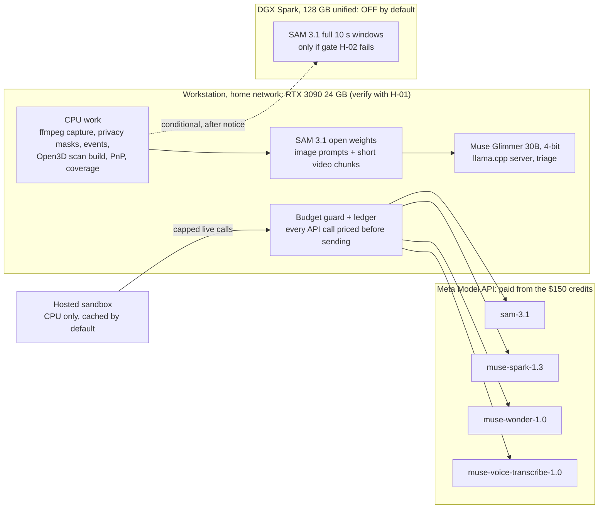

### 10.1 Why the 3090 changes the plan

- **Local SAM 3.1** (open weights) handles live home mode and bulk benchmark processing at no API cost and without upload delay. The API version of SAM 3.1 stays for the hosted sandbox, which has no GPU, and for a parity check.
- **Local Muse Glimmer** (Apache 2.0, 30B dense) handles triage. Unsloth lists its 4-bit GGUF at about 17 GB of memory ([Unsloth](https://unsloth.ai/docs/models/muse-glimmer)), which fits in 24 GB. Running it on your own hardware also makes Vigil eligible for the open-weights bonus as the event guide copy describes it. FR-028 moves from Modal to the 3090 and from P2 to P1.
- **Not on any local machine:** Muse Spark Open (816B parameters) fits neither the 3090 nor the Spark's 128 GB; Muse Wonder is closed.
- **The memory risk is real.** One user's RTX 4090 (24 GB) ran out of memory on SAM 3.1 video after 16 of 63 frames; the suggested fix is lower resolution or shorter clips ([sam3 issue 511](https://github.com/facebookresearch/sam3/issues/511)). Vigil already stitches overlapping windows (FR-007), so on the 3090 it tracks 2 to 3 s chunks with 1 s overlap at reduced resolution. H-02 measures whether that costs accuracy.
- **SAM and Glimmer do not share the GPU.** Glimmer's 17 GB plus a SAM video chunk will not fit together. Live home mode runs local SAM with Spark triage (API); the benchmark runs SAM first, then a separate Glimmer triage pass.
- **Workstation OS:** if Windows, run SAM 3.1 under WSL2 Ubuntu with CUDA (⚠️ confirm the sam3 repo builds there) and Glimmer through llama.cpp's Windows CUDA build or the same WSL2.

### 10.2 Hardware verification tasks (added to section 9)

| Task | Done by (PT) | What it runs | Done when |
| --- | --- | --- | --- |
| H-01 GPU probe | Mon 12:30 | `scripts/gpu_probe.py`: `nvidia-smi`, driver, CUDA, `torch.cuda` check, free VRAM, a 30 s matrix-multiply burn to confirm clocks and temperatures | Report saved to `eval/hardware/3090.json`; 3090 marked Ready or Not ready |
| H-02 Local SAM 3.1 benchmark | Mon 22:00 (**gate**) | sam3 install, checkpoint download (licence accepted on Hugging Face), image prompt test, then video chunks of 2, 3, 5 and 10 s at 640 and 960 px, 5 and 10 fps | Table of peak VRAM, seconds per window, out-of-memory failures; chosen chunk settings |
| H-03 Local Glimmer benchmark | Tue 12:00 | llama.cpp server with the 4-bit GGUF and vision projector; 20 triage fixtures | Tokens per second, peak VRAM, JSON-valid rate, agreement with Spark on the 20 fixtures |
| H-04 Local versus API SAM parity | Tue 12:00 | Same 20 windows through both backends | Mean mask IoU and ID-switch counts; target mean IoU at least 0.8 ⚠️, pre-registered in EVAL.md |

**Gate H-02 (Mon 22:00).** The 3090 passes if a 10 s window from one camera, processed in chunks, finishes in 10 s or less (keeps up with live), and if chunking adds no more than 1 ID switch per window compared with the API. If it passes, the DGX Spark stays off. If it fails, live mode and the benchmark fall back to API SAM (costed in section 11), and the DGX Spark phase below becomes optional.

### 10.3 Hardware dependency matrix

| Phase or task | Workload | Hardware | Estimated compute | Fallback | Readiness |
| --- | --- | --- | --- | --- | --- |
| T-02, T-03 Scaffold, CI, smoke tests | Tooling, 1 API call per model | CPU | Negligible | none | Ready |
| T-05 Capture and windows | ffmpeg stream copy; re-encode only triggered windows | CPU (NVENC on the 3090 optional) | 4 streams, low CPU in stream copy (NFR-033 measures it) | CPU encode | Unverified |
| T-08 Privacy and motion | OpenCV masks and frame differences | CPU | Seconds per window | none | Ready |
| T-09 Perception (development) | SAM 3.1 video tracking | **RTX 3090** local; API for parity | VRAM per H-02; about 1 window per 10 s target | API SAM | Unverified until H-02 |
| T-10 3D model build | Open3D registration and meshing | CPU (RAM heavy) | Minutes; ⚠️ 8 to 16 GB RAM estimated | Site-plan model | Unverified |
| T-12, T-14 Calibration | Checkerboard and PnP | CPU | Seconds | Field-of-view fallback | Ready |
| T-16 Appearance notes | Video understanding with track tags | Meta API (Spark) | Tokens per clip measured in T-03 | Glimmer on keyframes (3090) for development only | Unverified |
| T-17, T-19 Coverage and positions | Ray casting | CPU | Under 1 min for the yard grid | none | Ready |
| T-20 Story | Wonder over JSON | Meta API | About 6k tokens in, 0.8k out per visit (estimate) | Template story | Unverified |
| T-22 Tap-to-protect | SAM image prompt | 3090 locally; API in the hosted sandbox | Under 1 s GPU (estimate) | Cached preset masks | Unverified |
| T-23 Triage | Glimmer 4-bit | **RTX 3090** | About 17 GB VRAM | Spark via API | Unverified until H-03 |
| T-24 3D viewer | WebGL | Viewer's browser | GLB under 15 MB | 2D map | Ready |
| T-26 Live home mode | SAM chunks while the loop runs | **RTX 3090** | Must keep up with 4 cameras' triggered windows | API SAM with live spend cap | Unverified until H-02 |
| T-27 Benchmark | SAM pass, then Glimmer pass, then API stages | **RTX 3090** + API | Hours of GPU time at most (estimate) | API SAM | Unverified |
| T-28 Hosted sandbox | Web and cached data | Host CPU | Small container | Screen recording | Ready |
| D-1 (conditional) Full-window SAM | SAM 3.1 on 10 s windows unchunked | **DGX Spark** | Up to tens of GB per window (estimate) | API SAM | **Off; needs your connection** |

### 10.4 Advance notice: DGX Spark phase D-1 (conditional, not yet triggered)

- **When.** Tue 08:00 to 12:00 PT, only if gate H-02 fails at Mon 22:00, and only after G1 (footage and API-SAM parity fixtures exist). If it is triggered, connect the Spark by Tue 08:00.
- **Why.** SAM 3.1 video memory grows with the frames tracked. If 2 to 3 s chunks on 24 GB cause ID switches or cannot keep up, the Spark's 128 GB of unified memory holds full 10 s windows at full resolution. The trade-off: its memory bandwidth is 273 GB/s ([StorageReview](https://www.storagereview.com/review/nvidia-dgx-spark-review-the-ai-appliance-bringing-datacenter-capabilities-to-desktops)), so it may be slower per frame. It fixes a capacity problem, not a speed problem. It is never used for Muse Spark Open, which does not fit.
- **Setup.** Ethernet (10GbE port) on the home network with a fixed address; SSH key from the workstation; DGX OS (Ubuntu, Arm64). Run an NGC PyTorch container for Arm64, plus the sam3 repo and the SAM 3.1 checkpoint (licence accepted). Add a small `sam-worker` service with the same interface as the local backend (`POST /track` with a window file), reachable only from the workstation's address. Sync masked windows with rsync; set `VIGIL_SAM_BACKEND=remote` and `VIGIL_SAM_URL`.
- **Validation.** Run H-02's windows on the Spark: no out-of-memory failures on 10 s windows; ID switches at most the API's; mean IoU with the API at least 0.8; seconds per window recorded. If it is not better than the API on the metric that failed, stay on the API and power the Spark down.

Not planned for the Spark: Glimmer at 8-bit or BF16 (34 GB and 58 GB per Unsloth). A 4-bit versus 8-bit quality comparison would not move any judging score in the time left.

## 11. Meta API credit plan ($150)

The plan spends about **$55 to $95** of the $150, depending on whether local SAM passes gate H-02. That leaves a reserve of at least $40, and a hard cap of **$140** is enforced in code.

The largest risk is timing, not the amount. The Official Rules say the credits are "valid for a 10-day development window", and judging (Nov 5 to 9) probably falls after it. Live calls during judging could therefore be charged to the card on file. **Vigil switches to cached-only when the window ends unless you approve otherwise** (decision needed before Nov 4, 9 PM ET).

### 11.1 What is verified about the credits

| Term | Status | Source |
| --- | --- | --- |
| $150 in Meta Model API credits per selected participant | Verified | Official Rules (your copy) |
| Valid for a 10-day development window | Verified wording; exact start and end time **not published** | Official Rules |
| A separate "Credit Terms" document applies | Verified that it exists; its text is behind the Cerebral Valley login and was **not read** | Official Rules |
| Each person claims individually, by Nov 4, 9 PM ET, through a form | Mirror only | [Event guide copy](https://github.com/meta-ai-hackathon/meta-hack/blob/main/info/event%20guide.md) |
| A credit card must be on the account, with a temporary pre-authorisation | Mirror only | Same |
| A spend limit can be set on the Billing page | Mirror only; ⚠️ whether it hard-stops calls is unverified | Same |
| What happens after credits run out or expire | **Unknown**: assume the card is charged | none |

### 11.2 Coverage matrix

| Service | Covered by the $150? | Basis | Vigil uses it? |
| --- | --- | --- | --- |
| Model API, Standard mode: `muse-spark-1.3`, `muse-wonder-1.0`, `sam-3.1`, `muse-voice-transcribe-1.0`, `muse-image-1.0` | Expected yes, ⚠️ per-model coverage unconfirmed | Credits are "Meta Model API credits"; all are Model API models ([models](https://dev.meta.ai/docs/models)) | Yes, except Muse Image |
| Model API Contributor-mode IDs | Probably, ⚠️ unconfirmed | Same API | **No**: content would be used for training; home footage rules it out |
| Web search grounding ($2.50 per 1,000 queries) | Probably, ⚠️ unconfirmed | Billed through Model API | No |
| Muse Code subscriptions | **No**: separate billing | [Models page](https://dev.meta.ai/docs/models) | No |
| Open weights on own hardware (Glimmer, SAM 3.1 weights) | **Not applicable**: never billed by Meta | Same | Yes: electricity only |
| Partner inference (Baseten, Modal, Fireworks) | **No**: separate partner credits, granted by each partner | [Event page](https://cerebralvalley.ai/e/meta-ai-developer-hackathon) | No |
| Hosting, domain, GitHub | No | none | Host on a free or existing plan |

**Confirm today:** run T-03 smoke tests, then check that the Billing balance dropped by the logged amount for each model. That turns "expected" into "verified" for the 4 models Vigil uses.

### 11.3 Unit prices used

Source: [Pricing and rate limits](https://dev.meta.ai/docs/pricing-rate-limits), Standard mode:

- SAM 3.1: $0.20 per 1,000 video frames (minimum 50 per request); $2.50 per 1,000 images.
- Muse Spark 1.3: $1.25 per million input tokens, $4.25 per million output tokens.
- Muse Wonder 1.0: $4 input and $20 output per million tokens.
- Muse Voice Transcribe: $0.18 per hour of audio.

⚠️ The largest unknown is how many tokens a 10 s video clip costs Muse Spark. The plan assumes 30,000 input tokens per clip (about $0.04) until T-03 measures it; then `vigil cost estimate` recomputes every line below.

### 11.4 Cost by feature

| Feature | Paid calls | Volume assumption | Estimated cost | Free alternative used |
| --- | --- | --- | --- | --- |
| Smoke tests (T-03) | 1 to 3 per model | Small | About $1 | none |
| Perception for the 3 demo scenarios through the API | SAM 3.1 video | 3 scenarios × 4 cameras × 60 s active × 10 fps × 3 phrases ≈ 21,600 frames | About $4 | Local SAM for everything else |
| Perception for all 12 scenarios through the API (only if H-02 fails) | SAM 3.1 video | About 108,000 frames | About $22 | Local SAM if H-02 passes: $0 |
| Appearance notes | Spark video | About 290 clips in the benchmark plus about 100 in development | About $16 ⚠️ | Glimmer on keyframes during development |
| Stories | Wonder | About 100 calls (development, benchmark, retries) at about 6k in, 0.8k out | About $4 | Template for non-escalated visits |
| Triage | Spark, only as fallback | About 50 calls | Under $1 | Glimmer on the 3090: $0 |
| Rule compile and tap-to-protect tests | Spark text, SAM image | About 50 calls | Under $1 | Local SAM for tap during development |
| Naive baseline | Spark video | About 70 clips | About $3 ⚠️ | none |
| Voice rules (P2) | Voice Transcribe | A few minutes | Under $0.10 | Typed rules |
| Hosted sandbox, live buttons until the window ends | All | Capped | Up to $10 per day × 2 days = $20 | Cached mode |
| Video recording live calls | All | A few | About $2 | none |

### 11.5 Phased usage plan and balance

| Phase | When (PT) | Spend if local SAM passes | Spend if API SAM is needed | Balance after (pass / fail) |
| --- | --- | --- | --- | --- |
| Start | Now | $0 (check prior spend on the Billing page first) | $0 | $150 / $150, minus prior spend |
| Smoke tests, T-03 | Mon 12:30 | $1 | $1 | $149 / $149 |
| Development to G2 | Mon to Tue 13:00 | $12 | $16 | $137 / $133 |
| Benchmark and baseline, T-27 | Tue evening | $18 | $40 | $119 / $93 |
| Sandbox live caps | Tue night to Nov 4 | up to $20 | up to $20 | $99 / $73 |
| Video live calls | Wed | $2 | $2 | $97 / $71 |
| Live home testing through the API | Only if H-02 fails | $0 | up to $15 cap | $97 / $56 |
| **Reserve** |  | **at least $90** | **at least $50** |  |

The hard cap of $140 sits above both columns. No planned phase needs more than $150.

### 11.6 Safeguards

1. **Billing-page spend limit at $140**, set before T-03. ⚠️ Confirm with a test whether it hard-stops calls.
2. **Budget guard in `meta/client.py`.** Every call is priced from the 11.3 table before it is sent. A call is refused if it would cross the total cap ($140), its feature budget (11.4), or the daily cap. Warnings show at 50%, 75% and 90%.
3. **Pre-flight estimate.** Batch commands (`vigil process`, `vigil eval`) print frames, tokens and cost first, and require `--confirm` above $5.
4. **Cache first.** Identical requests are never paid for twice; benchmark re-runs read the cache unless told otherwise.
5. **Model allowlist.** Only the 4 Standard-mode IDs are allowed: no `-contributor`, no web-search tool, no Muse Image.
6. **Sandbox limits.** 10 live requests per minute per IP; $10 per day; live is disabled automatically at the credit window's end (`VIGIL_CREDIT_WINDOW_END`) unless `VIGIL_ALLOW_PAID=1` is set by you.
7. **Daily reconciliation.** Compare the ledger total with the Billing page and log both in `eval/budget.md`. A drift over 10% means updating the price table before spending more.
8. **Separate keys.** One key for development and one for the sandbox, so the public one can be revoked alone. ⚠️ Check whether per-project limits exist (the billing URL suggests projects).

### 11.7 If credits run out or expire

- The sandbox serves cached results only; every flow still works (NFR-009).
- Perception runs on local SAM; triage runs on Glimmer; non-escalated stories use templates; Wonder stories for the 3 demo scenarios are already cached.
- Voice rules fall back to typed rules.

### 11.8 Notice: decisions that could cost beyond the $150

- **Live calls during judging (Nov 5 to 9).** These likely fall outside the credit window and would be charged to your card. Default: off. If you want judges to run live calls, approve a separate cap, for example $15 in total, before Nov 4, 9 PM ET.
- **Nothing else in this plan exceeds $150.** If T-03 shows video tokens far above the assumption, so that the projected total passes $140, I will flag it before the benchmark runs. The fallback is to run notes at 2 fps and 480 px, or on keyframes.

## 12. Quality and verification

CI runs every automated test below on each pull request with recorded model responses, so it costs nothing and is deterministic. Live tests run by hand before each gate, and their results go to EVAL.md. A requirement counts as Verified only when its test is green in CI or its manual check is logged with a date.

### 12.1 Test suites

| Suite | Files | What it proves | Requirements | Runs |
| --- | --- | --- | --- | --- |
| Unit: config and topology | `tests/unit/test_config.py`, `test_topology.py` | Bad references fail clearly; edges and blind regions load | FR-001, FR-010 | CI |
| Unit: privacy | `test_privacy.py` | Every pixel inside every polygon is 0 on synthetic frames; no audio stream | FR-003, NFR-001, NFR-002 | CI |
| Unit: windows and motion | `test_windows.py`, `test_motion.py` | Window edges within 1 frame; 2 s overlap; idle windows skipped | FR-004, FR-005, FR-031 | CI |
| Unit: SAM parsing | `test_sam_parse.py` | Recorded streams become tracks; empty result; 400 surfaced; window split at 16 IDs | FR-006 | CI |
| Unit: stitching and events | `test_tracks.py`, `test_events.py` | One track across windows; touch, cross, removed and dwell on synthetic tracks | FR-007, FR-008 | CI |
| Unit: appearance schema | `test_spark_schema.py` | Unknown tag rejected; no sensitive fields exist | FR-009, NFR-003 | CI |
| Property: visits and gaps | `test_visits.py` (hypothesis) | Links only inside transit windows; ambiguity never links; every out-of-view interval becomes a gap | FR-010, FR-011 | CI |
| Truth table: rules and verdict | `test_rules.py`, `test_verdict.py` | Midnight-crossing windows; every combination of floor, gap and proposal | FR-012, FR-016 | CI |
| Adversarial: validator | `test_validator.py` | Planted failures caught: missing ID, foreign ID, time inside a gap, wrong camera, banned words, malformed JSON | FR-015, NFR-003 | CI |
| Adversarial: loop | `test_loop.py` | Off-list phrase, unknown camera and cap overflow are rejected and logged | FR-020, NFR-016 | CI |
| Spatial: synthetic camera | `test_calibrate.py` | Projects known 3D points through a known pose with noise; PnP recovers it within 2 cm and 0.5°; distortion model round-trips | FR-036, FR-037 | CI |
| Spatial: locate | `test_locate.py` | On a synthetic slope, the foot-point ray hits the known point; a clipped mask uses the height prior and is flagged; no positions inside gaps | FR-039 | CI |
| Property: uncertainty | `test_locate_coverage.py` (hypothesis) | On synthetic noise, the true point is inside r95 at least 93% of the time | FR-039, NFR-026 | CI |
| Spatial: coverage | `test_coverage.py` | A synthetic wall blocks line of sight; privacy polygons remove cells; blind regions form connected polygons | FR-038 | CI |
| Integration: golden pipeline | `tests/integration/test_golden.py` | Recorded responses for scenarios A, B, C produce the labelled visits, verdicts, gaps and positions | FR-004 to FR-016, FR-039 | CI |
| Integration: determinism | `test_determinism.py` | Two runs give byte-identical `visits.json` | NFR-011 | CI |
| Integration: fault injection | `test_client_faults.py` (respx) | 429, 500, timeout and malformed JSON trigger retry, then fallback; never a blank result | FR-026, NFR-010 | CI |
| Integration: guards | `test_guards.py` | Spend cap blocks live calls; 11th call in a minute gets 429; oversized audio gets 413; no `-contributor` model ID | FR-026, NFR-004, NFR-013, NFR-015 | CI |
| Integration: Reolink | `test_reolink.py` | Recorded TCP-push payloads become `camera_ai` events; capture restarts after a dropped stream (simulated) | FR-031, FR-032 | CI |
| E2E (Playwright) | `tests/e2e/test_judge_path.py` | The 8 judge steps of section 4 against the cached build, including every citation chip, players within 0.2 s, 3D layers and legend, the gap label, and badges | FR-017, FR-018, FR-027, FR-040, NFR-018, NFR-022 | CI |
| E2E: offline API | same suite with `MODEL_API_KEY=invalid` | Every cached flow still passes; live buttons show the fallback notice | NFR-009 | CI |
| E2E: mobile | `test_mobile.py` (390 px viewport) | Verdict and first sentence visible without scrolling; legend readable | NFR-017 | CI |
| Performance | `test_perf.py` | First card under 2.5 s (p95 of 20 loads); GLB under 15 MB and loaded under 5 s | NFR-005, NFR-030 | CI and deployed URL |
| Security scans | `ci.yml` steps | gitleaks clean; key absent from every served file; exiftool finds no GPS; privacy scan over `demo/` | NFR-001, NFR-014, NFR-032 | CI |
| Live smoke | `scripts/smoke_meta.py --live` | One real call per model succeeds and is logged | FR-006, FR-009, FR-014, FR-019, FR-021 | Before each gate |
| Live latency | `vigil eval --latency` | Measured p50 and p90 for tap, re-run, Reolink pulse and live lag | NFR-006, NFR-007, NFR-027, NFR-028 | G3, G4 |
| Field: calibration and accuracy | `vigil eval --spatial` on the marker walk | Held-out error, median and p90 position error, share inside r95 | NFR-024 to NFR-026 | After T-15 |
| Field: capture endurance | 2 h capture plus a cable pull | No gap over 1 s; reconnect under 30 s; CPU logged | NFR-029, NFR-033 | Mon night |
| Field: exposure check | Phone on cellular tries the edge and camera ports | Nothing reachable | NFR-031, FR-034 | Before recording the video |
| Benchmark | `vigil eval` | All EVAL metrics against the pre-registered targets, misses included | FR-024, NFR-023 | G4 |

### 12.2 CI pipeline (`.github/workflows/ci.yml`)

1. ruff lint and format check.
2. gitleaks secret scan.
3. Unit, property and integration tests (`pytest -m "not live"`).
4. Determinism check (pipeline twice, diff).
5. Privacy scan and exiftool metadata scan over `demo/`.
6. Build the Docker image; start it with `VIGIL_MODE=sandbox` and an invalid key.
7. Playwright E2E, offline and mobile suites against the container.
8. Upload Playwright traces and screenshots as artifacts. These double as demo evidence.

### 12.3 Definition of done for any task

- [ ] Code merged through a pull request with CI green
- [ ] Its tests named in the table above exist and pass
- [ ] Status in sections 1 and 2 updated to Verified by test, or Done with the manual check dated
- [ ] Any number it produces is written to EVAL.md, not only to chat or notes
- [ ] No raw footage, credentials or location metadata added to the repo

## 13. Final readiness

Vigil is ready to submit when every row of the traceability matrix has a green test and the demo evidence it names. Today every row is planned and unverified. The six blockers at the end must be cleared today, or the schedule in section 9 does not hold.

### 13.1 Traceability matrix

| Criterion | Requirement | Use case | Code module | Test | Demo evidence |
| --- | --- | --- | --- | --- | --- |
| Impact | FR-016, FR-017, FR-024: fewer, better alerts | UC-04, UC-06 | `verdict.py`, `web/cards.js`, `eval/metrics.py` | `test_verdict`, `test_judge_path`, `vigil eval` | Step 1 counts; a quiet Normal card |
| Impact | FR-030, FR-031: real home cameras | UC-11 | `vigil/reolink/` | `test_reolink`, capture endurance | Real footage; live clip in the video |
| Impact | FR-003, NFR-001, NFR-031, NFR-032: privacy that can be checked | UC-01 | `ingest/privacy.py`, CI scans | `test_privacy`, privacy and metadata scans | Black areas in every view; HACKATHON.md consent note |
| Tooling | FR-006, FR-019: SAM 3.1 tracking and tap-to-protect | UC-02, UC-06 | `meta/sam.py` | `test_sam_parse`, live smoke | Outlines; live mask in step 5 |
| Tooling | FR-039: SAM masks become 3D positions | UC-06 | `spatial/locate.py` | `test_locate`, `test_locate_coverage` | Step 3: outline and disc together |
| Tooling | FR-009: Spark refers to SAM's own track tags | UC-05 | `meta/spark.py` | `test_spark_schema` | Trace shows notes per tag |
| Tooling | FR-014, FR-020: Wonder writes the story and steers SAM | UC-05, UC-06 | `meta/wonder.py`, `reasoning/loop.py` | `test_golden`, `test_loop` | Card B "Now watching: package"; step 7 |
| Tooling | FR-021: rules compiled from plain language | UC-03 | `meta/spark.py` | Reference phrasings, `test_rules` | Step 6 |
| Depth | FR-015, FR-016: code decides, claims are checked | UC-06 | `validator.py`, `verdict.py` | `test_validator`, `test_verdict` | Step 4 trace with any rejected sentence |
| Depth | FR-010, FR-011, FR-038: gaps from measured geometry | UC-06, UC-10 | `visits.py`, `spatial/coverage.py` | `test_visits`, `test_coverage` | Dotted "Not observed · 41 s" in step 2 |
| Depth | FR-036, FR-037, NFR-024 to NFR-026: calibration and honest uncertainty | UC-10 | `spatial/calibrate.py`, `locate.py` | `test_calibrate`, field accuracy test | Benchmark tab, step 8 |
| Depth | FR-024, FR-025: pre-registered benchmark and baseline | none | `vigil/eval/` | `vigil eval` | Step 8; EVAL.md commit dates |
| Demo | FR-026, FR-027: works with no setup, survives failures | UC-09 | `api/guards.py`, `store/export.py` | Offline E2E, fault injection | Whole judge path |
| Demo | FR-040: 3D viewer | UC-09, UC-11 | `web/twin/` | E2E, `test_perf` | Steps 1 to 3 |
| Demo | FR-023: telemetry | UC-09 | `meta/client.py`, `web/cards.js` | `test_guards`, E2E | Latency and cost on every live call |
| Demo | FR-032 to FR-034: live home mode | UC-11 | `reolink/ai_events.py`, `api/live.py` | `test_reolink`, field tests | Live clip with measured lag in the video |

| Criterion | Requirement | Use case | Code module | Test | Demo evidence |
| --- | --- | --- | --- | --- | --- |
| Tooling | FR-028, FR-042: open weights on own hardware (Glimmer, SAM 3.1) alongside the hosted API | UC-04, UC-11 | `meta/glimmer.py`, `meta/sam.py` backends | H-02 to H-04, `test_golden` | Trace badges "Glimmer on RTX 3090"; parity table in EVAL |
| Depth | FR-043, NFR-036, NFR-037: cost discipline | none | `meta/client.py` budget guard | `test_guards`, `test_budget` | Cost per scenario and total spend in EVAL and README |

### 13.2 Missing functionality (as of Nov 2, 11 AM PT)

- Everything in sections 1 and 2 is **Not verified** until the repo audit (T-01).
- Three Meta API behaviours are unconfirmed (section 5.14): Wonder's strict schema, the Voice Transcribe batch endpoint, Spark video with a strict schema.
- Reolink camera models, firmware and any NVR are unknown, so continuous capture on all 4 sides is not yet confirmed.
- No scan, calibration or footage exists yet.

### 13.3 Critical risks

| Risk | Likelihood | Impact | Mitigation | Decision point |
| --- | --- | --- | --- | --- |
| Spatial work overruns the schedule | High | Late MVP | Hard cut-off; site-plan fallback (section 7) | Tue 10:00 AM |
| Night footage is infrared and greyscale, so colour notes become "unknown" and linking weakens | High | Lower link precision at night | Test scenario C windows Monday night; linking relies on transit time when colours are unknown; report night and day results separately | Mon 23:00 |
| LiDAR drift or sunlight degrades the scan | Medium | 3D accuracy | Short loops with overlaps, shade, scale check | Mon 20:00 |
| A camera is battery-powered, with no continuous RTSP | Unknown | One side has event clips only | Probe first; Home Hub or NVR route; document it | Mon 12:30 |
| Wonder rejects a strict schema | Medium | Parsing failures | JSON mode plus the validator; template fallback | Mon 12:30 |
| Live lag is long | Medium | Weaker live claim | Show measured lag honestly; the cached sandbox is unaffected | Tue 21:00 |
| Privacy leak: neighbour, plate, house number, GPS metadata | Medium | Waiver breach; disqualification risk | Two masking layers, CI scans, manual review of every published frame | Every export |
| Home network exposed | Low | Severe | LAN only, no port forwarding, cellular port check | Before the video |
| Code from before Oct 26 in the demo | Unknown | Disqualification | Audit; disclose or remove | Mon 11:30 |
| Credits run out | Low | Live calls stop | Cache, spend cap, ledger; Standard-mode pricing checked | Daily |

**Added risks (compute and credits)**

| Risk | Likelihood | Impact | Mitigation | Decision point |
| --- | --- | --- | --- | --- |
| SAM 3.1 video runs out of memory on 24 GB | Medium | Live mode and benchmark move to the API | Chunking; API fallback; DGX Spark phase D-1 only after notice | Mon 22:00 (gate H-02) |
| Glimmer and SAM compete for the 3090 | High | Slow or failed jobs | Never co-resident: live mode uses Spark triage; benchmark runs SAM then Glimmer | Design rule |
| Credits expire before judging | High | Card charges or no live calls for judges | Cached-only after the window unless you approve a cap | Before Nov 4, 9 PM ET |
| Video tokens far above the 30,000-token assumption | Medium | Budget overrun | Measure in T-03; reduce fps and resolution; keyframes | Mon 12:30 |
| Spend limit on the Billing page is not a hard stop | Unknown | Overrun | Budget guard in code is the real stop | Mon 12:30 |

### 13.4 Blockers to clear today

- [ ] Repo access: share the `owner/repo` or connect GitHub, so the audit can be done (it can also be done locally with the commands in section 0)
- [ ] Reolink models for the 4 cameras, and whether an NVR or Home Hub is used
- [ ] An iPhone Pro with LiDAR available this afternoon, before dusk
- [ ] Track (Indie or Startup) and team members confirmed
- [ ] Consent from everyone who will appear on camera
- [ ] API credits claimed and the spend limit set (claim deadline Nov 4, 9 PM ET per the event guide copy)

* [ ] Read the Credit Terms (behind the Cerebral Valley login): exact expiry, per-model coverage, what happens at zero balance
* [ ] Check the Billing page for any spend since Oct 26, and set the $140 spend limit
* [ ] Run H-01 on the RTX 3090, and confirm the workstation OS (Windows with WSL2, or Linux)
* [ ] Decide on live calls during judging: cached-only (default), or approve a separate cap

### 13.5 Submission checklist (Wed 2:00 PM PT)

- [ ] All P0 requirements Verified by test in CI; P1 results written in EVAL.md, including misses
- [ ] Sandbox URL opens on a phone and a laptop in a private window; the offline E2E run is green
- [ ] Video under 3:00: judge path, live home clip with measured lag, benchmark table; public link tested
- [ ] README: value line, video, sandbox link, model table with file paths, EVAL table, honest limits (near-real-time, uncertainty radii, IR at night)
- [ ] HACKATHON.md: build window, commit range, any prior work, contributors, consent statement
- [ ] EVAL.md: targets commit earlier than the results commit
- [ ] Privacy scan, metadata scan and gitleaks clean; no raw footage or credentials in the repo
- [ ] Cellular port check passed; live mode turned off on the edge machine after recording
- [ ] Form submitted with track, team members and links; confirmation saved
